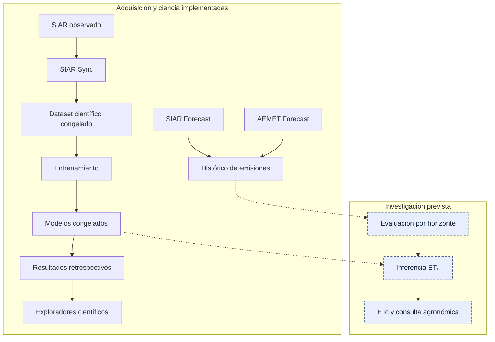

# SIAR y evapotranspiración de referencia (ET₀)

El proyecto extiende un TFG de ingeniería agronómica. Reúne observaciones meteorológicas del SIAR, prepara datos reproducibles y compara métodos de estimación diaria de ET₀. El histórico de emisiones meteorológicas servirá para evaluar en el futuro qué precisión se obtiene antes de conocer las observaciones.

El dataset congelado se construyó con observaciones sometidas a control de calidad. Las actualizaciones del Sync V3 siguen una línea evolutiva independiente. Las flechas indican el flujo de datos, y el [inventario](docs/PROJECT_STATUS.md) distingue implementación, evidencia de operación y tareas pendientes.

| Componente | Qué se puede consultar | Evidencia disponible |
|---|---|---|
| [SIAR Sync](siar-sync/README.md) | Código canónico v2.3.3 y CSV evolutivos V3 | V3 publica CSV en GitHub. Estado del servicio por confirmar |
| [SIAR Forecast](forecast_collector/README.md) | Capturas y preservación por emisión | Piloto en marcha según último parte |
| [AEMET Forecast](aemet_forecast_collector/README.md) | Colector municipal y piloto de Palma | Captura puntual preservada; cierre operativo pendiente |
| [Explorador de resultados V1](web_app/docs/release-v03.md) | [Web V0.3 en LAN](http://192.168.1.43:8088/) | Recuperación comprobada por 06 el 25/11 |
| [Explorador ET₀ V2](web_app/docs/et0-v2-integration.md) | [Revisión en LAN](http://192.168.1.43:8090/?science=et0-v2) | Catálogo VERIFIED; resultados NOT_PUBLISHED |

Para V1, consultar el [pipeline y sus resultados](scientific_pipeline/README.md), incluidos PM FAO-56, Hargreaves–Samani, Hargreaves con radiación medida, Valiantzas, AHC, ML clásico y ANN moderna. Para V2, consultar la [memoria científica](scientific_pipeline/docs/ET0_V2_MEMORIA_CIENTIFICA.md), los [resultados retrospectivos](scientific_pipeline/docs/et0_v2_retrospective_results_2026.md) y la [certificación técnica](scientific_pipeline/docs/et0_v2_certificacion_evidencia.md). V2 compara contra PM calculada en 2020–2025 y mantiene identificados los resultados AHC dentro de muestra.

- [Datos, resultados y rutas](docs/DATA_LOCATIONS.md) y [preservación y restauración](docs/backup/README.md).
- [Prioridades vigentes](docs/ROADMAP.md), [hitos](docs/MILESTONES.md) y [corte del 25/11/2026](docs/PROJECT_UPDATE_2026-11-25.md).
- [Origen y capítulos del TFG](docs_1.0_Objetivos%20alcanzables.md) y [copia histórica del índice anterior](docs/README_PROJECT_HISTORY_2026-11-25.md).
