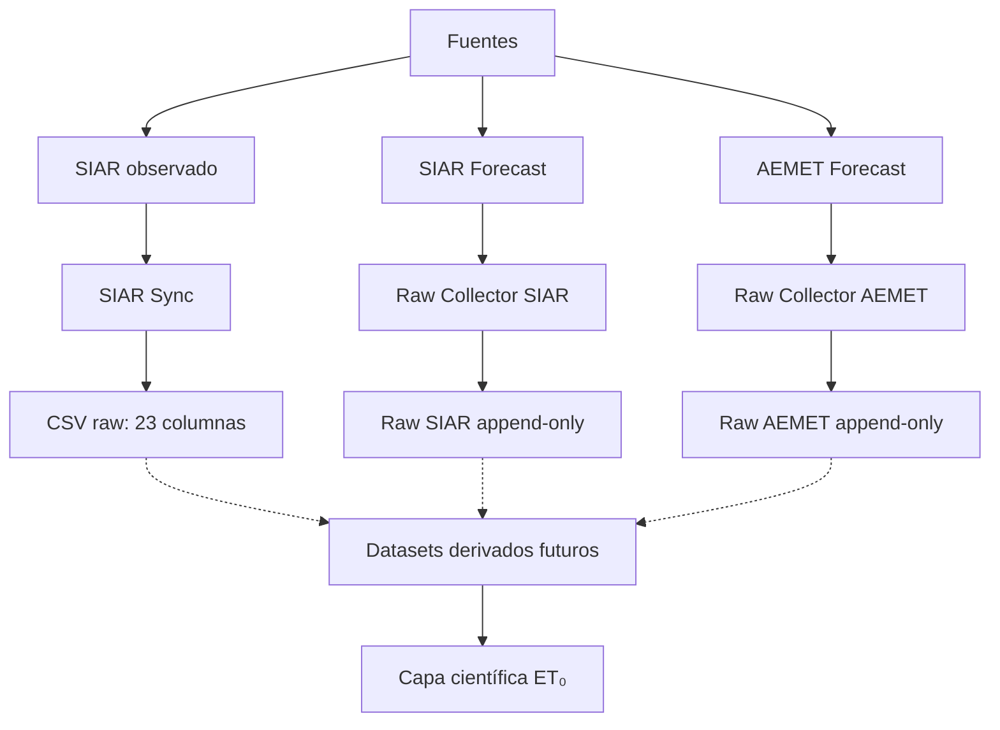

# 1. Obtención de datos históricos y actuales de las estaciones meteorológicas de Baleares

> **Estado vigente — 23/10/2026.** Las secciones y actualizaciones anteriores son snapshots históricos; sus planes, inventarios y afirmaciones de estado pueden estar superados. La actualización final de este documento recoge el estado contrastado, y [PROJECT_STATUS](docs/PROJECT_STATUS.md) es la autoridad de estado rápido. La metodología histórica se conserva sin convertir sus resultados en resultados v1.


> **Lectura histórica.** Las secciones anteriores a la actualización del 18/10/2026 conservan los estados intermedios de la adquisición, incluidos planes que después se realizaron. El estado consolidado a esa fecha se explica en la sección final «ACTUALIZACIÓN 18/10/2026 — Arquitectura de adquisición consolidada»; para cambios posteriores, consultar [PROJECT_STATUS](docs/PROJECT_STATUS.md).

**Objetivo:** Conseguir todos los datos históricos y actualizados hasta 2024 de las estaciones meteorológicas de las Islas Baleares de la pagina web del SIAR de manera automatizada, para almacenarlos en una **base de datos local** en formato CSV.

**A CONTINUACIÓN SE INDICAN LOS PASOS QUE SE VAN DANDO**


## 09/09/2025: Con siarID he podido conseguir una lista de todas las estaciones de España, con los siguientes datos:

1. Nombre estación
2. Código estación
3. Termino 
4. Longitud 
5. Latitud 
6. Altitud
5. Fecha de alta
6. Fecha de baja

El siguiente objetivo: Filtrar estaciones de Islas Baleares

## 20/09/2025: Hacer un programa en python para obtener solamente las estaciones de baleares.

Con siarIDIB hacemos el filtro y lo exporta en fomrato csv ya filtrado.

Vamos a intentar ir consigiendo datos, sabiendo ya que no podemos hacer consultas masivas ya que excederemos el límite. 

Por tanto, vamos a intentar hacer un programa que recoja los datos historicos de las estaciones de las Islas BAleares.

### siarIBconsulta.py

Tras ajustar el codigo con ayuda de GROK, he detectado que no puedo hacer la consulta masiva de todas a la vez. 

Por tanto he tomado los siguientes criterios:

1. Empezar con estación IB01
2. Recoger datos mensuales para no saturar la consulta
3. Compilarlos posterormente en un mismo archivo

Consideraciones:

- IB01 Se inserta manuelamente (Posteriormente cambiaremos a IB02, IB03,...)
- La fecha inicio la extrae de la columna pertinente en el archivo estaciones_baleares
- La fecha fin es 2024-12-31 , a no ser que tenga menos registros, previamente indicado en el archivo estaciones_baleares (Debo comprobar qye es así, o si por defecto, si no encuentra en fecha, simplemente da error y el archivo incluye hasta el maximo de dias recogidos)

Resultado: Se ha podido extraer los datos , hsata que se superó el limite diario, y se quedó en 2023. Se ha ceado un archivo IB01_datos_completos.csv. Los datos de momento no se han analizado. Simplemente se pueden observar fallos al abrir en CSV desde Excel , con valores com comas corridas y demás. Se evaluará posteriormente los datos para ajustarlos y ponerlo todo en un formato coherente y filtrarlos.

#### Como conclusión de siarIBconsulta:
 Vamos a hacer un programa que coga de la misma manera los datos, pero con las siguietnes consideraciones:

 Inputs:
 -ESTACIÓN: "IB01" (POR EJEMPLO)
 -FECHA INICIO: ""dd""mm""aaaa""
 -FECHA FIN: ""dd""mm""aaaa""

 Cuando vaya a guardar los datos en la carpeta "datos_siar_baleares" que los guarde como IB01_datos_completos.csv con los isguientes condicionantes:
 -Si no existe dicho archivo (dependiende de si existe ya datos de esa estación), crea archivo


 -Si existe dichoa rchivo, lo actualiza si las fechas que acabamos de descargar no eran existentes en ese archivo. Por tanto comprueba el archivo que datos tiene actualmente


 Justificación: Podremos así ir obtieniendo cada dia los datos poco a poco e ir completandolos o actualizandolos

 ### siarIBconsulta2_corregido.py

 Con este programa tenemos como inputs:

-ESTACIÓN: "IB01" (POR EJEMPLO)
-FECHA INICIO: ""dd""mm""aaaa""
-FECHA FIN: ""dd""mm""aaaa""

 -Si existe dicho archivo, lo actualiza si las fechas que acabamos de descargar no eran existentes en ese archivo. Por tanto comprueba el archivo que datos tiene actualmente.

 El formato de salido es el siguiente:
 IBXX_datos_completos.csv

| Variable              | Unidad             |
|-----------------------|--------------------|
| Fecha                 | YYYY-MM-DD         |
| TempMedia             | °C (Grados Celsius)|
| TempMax               | °C (Grados Celsius)|
| HorMinTempMax         | Minutos            |
| TempMin               | °C (Grados Celsius)|
| HorMinTempMin         | Minutos            |
| HumedadMedia          | % (Porcentaje)     |
| HumedadMax            | % (Porcentaje)     |
| HorMinHumMax          | Minutos            |
| HumedadMin            | % (Porcentaje)     |
| HorMinHumMin          | Minutos            |
| VelViento             | m/s (Metros por segundo) |
| VelVientoMax          | m/s (Metros por segundo) |
| HorMinVelMax          | Minutos            |
| DirViento             | ° (Grados, 0-360)  |
| DirVientoVelMax       | ° (Grados, 0-360)  |
| Precipitacion         | mm (Milímetros)    |
| PePMon                | mm (Milímetros)    |
| Radiacion             | MJ/m² (Megajulios por metro cuadrado) |
| TempSuelo1            | °C (Grados Celsius)|
| TempSuelo2            | °C (Grados Celsius)|
| EtPMon                | mm (Milímetros)    |
| Estacion              | Código de estación |


---

# ACTUALIZACIÓN 2026 — SIAR Sync

Durante 2026 el sistema de obtención de datos ha evolucionado desde los primeros scripts de consulta desarrollados durante 2025 hacia un sistema automatizado de sincronización de datos.

El objetivo deja de ser simplemente descargar datos y pasa a ser:

> **Mantener una copia local fiable, verificable y actualizable de los datos meteorológicos diarios de las estaciones SIAR de las Islas Baleares.**

Esta nueva etapa se desarrolla mediante un sistema independiente denominado **SIAR Sync**.

---

## 1. Acceso a la API oficial de SIAR

Tras las primeras pruebas realizadas mediante scripts independientes, se decidió trabajar directamente con la API oficial de SIAR.

La API permite consultar:

* información de estaciones;
* datos meteorológicos;
* información de acceso;
* diferentes parámetros de consulta.

La dirección utilizada actualmente es:

```text
https://servicio.mapa.gob.es/siarapi
```

La consulta de datos diarios se realiza mediante el endpoint correspondiente a:

```text
/API/V1/Datos/{tipoDatos}/{ambito}
```

utilizando parámetros de fecha para limitar cada consulta.

La autenticación se realiza mediante el sistema de tokens proporcionado por SIAR.

---

## 2. Problema de las consultas masivas

Una de las principales dificultades detectadas durante las primeras versiones fue que no era viable realizar una única consulta masiva para descargar todos los datos históricos de una estación.

La API dispone de límites de acceso y de registros.

Por este motivo, el sistema actual no intenta descargar grandes períodos de una sola vez.

En su lugar, divide las solicitudes en pequeños bloques temporales.

Actualmente se utiliza un máximo de:

```text
7 días por bloque
```

Esto permite controlar mejor el número de registros descargados y limitar las consecuencias de un posible error.

---

## 3. Consulta de los límites de la API

Una mejora importante respecto a los primeros scripts consiste en no asumir que los límites de acceso son constantes.

SIAR proporciona información sobre los límites mediante sus servicios de información.

Entre los parámetros disponibles se encuentran:

* accesos realizados;
* máximo de accesos por minuto;
* accesos diarios;
* máximo de accesos diarios;
* registros acumulados por minuto;
* máximo de registros por minuto;
* registros acumulados diarios;
* máximo de registros diarios.

El sistema utiliza esta información para conocer el estado de acceso y evitar diseñar el proceso basándose en valores históricos que podrían cambiar.

---

## 4. Cobertura real de los archivos locales

Una de las mejoras fundamentales de SIAR Sync es que el sistema no considera que un archivo esté actualizado simplemente porque exista.

Antes de descargar información se analiza el contenido real del CSV.

Para cada estación se comprueba:

* primera fecha disponible;
* última fecha disponible;
* número de registros;
* número de fechas únicas;
* duplicados;
* huecos internos;
* fechas pendientes.

Esto permite conocer la cobertura real de cada estación.

---

## 5. Detección de huecos internos

Una situación especialmente importante aparece cuando un archivo contiene datos antiguos y recientes, pero existe un período intermedio sin información.

Por ejemplo:

```text
2004 ───────── 2010
                  │
                  │  ← hueco
                  │
2025 ─────────────
```

Un sistema basado únicamente en la primera y última fecha podría considerar erróneamente que el archivo está completo.

SIAR Sync analiza las fechas existentes para detectar estos huecos.

De esta forma puede solicitar únicamente los períodos que faltan.

---

## 6. Descarga únicamente de fechas pendientes

El sistema genera una lista de fechas que todavía no están correctamente cubiertas.

Posteriormente agrupa esas fechas en bloques de consulta.

Antes de realizar cada descarga se vuelve a leer el archivo local.

Esto es importante porque el estado del archivo puede haber cambiado entre dos consultas.

La lógica general es:

```text
Leer CSV
   ↓
Analizar fechas
   ↓
Detectar pendientes
   ↓
Crear bloque
   ↓
Volver a comprobar CSV
   ↓
¿El bloque sigue pendiente?
   │
   ├── No → Saltar
   │
   └── Sí → Consultar SIAR
```

De esta forma se reduce la posibilidad de descargar dos veces la misma información.

---

## 7. Validación de la respuesta de SIAR

La respuesta recibida de la API no se incorpora directamente al archivo.

Primero se realizan comprobaciones básicas:

* respuesta válida;
* estructura esperada;
* existencia de registros;
* fechas dentro del intervalo solicitado;
* datos correspondientes a la estación solicitada.

Si una consulta devuelve cero registros, el sistema no inventa información ni genera filas artificiales.

La ausencia de datos se conserva como ausencia de datos.

---

## 8. Estructura canónica de los CSV

Durante el desarrollo se estableció una estructura fija para los archivos históricos.

La estructura canónica actual está formada por 23 columnas:

```text
Fecha
TempMedia
TempMax
HorMinTempMax
TempMin
HorMinTempMin
HumedadMedia
HumedadMax
HorMinHumMax
HumedadMin
HorMinHumMin
VelViento
DirViento
VelVientoMax
HorMinVelMax
DirVientoVelMax
Radiacion
Precipitacion
TempSuelo1
TempSuelo2
EtPMon
PePMon
Estacion
```

La API puede proporcionar determinados campos adicionales, como códigos asociados a la temperatura del suelo, pero estos no forman parte del formato canónico de los CSV.

También se normalizan diferencias de nomenclatura cuando es necesario, por ejemplo:

```text
humedadMin → HumedadMin
```

---

## 9. Deduplicación y orden cronológico

Una vez obtenidos nuevos registros, estos se combinan con los datos existentes.

Antes de guardar el resultado se:

1. combinan los datos;
2. identifican duplicados por fecha;
3. conservan un único registro por fecha;
4. ordenan cronológicamente;
5. comprueba la estructura final.

El objetivo es que cada estación disponga de una serie diaria coherente y sin duplicaciones.

---

## 10. Escritura atómica de los archivos

Otra mejora importante respecto a los primeros scripts es la forma de guardar los datos.

El archivo original no se sobrescribe directamente durante todo el proceso.

Primero se genera un archivo temporal con el resultado completo.

Después se valida.

Solo cuando la validación es correcta se sustituye el archivo original mediante una operación atómica.

Conceptualmente:

```text
CSV original
     │
     ├── leer
     │
     ├── actualizar
     │
     ├── validar
     │
     └── guardar temporal
              │
              ↓
        validación correcta
              │
              ↓
        sustitución atómica
```

Esto reduce el riesgo de dejar un CSV parcialmente escrito si se produce un error durante el proceso.

---

## 11. Actualización de datos modificados

El sistema no solamente busca fechas que no existen.

También contempla la posibilidad de que SIAR modifique o complete registros que ya estaban descargados.

Para ello se puede utilizar el parámetro de modificación disponible en la API:

```text
FechaUltModificacion
```

Esto permite plantear una actualización incremental en la que se revisen datos que hayan sido modificados posteriormente.

---

## 12. Diferenciación entre ausencia de datos y error de descarga

Una de las reglas importantes del sistema es no interpretar automáticamente una ausencia de registros como un fallo.

Puede ocurrir que una fecha:

* no tenga datos disponibles;
* todavía no haya sido incorporada por SIAR;
* haya sido solicitada incorrectamente;
* provoque un error temporal de conexión.

Estas situaciones deben diferenciarse.

Por tanto, el sistema evita rellenar artificialmente las fechas sin datos.

---

## 13. Autenticación y control de errores

La autenticación con SIAR se realiza mediante token.

Durante el desarrollo se detectó la necesidad de diferenciar claramente:

* token inválido o inexistente;
* límite de consultas;
* error temporal de red;
* error de servidor;
* ausencia real de datos.

Esto es importante porque cada problema requiere una estrategia diferente.

Por ejemplo, un error de autenticación no debe tratarse como si fuese un problema de límite de consultas.

---

## 14. Integración con Git

Una vez completada una actualización local, el sistema puede utilizar Git para registrar los cambios.

El flujo es:

```text
SIAR
 ↓
SIAR Sync
 ↓
CSV actualizado
 ↓
Validación
 ↓
Git status
 ↓
Commit
 ↓
Push
```

Esto permite conservar un historial de los cambios de los datos.

Además, los datos locales no se consideran perdidos si GitHub no está disponible temporalmente.

---

## 15. Recuperación ante errores de GitHub

Durante las pruebas reales apareció un problema de conexión TLS/GnuTLS al realizar determinados `git push`.

La investigación permitió diferenciar este problema de los errores de autenticación de SIAR.

Para evitar que un fallo temporal de red impida completar el proceso local, se incorporó una estrategia de reintentos para errores transitorios de Git.

Los reintentos utilizan esperas progresivas:

```text
0 s
5 s
15 s
30 s
```

hasta un máximo de cuatro intentos.

El mecanismo se aplica únicamente a errores considerados potencialmente transitorios.

Los errores que no corresponden a este tipo de fallo no se repiten indefinidamente.

---

## 16. Ejecución mediante Docker

El sistema se ejecuta actualmente dentro de un contenedor Docker.

La arquitectura permite mantener:

* aplicación;
* worker;
* configuración;
* dependencias;
* entorno de ejecución;

separados del sistema operativo principal.

El contenedor se denomina actualmente:

```text
siar_sync
```

y la aplicación web de control utiliza el puerto:

```text
8000
```

La interfaz permite consultar el estado de las estaciones y del proceso de sincronización.

---

## 17. Arquitectura actual

La arquitectura de la etapa de adquisición puede resumirse de la siguiente forma:

```text
                 API SIAR
                    │
                    ↓
             Autenticación
                    │
                    ↓
             SIAR Sync Worker
                    │
          ┌─────────┴─────────┐
          │                   │
     Cobertura             Pendientes
          │                   │
          └─────────┬─────────┘
                    ↓
             Bloques ≤ 7 días
                    │
                    ↓
              Consulta SIAR
                    │
                    ↓
               Validación
                    │
                    ↓
              Deduplicación
                    │
                    ↓
             CSV actualizado
                    │
              ┌─────┴─────┐
              ↓           ↓
           Git local    Aplicación
              │
              ↓
           GitHub
```

---

## 18. Estado alcanzado

El sistema ya ha permitido recuperar y consolidar una cantidad importante de información histórica de las estaciones de Baleares.

Como ejemplo de las pruebas realizadas durante esta etapa, la estación IB04 ha alcanzado cobertura hasta finales de 2025, con miles de registros diarios, sin duplicados y manteniendo la estructura canónica de 23 columnas.

También se han identificado fechas pendientes para las que SIAR no devuelve necesariamente datos.

Esto es importante porque el objetivo no es conseguir artificialmente una serie sin huecos, sino conocer con precisión qué información existe realmente en SIAR.

---

## 19. Estado del proyecto de adquisición

La situación actual puede resumirse como:

```text
Descarga manual
      ↓
Scripts experimentales
      ↓
Consultas mensuales
      ↓
Actualización incremental
      ↓
API oficial
      ↓
Detección de huecos
      ↓
Validación
      ↓
SIAR Sync
      ↓
Docker + Git
```

El sistema de adquisición histórica se considera actualmente una infraestructura estable sobre la que pueden desarrollarse las siguientes fases del proyecto.

---

## 20. Próxima etapa: recopilación de predicciones

La recopilación de predicciones se tratará como un proyecto paralelo a SIAR Sync.

La arquitectura prevista será:

```text
                 SIAR
                  │
        ┌─────────┴─────────┐
        │                   │
   Datos históricos     Predicciones
        │                   │
    SIAR Sync         Forecast Collector
        │                   │
        └─────────┬─────────┘
                  ↓
             Dataset final
```

No se modificará SIAR Sync para incorporar esta nueva función mientras no sea necesario.

El objetivo del nuevo sistema será investigar:

* si las predicciones de ET₀ están disponibles mediante API;
* qué variables meteorológicas proporciona SIAR;
* qué horizonte de predicción utiliza;
* cuándo se genera cada predicción;
* cómo identificar cada ejecución;
* cómo conservar las predicciones históricas;
* cómo compararlas posteriormente con las observaciones reales.

Las predicciones deberán almacenarse de forma que una nueva actualización no sobrescriba las predicciones emitidas anteriormente.

Esto permitirá posteriormente estudiar el error de predicción para diferentes horizontes temporales.

---

## 21. Próximo objetivo de los datos

Una vez consolidada la adquisición histórica, el siguiente objetivo será transformar los archivos CSV en un dataset preparado para análisis y Machine Learning.

La arquitectura prevista será:

```text
CSV SIAR
   ↓
Validación
   ↓
Normalización
   ↓
Parquet
   ↓
DuckDB / Python
   ↓
Modelos ET₀
```

El CSV seguirá siendo una fuente sencilla y auditable, mientras que Parquet y DuckDB podrán utilizarse para análisis más grandes y eficientes.

---

> **Conclusión de la actualización 2026:**
> La obtención de datos ha pasado de ser un conjunto de scripts experimentales a convertirse en un sistema automatizado de sincronización. El objetivo actual no es únicamente descargar datos, sino garantizar su cobertura, integridad, trazabilidad y capacidad de actualización, creando una base sólida para las siguientes fases de análisis de ET₀, Machine Learning y predicción.


# ACTUALIZACIÓN OCTUBRE 2026 — SIAR Sync v2.3.x y Forecast

Esta sección actualiza el estado descrito anteriormente sin eliminar la bitácora histórica de 2025–2026.

A octubre de 2026, la adquisición de datos SIAR ha pasado de ser un conjunto de scripts experimentales a una infraestructura operativa con código canónico versionado, ejecución Docker y control de integridad de los CSV.

---

## 22. SIAR Sync v2.3.1 — versión estable en producción

La versión actualmente estable en producción es:

```text
v2.3.1
```

La instancia productiva continúa ejecutándose desde:

```text
/home/josep/siar-sync
```

El código canónico de esta versión ya se encuentra también versionado dentro del monorepo:

```text
siar-sync/
```

La incorporación a GitHub se realizó mediante la PR #2 sin desplegar automáticamente dicha copia sobre producción.

Los archivos canónicos identificados son:

```text
siar-sync/
├── app.py
├── siar_worker.py
├── Dockerfile
├── requirements.txt
├── docker-compose.yml
├── .env.example
├── .dockerignore
├── README.md
└── templates/
    └── index.html
```

Las credenciales reales permanecen fuera de Git mediante `.env`.

---

## 23. Aplicación web actual

SIAR Sync utiliza FastAPI y Uvicorn.

El contenedor se denomina:

```text
siar_sync
```

y la aplicación se sirve actualmente en:

```text
puerto 8000
```

La interfaz permite:

- consultar las estaciones presentes en los CSV;
- analizar cobertura;
- detectar huecos y pendientes;
- seleccionar una fecha objetivo;
- iniciar sincronizaciones;
- visualizar el estado de las tareas;
- consultar el uso/cuota actual de SIAR;
- mostrar la leyenda de estaciones desde `estaciones_baleares.csv`.

Los endpoints principales del componente son:

```text
GET  /
GET  /status
GET  /api_usage
GET  /analyze
POST /start
```

La interfaz no sustituye al worker; actúa como capa de control sobre `siar_worker.py`.

---

## 24. Autenticación actual de SIAR

El flujo productivo utiliza:

```text
SIAR_NIF
SIAR_PASSWORD
```

para obtener dinámicamente el token necesario para la API.

La variable:

```text
SIAR_API_KEY
```

permanece únicamente por compatibilidad legacy en el código actual y no constituye el mecanismo principal de autenticación.

---

## 25. Catálogo oficial de estaciones de Baleares

El catálogo actual confirmado contiene 12 estaciones:

```text
IB01
IB02
IB03
IB04
IB05
IB06
IB07
IB08
IB09
IB10
IB101
IB11
```

De ellas, se han identificado tres estaciones cerradas:

```text
IB07
IB09
IB101
```

Por tanto:

```text
12 estaciones oficiales
9 activas
3 cerradas
```

El sistema utiliza `Info/ESTACIONES` para obtener metadatos de instalación y baja cuando necesita crear una estación nueva.

Una estación sin CSV local puede:

1. consultar sus metadatos;
2. crear un CSV vacío con las 23 columnas canónicas;
3. comenzar desde su fecha de instalación;
4. limitar la adquisición a su fecha de baja cuando corresponda.

---

## 26. Esquema canónico consolidado

Los CSV siguen utilizando exactamente 23 columnas:

```text
Fecha
TempMedia
TempMax
HorMinTempMax
TempMin
HorMinTempMin
HumedadMedia
HumedadMax
HorMinHumMax
HumedadMin
HorMinHumMin
VelViento
DirViento
VelVientoMax
HorMinVelMax
DirVientoVelMax
Radiacion
Precipitacion
TempSuelo1
TempSuelo2
EtPMon
PePMon
Estacion
```

Regla vigente:

> No debe modificarse este esquema durante la fase de adquisición sin una migración explícita y validada.

Las auditorías realizadas sobre las estaciones ya descargadas no han mostrado duplicados ni fechas inválidas en los CSV revisados.

---

## 27. Descarga, cuota y resiliencia HTTP

El worker continúa trabajando con bloques máximos de:

```text
7 días
```

La cuota no se trata como un número fijo asumido por el programa.

SIAR Sync consulta dinámicamente la información de acceso y uso disponible mediante SIAR.

La versión v2.3.1 incorpora tratamiento/reintentos para errores temporales como:

```text
HTTP 429
HTTP 500
HTTP 502
HTTP 503
HTTP 504
timeouts
```

El objetivo es detener o reintentar de forma controlada sin comprometer la integridad del CSV.

---

## 28. Persistencia y escritura segura

La estrategia sigue siendo:

```text
descargar
   ↓
validar
   ↓
combinar
   ↓
deduplicar por Fecha
   ↓
ordenar
   ↓
guardar temporal
   ↓
validar
   ↓
reemplazo atómico
```

Si GitHub falla después de guardar correctamente el CSV:

> los datos locales permanecen conservados.

Git no es la única copia operativa de los datos durante una ejecución.

---

## 29. Checkpoints Git

SIAR Sync realiza checkpoints periódicos en Git para reducir el volumen de cambios pendientes.

El flujo general es:

```text
CSV local
   ↓
git status
   ↓
commit
   ↓
fetch / integración segura
   ↓
push
```

Se ha comprobado en producción que una estación puede seguir avanzando y conservar el progreso local aunque el push no pueda completarse temporalmente.

---

## 30. v2.3.2 — correcciones internas previstas

Se ha definido una siguiente versión con alcance deliberadamente reducido:

```text
v2.3.2
```

Los cuatro cambios previstos son:

### 30.1 Fecha_Instalacion y Fecha_Baja

SIAR puede devolver timestamps cuya fecha UTC no coincide directamente con la fecha civil local.

No debe aplicarse `.date()` sobre UTC sin considerar la zona horaria.

La regla prevista es interpretar correctamente el instante y convertirlo a:

```text
Europe/Madrid
```

antes de obtener la fecha civil.

### 30.2 Aplicar Fecha_Baja al reanudar estaciones

Actualmente la lógica de metadatos está más orientada a estaciones nuevas.

Una estación cerrada con CSV parcial no debe intentar completar fechas posteriores a su baja real.

### 30.3 Checkpoint al agotarse la cuota diaria

Se ha comprobado que, cuando se alcanza la cuota diaria de SIAR, los últimos bloques pueden quedar correctamente guardados en local pero no llegar al push final.

v2.3.2 debe intentar un último checkpoint Git seguro antes de terminar por:

```text
SiarDailyLimitError
```

Si Git falla, los CSV locales deben conservarse igualmente.

### 30.4 Permisos de los CSV

La escritura atómica puede dejar algunos archivos con permisos demasiado restrictivos.

La versión prevista normalizará el archivo final a:

```text
0644
```

sin eliminar la escritura atómica.

---

## 31. v2.3.3 — soporte de CA personalizada

En octubre de 2026 se detectó un problema TLS contra:

```text
servicio.mapa.gob.es
```

El fallo se reproduce también fuera de SIAR Sync utilizando herramientas del host, por lo que no se considera inicialmente un defecto del worker.

Se ha comprobado que el servidor responde correctamente si se utiliza explícitamente una cadena CA válida.

La solución prevista para una versión posterior es permitir:

```text
SIAR_CA_BUNDLE=/ruta/siar_bundle.pem
```

de manera opcional.

Regla de seguridad:

> La validación TLS debe permanecer activa.

No se recomienda ni se autoriza utilizar:

```text
verify=False
```

como solución permanente.

---

## 32. Incidencia Docker: procesos zombie

Durante la auditoría del servidor se detectó una acumulación anormal de procesos zombie `git` dentro del contenedor `siar_sync`.

La investigación mostró que:

- Uvicorn actuaba como PID 1;
- el contenedor no disponía de un init/reaper;
- procesos Git huérfanos podían quedar adoptados por PID 1;
- la acumulación afectaba al contador de PIDs aunque no consumiera CPU de forma significativa.

La corrección mínima autorizada consiste en añadir:

```yaml
init: true
```

al servicio Docker de SIAR Sync y recrear únicamente ese contenedor sin reconstruir la imagen.

Esta incidencia pertenece principalmente a infraestructura y debe considerarse cerrada solo después de observar varios checkpoints Git sin nueva acumulación.

---

## 33. Estado del backfill histórico

El backfill de Baleares continúa en curso.

Último snapshot consolidado comunicado a Dirección 00:

- IB01–IB08 disponen de CSV válidos en las auditorías realizadas;
- IB01–IB06 e IB08 habían alcanzado 31/12/2025;
- IB07 está cerrada y requiere respetar correctamente su fecha de baja;
- IB09 tiene progreso histórico parcial conservado;
- IB10 está pendiente;
- IB101 está pendiente;
- IB11 está pendiente.

Este estado debe actualizarse conforme avance la descarga.

---

# NUEVA LÍNEA — Forecast SIAR

## 34. Ingeniería inversa completada

La investigación del forecast SIAR ha demostrado que la fuente es reproducible mediante HTTP sin navegador humano y sin autenticación de usuario.

Flujo confirmado:

```text
GET /siarweb/necesidadesHidricas/inicio
→ obtiene sesión web + CSRF
→ llamadas auxiliares de estación/cultivo
→ validación del formulario
→ POST /siarweb/necesidadesHidricas/calculo
→ HTML con forecast
→ GET /siarweb/necesidadesHidricas/exportCSV
→ ZIP con CSV oficial
```

La sesión utiliza:

```text
JSESSIONID
XSRF-TOKEN
_csrf
```

Estos identificadores se necesitan durante la sesión, pero no forman parte de los datos científicos y no deben persistirse como secretos.

---

## 35. Datos del forecast SIAR

En las pruebas realizadas se observó la estructura:

```text
Fecha
Kc
ET0 (mm)
ETc (mm)
Pe (mm)
ETc - Pe (mm)
```

El CSV oficial utiliza:

```text
delimitador ;
decimal ,
```

El HTML de `/calculo` contiene los mismos resultados con mayor precisión numérica que el CSV.

Por este motivo, la estrategia actual es conservar ambos artefactos raw cuando sea seguro:

```text
HTML original
+
ZIP/CSV oficial
```

sin decidir prematuramente cuál será la única fuente científica.

---

## 36. Horizonte todavía no resuelto

En pruebas iniciales aparecieron siete fechas, pero únicamente seis tenían ET₀ informado.

Una fila con ET₀ vacío:

```text
ET0 vacío
```

no debe transformarse en:

```text
ET0 = 0
```

Tampoco se debe etiquetar todavía cada fecha como D+0, D+1, D+6, etc.

La semántica exacta se determinará observando varias emisiones durante varios días.

---

## 37. Histórico de emisiones

La interfaz no ha mostrado hasta ahora un selector de fecha de emisión para recuperar predicciones anteriores.

Por tanto, se adopta una regla conservadora:

> Una emisión que no se capture cuando está disponible puede ser irrecuperable.

Esto convierte la preservación de forecast raw en una prioridad temporal.

---

## 38. Raw Forecast Capturer

Antes de construir el Forecast Collector completo se ha aprobado una capa mínima de preservación.

Responsabilidad:

```text
SIAR web
   ↓
captura HTTP
   ↓
RAW append-only
```

Una captura representa:

```text
1 estación
+
1 instante de recogida
+
HTML original
+
ZIP oficial
+
CSV extraído
+
metadata
+
hashes SHA-256
```

Cada ejecución tendrá un:

```text
run_id
```

y cada estación un:

```text
capture_id
```

Las capturas nunca se sobrescriben ni se eliminan automáticamente aunque dos ejecuciones devuelvan exactamente el mismo contenido.

Estados previstos:

```text
complete
partial
failed
```

---

## 39. Almacenamiento raw forecast

La ubicación física aprobada conceptualmente es:

```text
/srv/siar-forecast/raw
```

Debe vivir fuera del repositorio Git.

La creación, propietario y permisos se coordinarán con infraestructura antes del despliegue.

Frecuencia experimental inicial prevista:

```text
08:00
14:00
20:00
Europe/Madrid
```

El objetivo de esta frecuencia es caracterizar cuándo cambia realmente la publicación SIAR.

No presupone que SIAR emita exactamente tres forecasts diarios.

---

## 40. Separación SIAR Sync / Forecast

SIAR Sync y la nueva captura de forecast deben permanecer funcionalmente independientes.

El capturador de forecast no debe:

```text
importar siar_worker.py
modificar datos_siar_baleares/
participar en los commits automáticos de SIAR Sync
depender del scheduler de SIAR Sync
requerir que el contenedor siar_sync esté activo
```

Ambos componentes pueden ejecutarse en el mismo servidor, pero un fallo del forecast no debe comprometer la adquisición histórica.

---

## 41. Próxima investigación: AEMET

La siguiente línea técnica consiste en identificar una fuente AEMET que permita obtener para ubicaciones equivalentes a las estaciones SIAR:

```text
temperatura
humedad relativa
viento
radiación
precipitación
```

Estas variables serán candidatas a inputs de modelos propios de ET₀ futura.

Regla científica:

> Para predecir D+n solo podrán utilizarse datos que estuvieran disponibles en el instante de emisión.

No se utilizarán observaciones futuras como inputs de entrenamiento predictivo.

---

## 42. Arquitectura de adquisición actualizada

La arquitectura de adquisición pasa a ser:

```text
                        SIAR
                         │
              ┌──────────┴──────────┐
              │                     │
        OBSERVACIONES           FORECAST
              │                     │
         SIAR Sync          Raw Forecast Capturer
              │                     │
     CSV canónico 23 col.      raw append-only
              │                     │
              └──────────┬──────────┘
                         │
                         ↓
                 Dataset científico
                         │
              ┌──────────┴──────────┐
              │                     │
          ET₀ / métodos        ML / forecast
              │                     │
              └──────────┬──────────┘
                         ↓
                    Validación
```

---

## 43. Documentación maestra del proyecto

A partir de esta etapa se incorporan dos documentos de coordinación:

```text
docs/PROJECT_STATUS.md
docs/ROADMAP.md
```

Su objetivo es evitar que el estado del proyecto dependa únicamente de los chats o de la memoria de trabajo.

`PROJECT_STATUS.md` describe:

- estado real;
- versiones;
- componentes;
- incidencias;
- decisiones vigentes;
- próximos pasos.

`ROADMAP.md` describe:

- fases;
- dependencias;
- prioridades;
- criterios de salida.

La bitácora histórica de este documento se mantiene como registro de cómo evolucionó la adquisición.

---

> **Conclusión de octubre de 2026:**  
> SIAR Sync ya constituye una infraestructura productiva y versionada para observaciones históricas. La prioridad inmediata es cerrar las correcciones v2.3.2/v2.3.3, completar el backfill y mantener acceso TLS seguro. En paralelo, el forecast SIAR ha pasado de ser una incógnita a una fuente HTTP reproducible, por lo que la nueva prioridad de adquisición es preservar emisiones raw antes de que puedan perderse.


---

# ACTUALIZACIÓN 10/10/2026 — SIAR Sync v2.3.2 y v2.3.3 validadas

Desde la actualización anterior, las versiones v2.3.2 y v2.3.3 de SIAR Sync se desplegaron y validaron en producción, que continúa ejecutándose desde `/home/josep/siar-sync`.

## v2.3.2 — correcciones funcionales

La versión v2.3.2 aplicó las correcciones aprobadas para fechas civiles de instalación y baja en `Europe/Madrid`, estaciones cerradas que se reanudan, checkpoint Git al alcanzar la cuota diaria y permisos finales `0644` conservando la escritura atómica. SHA-256 del artefacto final:

```text
87e583dd6576d74cc4b51e1abb7ccbdd34ec94ec1fc15619e1999786367d1916
```

## v2.3.3 — compatibilidad TLS

La v2.3.3 añadió el uso opcional de `SIAR_CA_BUNDLE` para resolver la cadena TLS de SIAR sin desactivar la validación. Sin esta variable se mantiene la verificación TLS estándar; con ella se verifica contra el bundle indicado. No se utiliza `verify=False`.

El worker productivo tiene SHA-256 `7d48be629cd6cf584bed491f9e30da57f62a025f67654be1c33706b02886a81f`. El Dockerfile productivo tiene SHA-256 `39998beee1043cc1a12388038ea3b9faf6aa831adeeabc2cf90c88f0ae96f9f9`. La cadena `siar_extra_chain.pem` (SHA-256 `3b212076d42035c737e112287fef31db3fbcea2e907e17c9a95cd13bb31b97cf`) contiene únicamente certificados CA públicos; `siar_bundle.pem` se genera en el build combinando esa cadena con el almacén de confianza de `certifi` y no se versiona. El workaround podrá retirarse cuando MAPA sirva una cadena compatible.

## Validación operativa y continuidad

Se validaron la autenticación real y `Info/ACCESOS`. Los CSV de IB01–IB09 permanecieron byte a byte idénticos tras ambos despliegues. El TLS deja de ser un bloqueador inmediato para SIAR Sync; el siguiente objetivo de adquisición es reanudar y completar el backfill histórico.

La v2.3.3 queda incorporada como versión canónica de GitHub mediante la PR #4; esta actualización no despliega ni sustituye la instancia productiva.

---

# ACTUALIZACIÓN 18/10/2026 — Arquitectura de adquisición consolidada

Esta actualización continúa la bitácora: no sustituye los ensayos iniciales, las consultas mensuales ni los estados intermedios descritos arriba. Durante esa evolución se pasó de scripts locales de adquisición a tres líneas separadas: observaciones SIAR, predicciones SIAR y predicciones municipales AEMET. Cada una conserva sus propios originales y su trazabilidad; ninguna equivale todavía a un dataset científico integrado.

La [situación vigente](docs/PROJECT_STATUS.md), la [dirección futura](docs/ROADMAP.md) y el [registro de hitos](docs/MILESTONES.md) tienen sus documentos propios. Aquí se explica qué cambió técnicamente y qué límites conserva la adquisición.

## SIAR Sync: de las consultas históricas a v2.3.3 operativa

La producción utiliza **SIAR Sync v2.3.3**. Tanto v2.3.2 como v2.3.3 fueron desplegadas y validadas; las secciones anteriores que las presentan como futuras describen el momento previo a esos despliegues. El código canónico está en [siar-sync/](siar-sync/README.md), separado del material histórico archivado bajo `legacy/`.

La adquisición actual utiliza autenticación dinámica SIAR y consultas en bloques de **como máximo siete días**. Mantiene el contrato de **23 columnas canónicas**, detecta huecos y refresca datos recientes. Los reintentos HTTP permiten gestionar fallos de consulta sin tratar automáticamente una petición fallida como ausencia de observaciones.

La escritura del CSV es atómica. La persistencia local no depende de que Git funcione: un fallo al publicar no debe hacer perder los datos ya adquiridos; los checkpoints Git aportan trazabilidad de la evolución del repositorio. El modo final esperado es **0644** y el saneamiento operativo posterior a v2.3.2 ya dejó los **12/12 CSV en 0644**, con SHA-256 PRE y POST idénticos para los doce archivos. Ese saneamiento no cambió contenido ni constituyó una nueva versión funcional.

La compatibilidad TLS incorporada en v2.3.3 mantiene activa la verificación del servidor. `SIAR_CA_BUNDLE` es opcional: sin definirla o vacía se utiliza TLS estándar; al definirla se usa el bundle indicado, conservando la verificación. **No se utiliza `verify=False`.**

También quedó resuelta **INC-INFRA-001**, la acumulación de procesos zombies: `init: true` es requisito canónico del servicio Docker. La validación de `docker-init` como PID 1 y de los checkpoints Git permitió cerrar la incidencia. No se trata de correcciones pendientes.

## Inventario observado y separación entre cobertura temporal y calidad

El inventario oficial comprende **12 estaciones: 9 ACTIVE y 3 CLOSED**.

| Estado oficial | Estaciones |
|---|---|
| ACTIVE | IB01, IB02, IB03, IB04, IB05, IB06, IB08, IB10, IB11 |
| CLOSED | IB07, IB09, IB101 |

El backfill temporal alcanzó las doce estaciones y existen sus doce CSV canónicos `IB*_datos_completos.csv` en `datos_siar_baleares/`. El catálogo canónico del repositorio sigue siendo [estaciones_baleares.csv](estaciones_baleares.csv).

**Adquisición temporal alcanzada no significa certificación científica completa.** Tener un archivo y alcanzar el extremo temporal previsto no demuestra que todas las fechas o todas las observaciones sean conformes.

Quality Audit v1 produjo un **snapshot PRE completado**:

| Medida del PRE | Resultado |
|---|---:|
| Días esperados | 77.840 |
| Días con dato | 75.494 |
| Huecos PRE | 2.346 |
| Cobertura ponderada | 96,99 % |

Estas cifras describen exclusivamente el PRE preservado; no son un resultado POST ni una medida actualizada de la recuperación. En ese snapshot los huecos se registraron como `PENDING_RETRY / NOT_ATTEMPTED / attempt_count=0`.

R1 quedó superada como etapa histórica y **Quality Recovery R2 continúa en ejecución autónoma**. Un `INVALID_RESPONSE` aislado no bloquea globalmente R2. **Quality POST permanece pendiente y Dataset Observational v1 todavía no está generado.**

La [especificación Quality](docs/siar/quality.md) distingue huecos de errores de consulta: `CONFIRMED_NO_DATA` exige una respuesta SIAR válida con cero registros. Los periodos oficiales terminan en `Fecha_Baja` para las cerradas y emplean un cutoff explícito para las activas. No se interpolan, imputan ni corrigen manualmente observaciones raw. Recovery puede incorporar registros reales devueltos por SIAR mediante el mecanismo canónico; esta actualización documental no altera ni reinterpreta los raw. El seguimiento de esa etapa está en [sync-status](docs/siar/sync-status.md).

## Forecast SIAR: del descubrimiento HTTP a conservar emisiones

La investigación que en las secciones anteriores figuraba como próxima ya demostró un flujo HTTP público reproducible: GET `/inicio`, sesión y CSRF, validación del formulario, cálculo mediante `/calculo` y exportación `/exportCSV` en la misma sesión. El resultado incluye ZIP/CSV oficial; la cabecera forecast observada es:

```text
Fecha;Kc;ET0;ETc;Pe;ETc - Pe
```

Esto prueba una vía de adquisición, pero no cierra por sí solo la semántica temporal. El instante de emisión de la fuente todavía no está demostrado: `source.source_issue_at = null`. **No se han asignado D+0…D+6** y no se ha demostrado que pueda recuperarse un histórico de emisiones. Por eso cada emisión capturada debe conservarse, en lugar de sobrescribirse con la siguiente.

El [Raw Forecast Collector SIAR](forecast_collector/README.md) ya está implementado. Utiliza `run_id` y `capture_id`, metadata, SHA-256, estados `complete / partial / failed`, conservación append-only y publicación atómica. La captura raw preserva evidencia de lo recibido sin convertirla todavía en variables científicas normalizadas.

El HTML no se conserva incondicionalmente: su política contempla `persisted`, `omitted_sensitive` y `not_available`. Si contiene material sensible reutilizable puede omitirse; ZIP/CSV y las demás evidencias permitidas se preservan según el contrato. Omitir HTML sensible no equivale a perder la exportación oficial ni autoriza guardar credenciales.

## Forecast SIAR: runtime y backup ya demostrados

La infraestructura permanente utiliza una identidad de servicio dedicada, `siar-forecast`, y separa release, configuración y datos:

| Ubicación | Función |
|---|---|
| `/opt/siar-forecast/` | Runtime y releases |
| `/etc/siar-forecast/` | Configuración |
| `/srv/siar-forecast/raw/` | Almacenamiento raw independiente |

Los gates **SMOKE-FC-001 = PASS**, **BACKUP-FC-001 = PASS** y **FC-STATIONS-001 = PASS** sustituyen a los antiguos planes de aprovisionamiento e inventario. El smoke demostró la ejecución desde el runtime permanente, con validación TLS, hashes y schemas.

El backup utiliza **rclone hacia Google Drive mediante rclone crypt**, con contenido, nombres y directorios cifrados. Se emplea `rclone copy`, no `sync`. Se validó un restore independiente y la integridad de los artefactos restaurados. Esta prueba de backup no debe confundirse con el cierre completo de recuperación ante pérdida total del servidor: el material de recuperación externa mantiene su gate propio.

## Inventario Forecast: IB08 activa, con indisponibilidad externa observada

Las nueve estaciones oficialmente ACTIVE constituyen el inventario Forecast activo; IB07, IB09 e IB101 se excluyen operacionalmente por estar CLOSED. La prueba **FC-MULTI-SMOKE-001** intentó las nueve activas: **ocho capturas completas y una fallida, IB08**.

Para IB08 deben conservarse dos estados distintos:

| Dimensión | Estado o evidencia |
|---|---|
| Estado oficial | `ACTIVE` |
| Estado operativo | `TEMPORARILY_UNAVAILABLE_EXTERNAL` |
| Identificador SIAR observado | `8_7` |
| Comarca | Menorca, `703` |
| Endpoint/catálogo de comarca 703 | HTTP 500 |
| Control Mallorca, comarca 702 | HTTP 200 |

Esta evidencia delimita la indisponibilidad observada, pero **no demuestra la causa interna exacta en SIAR/MAPA**. IB08 no se convierte en CLOSED ni se elimina del inventario activo.

## Piloto SIAR en observación operativa

A la fecha de esta actualización, el piloto está **en observación operativa**. Todavía no se consolida **`SIAR-FORECAST-PILOT = RUNNING`**: el cierre de ese gate requiere observar al menos dos ciclos programados y confirmar su resultado.

El target operativo inicial es **IB01, IB02, IB03, IB04, IB05, IB06, IB10 e IB11**; IB08 se vigila separadamente. La cadencia experimental prevista para los ciclos en observación es **08:00, 14:00 y 20:00, zona `Europe/Madrid`**.

La existencia del runtime, del backup y de una prueba multiestación no sustituye la validación de esos ciclos. Esta distinción evita presentar como operación periódica consolidada lo que todavía se está observando.

## AEMET: Track A demostrado y piloto prospectivo condicionado

La antigua «Próxima investigación: AEMET» queda como contexto histórico. **Track A = PASS**, **AEMET-TRACK-A-STABILIZE = PASS** y **AEMET final E2E = DEMONSTRATED**. La implementación se incorporó mediante [PR #18](https://github.com/lependens/Capitulo-1/pull/18), la comparación canónica de municipality id mediante [PR #19](https://github.com/lependens/Capitulo-1/pull/19) y la política POSIX de ancestros mediante [PR #20](https://github.com/lependens/Capitulo-1/pull/20).

El producto adquirido es la **predicción municipal diaria AEMET OpenData**. El piloto inicial relaciona **IB04 Son Ferriol → Palma → municipio `07040`**. Palma/07040 representa el producto municipal de la capital: no es un forecast puntual exacto de la estación SIAR.

El [Collector AEMET](aemet_forecast_collector/README.md) preserva los bytes recibidos en `wrapper.raw` y `payload.raw`, junto a hashes, metadata y manifiestos de ejecución/captura. La canonicalización necesaria para comparar el id observado `7040` con el configurado `"07040"` no modifica el raw.

Los límites científicos permanecen explícitos: **ET₀ = NO; D+n = NO; timezone de emisión inferida = NO; integración SIAR/AEMET = NO**. **Track B sigue OPEN**: no se ha demostrado cuál es el feed AEMET exacto utilizado por SIAR.

**AEMET-PROSPECTIVE-PILOT está preparado como siguiente hito, condicionado a que primero SIAR-FORECAST-PILOT alcance RUNNING.** Después corresponde habilitar runtime permanente, `/opt` y `/etc`, raw independiente en `/srv/aemet-forecast/raw`, backup rclone crypt, restore validado y scheduler experimental. El contrato validado del Collector no demuestra por sí solo ese despliegue prospectivo.

## Arquitectura de adquisición: tres originales separados



Las flechas discontinuas representan trabajo futuro, no una integración ya realizada. Los tres originales mantienen sus contratos y ubicaciones propios; no deben mezclarse prematuramente.

**Adquisición, procesamiento científico, modelado y producto son capas distintas.** La captura prospectiva puede avanzar en paralelo al cierre Quality y a la preparación científica, sin esperar a los modelos y sin atribuir a los raw una semántica aún no demostrada.

## Del cierre Quality al dataset científico reproducible

La secuencia prevista para las observaciones es: **Quality POST → Dataset Observational v1 reproducible → FAO-56 Penman-Monteith → Hargreaves-Samani → baselines → ML posterior**. Cada etapa requiere su propia validación; no se da por generado Dataset v1.

La propuesta histórica «CSV → Parquet → DuckDB → ML» no es una decisión irreversible sobre los originales. Parquet y DuckDB pueden ser opciones para almacenamiento o análisis de datos derivados; no sustituyen el raw ni son un requisito impuesto a la adquisición.

Existe trabajo en paralelo sobre `scientific_pipeline/`, con la [PR #23 en Draft](https://github.com/lependens/Capitulo-1/pull/23) al preparar esta actualización. Sus resultados provisionales y los detalles de PM/Hargreaves quedan fuera de esta bitácora. La separación permite avanzar en adquisición y en diseño científico sin confundir implementación en revisión con resultados certificados.

---

## ACTUALIZACIÓN 23/10/2026 — Cierre observacional y adquisición prospectiva

Esta actualización supera los estados PRE/R2/POST pendiente de las secciones anteriores. **Quality completeness = COMPLETE**: POST vigente **SIAR-QA-POST-20261020T193140Z**, superseding del original SIAR-QA-POST-20261018T233901Z preservado. PR #29 corrigió el ledger, que omitía la fecha recuperada ya presente en raw; no modificó observaciones.

12 estaciones, 9 ACTIVE y 3 CLOSED; 75.496 filas raw, 75.495 dentro de periodo oficial; 2.346 entradas ledger = 1 RECOVERED + 2.345 CONFIRMED_NO_DATA + 0 PENDING_RETRY. Cobertura 96.987410 %: la auditoría está completa y la serie observacional es incompleta por ausencias SIAR confirmadas. Las cifras PRE de 75.494 observados y 2.346 huecos siguen siendo exclusivamente PRE.

IB07/2012-11-13 es RECOVERED con evidencia FORENSIC-IB07-001/F2 y 23/23 campos verificados. La procedencia de escritura original sigue diferenciada de la confirmación de contenido. IB09/2005-10-23 permanece raw PRESERVED / OUTSIDE_OFFICIAL_PERIOD. CATALOG-TZ-001 continúa OPEN / NON_BLOCKING.

Publicación canónica source_repo_sha = `2c4874c73b6f818793cd2e0af42eeeb4cea9a6e9`; audit_source_repo_sha = `18e6d893d119d7a6bd2959d6fdeb69fbdfa2c865`. Los informes conservan el SHA auditado y los hashes acreditan continuidad con la publicación. [Estado observacional](docs/siar/sync-status.md).

**Dataset Observational v1 ya está construido y validado estructuralmente**, SHA256 `0ddb10941710f6d3a945eae94fe6b9eca36ae4c12f28203e2364862920a49bbb`. La ejecución oficial PM/HS también está PASS y publicada mediante PR #31; las afirmaciones anteriores de dataset/ejecución pendiente son históricas. El JSON completo es un artefacto derivado preservado localmente, no se afirma que esté íntegro en Git. [Datos y resultados](docs/DATA_LOCATIONS.md).

**SIAR-SYNC-RUNTIME = HOLD.** v2.3.3 sigue siendo el componente observacional; su reactivación exige SIAR-SYNC-PRODUCTION-ALIGNMENT y SIAR-SYNC-INCREMENTAL-2026. El default 2025-12-31 no demuestra un modo incremental 2026; /start podría reabrir aproximadamente 1.958 huecos históricos de activas. Panel y worker deben distinguir gaps históricos, lag actual y Fecha_Baja. El snapshot científico 2025 ya cerrado no depende de reactivar Sync.

Forecast SIAR mantiene Collector/runtime/raw append-only/TLS/hashes/schemas y backup rclone crypt + restore demostrados. Ocho funcionales: IB01, IB02, IB03, IB04, IB05, IB06, IB10, IB11. IB08 sigue ACTIVE / TEMPORARILY_UNAVAILABLE_EXTERNAL, vigilada por separado sin bloquear las demás.

Tras el incidente los timers quedaron pausados según el último parte. La dependencia vigente **no es SIAR Sync**: 1 ciclo automático real → SIAR-FORECAST-CAPTURE RUNNING; mínimo 2 → SIAR-FORECAST-PILOT RUNNING. No se afirma que estos gates hayan pasado. No reconstruir emisiones perdidas ni asignar D+0…D+6; source issue timestamp puede permanecer null.

AEMET Track A E2E DEMONSTRATED; piloto IB04 → Palma → municipio 07040, capital municipal y no forecast puntual de estación. Wrapper/payload raw con bytes y provenance preservados. Tras la pausa, **SIAR-FORECAST-CAPTURE RUNNING habilita reactivar AEMET**, sin esperar Sync ni el gate PILOT. ET₀, D+n, timezone científico de emisión, histórico y PM completo siguen sin demostrarse; Track B OPEN.

Toshiba CLOSED_OPERATIONALLY / MONITORING y STORAGE-DATA-PRESERVATION PASS: 238/238 archivos de datos por size/SHA256, 12/12 CSV contra POST y 242 archivos totales sin discrepancias; copia descifrada en PC fuera del Toshiba. No hubo evidencia actual de fallo físico activo en el parte recibido. Cualquier nuevo I/O error/emergency_ro/SMART warning/USB reset asociado/corrupción activa STOP de infraestructura.

Cada nuevo raw prospectivo relevante requiere backup externo. GitHub es autoridad de código/docs/artefactos versionables; Drive cifrado conserva raw/preservación; PC/OneDrive es copia adicional, sin atribuir auditoría independiente a OneDrive. Adquisición, ciencia, modelado y producto siguen separados.
