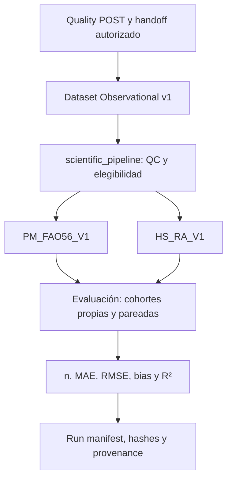

# 1.2 Depuración y Verificación de Datos Meteorológicos: Guía Paso a Paso

> **Estado vigente — 23/10/2026.** Las secciones y actualizaciones anteriores son snapshots históricos; sus planes, inventarios y afirmaciones de estado pueden estar superados. La actualización final de este documento recoge el estado contrastado, y [PROJECT_STATUS](docs/PROJECT_STATUS.md) es la autoridad de estado rápido. La metodología histórica se conserva sin convertir sus resultados en resultados v1.


> **Contexto histórico.** Las secciones iniciales conservan la metodología legacy utilizada durante el desarrollo original, con sus scripts, inventario y decisiones de depuración. No constituyen instrucciones vigentes de ejecución. La implementación científica vigente desde octubre de 2026 se explica en la actualización final de este documento y en [scientific_pipeline/](scientific_pipeline/README.md), autoridad técnica detallada.

**Objetivo**

Esta sección describe el proceso completo para depurar y verificar los datos diarios de las estaciones meteorológicas de las Islas Baleares, enfocándonos en la estimación de **ET₀** (evapotranspiración de referencia) proporcionada por el SIAR. El objetivo es limpiar los datos brutos, calcular ET₀ usando el modelo Penman-Monteith (PM) estándar y variantes, agregar estimaciones alternativas (Hargreaves y Valiantzas), y finalmente evaluar los errores comparativos.

Utilicé Python 3 en Visual Studio Code (VS Code), con bibliotecas como pandas para manipulación de datos, numpy para cálculos numéricos, y plotly/matplotlib para gráficos opcionales. Los scripts son interactivos para facilitar la reproducibilidad. Los datos provienen de la API de SIAR para 11 estaciones baleares (IB01 a IB11; nota: el texto original menciona 12, pero confirmamos 11 activas). Usaré IB05 como ejemplo ilustrativo.

**Requisitos previos**:
- Instala Python y las bibliotecas: `pip install pandas numpy matplotlib plotly`.
- Crea una carpeta `datos_siar_baleares` para almacenar CSVs.
- Ejecuta los scripts en orden secuencial para un flujo completo.
- Para ejecución: Abre una terminal en VS Code (Ctrl+`) y corre `python nombre_script.py`.

---

## 1.2.1 Recopilación Inicial de Datos de Estaciones

El primer paso es obtener metadatos y datos históricos diarios de las estaciones baleares usando la API de SIAR. Esto se hace en dos subpasos: filtrar estaciones y descargar datos diarios.

### Paso 1: Obtención de Metadatos de Estaciones (siarIDIB.py)
- **Descripción**: Este script consulta la API de SIAR para descargar un listado completo de estaciones de España y filtra solo las de Baleares (provincia 'Illes Balears'). Genera un CSV con metadatos útiles para cálculos posteriores (ej. latitud para Ra).
- **Inputs**: Ninguno (usa consulta API interna).
- **Outputs**: `estaciones_baleares.csv` en `datos_siar_baleares/`, con columnas como 'Estacion', 'Codigo', 'Latitud' (en DMS), 'Longitud', 'Altitud', 'Fecha de alta', etc. Resultado: 11 estaciones (IB01-IB11).
- **Ejecución**: 
  - Corre `python siarIDIB.py`.
  - Ejemplo de código simplificado (para referencia, no ejecutar directamente):
    ```python
    import pandas as pd
    # Consulta API (código real en script)
    df_all = pd.read_csv('estaciones_espana.csv')  # Listado completo de SIAR
    baleares_df = df_all[df_all['Provincia'].str.contains('Balears', case=False)]
    baleares_df.to_csv('datos_siar_baleares/estaciones_baleares.csv', index=False)
    print("Metadatos guardados. Estaciones encontradas:", len(baleares_df))
    ```
- **Consejo**: Si la API falla (límite de consultas), usa un backup local de 'estaciones_espana.csv'. Verifica que 'Latitud' esté en formato DMS (grados:minutos:segundos) para conversión posterior.

### Paso 2: Descarga de Datos Diarios por Estación (siarIBconsulta2_corregido.py)
- **Descripción**: Descarga datos históricos diarios (desde ~2004 hasta 2024) para cada estación, manejando límites de la API (descargas mensuales para evitar saturación).
- **Inputs** (interactivo):
  - Código de estación (ej. 'IB05').
  - Fecha inicio (extraída de metadatos o manual: 'dd/mm/aaaa').
  - Fecha fin (por defecto '31/12/2024').
- **Outputs**: `IBXX_datos_completos.csv` en `datos_siar_baleares/`, con columnas como 'Fecha' (YYYY-MM-DD), 'TempMedia' (°C), 'TempMax' (°C), 'HumedadMedia' (%), 'VelViento' (m/s), 'Radiacion' (MJ/m²), 'EtPMon' (mm, ET₀ de SIAR), etc.
- **Ejecución**:
  - Corre `python siarIBconsulta2_corregido.py`.
  - Ingresa inputs cuando se solicite. Ejemplo: Para IB05, descarga incremental si el archivo existe (actualiza solo fechas nuevas).
  - Diagnóstico: Si excede límites API, ejecuta en días diferentes; logs en consola muestran progreso.
- **Resultado para IB05**: ~7000 filas de datos diarios hasta 2024.

**Consejo general para recopilación**: Ejecuta para todas las estaciones en batch (modifica el script a un loop sobre códigos de `estaciones_baleares.csv`). Verifica integridad abriendo CSVs en Excel o pandas.

---

## 1.2.2 Depuración de Datos

Los datos brutos pueden contener NaNs, outliers o errores de medición. Usa `filtra.py` para limpiarlos, asegurando calidad para cálculos posteriores.

### filtra.py (Implementación)
- **Descripción**: Procesa datos brutos para eliminar NaNs y outliers (±3σ de la media por variable). Genera archivos depurados y eliminados, más gráficos para inspección visual.
- **Inputs** (interactivo):
  - Código de estación (ej. 'IB05').
- **Outputs**:
  - `IBXX_datos_depurados.csv`: Datos limpios.
  - `IBXX_datos_eliminados.csv`: NaNs y outliers.
  - Gráficos PNG en `graficas_eliminados/` (ej. `TempMedia_eliminados.png`: scatter con línea de media).
- **Pasos internos**:
  1. Elimina filas con NaNs en columnas de interés: ['TempMedia', 'TempMax', 'TempMin', 'HumedadMedia', 'HumedadMax', 'HumedadMin', 'VelViento', 'DirViento', 'VelVientoMax', 'DirVientoVelMax', 'Radiacion', 'Precipitacion', 'EtPMon'].
  2. Calcula media y σ por variable; filtra filas donde cualquier valor > ±3σ.
- **Ejecución**:
  - Corre `python filtra.py`.
  - Ingresa código de estación. Ejemplo para IB05: Input bruto ~7000 filas → Depurado ~6500 filas (~7% eliminados).
- **Consejo**: Inspecciona gráficos para validar outliers (ej. temperaturas >50°C). Si σ es demasiado estricto, ajusta a ±4σ en el código.

---

## 1.2.3 Cálculo de ET₀ con Penman-Monteith

Verifica ET₀ de SIAR implementando la fórmula FAO-56 Penman-Monteith (PM) en `PM2.py`, incluyendo una variante para cielo claro.

**Fórmula Estándar** (FAO-56):

\[
ET_0 = \frac{0.408 \, \Delta (R_n - G) + \gamma \, \frac{900}{T+273} \, u_2 (e_s - e_a)}{\Delta + \gamma (1+0.34 \, u_2)}
\]

Donde:
- \(R_n\): Radiación neta [MJ/m²/día].
- \(G\): Flujo de calor en suelo [MJ/m²/día] (aprox. 0 para diarios).
- \(T\): TempMedia [°C].
- \(u_2\): VelViento a 2m [m/s].
- \(e_s, e_a\): Presiones de vapor [kPa].
- \(\Delta, \gamma\): Pendiente y constante psicrométrica [kPa/°C].

### PM2.py (Implementación Actualizada)
- **Descripción**: Procesa datos depurados para calcular ET₀ PM estándar (usando Rs medida) y variante cielo claro (Rs = Rso).
- **Inputs** (interactivo):
  - Código de estación (ej. 'IB05').
- **Outputs**: `IBXX_et0_calc.csv` con columnas nuevas: 'J' (día juliano), 'N' (horas sol), 'ET0_calc' (PM estándar), 'diff' (vs EtPMon), 'ET0_sun' (cielo claro), 'diff_sun', 'Ra' (extraterrestre).
- **Pasos internos**:
  - Carga metadatos de `estaciones_baleares.csv` (convierte latitud DMS a decimal).
  - Calcula Ra (usando latitud, día juliano), Rso, Rn, etc.
  - Maneja errores: try/except, drop NaNs; logs en `pm2_log.txt`.
- **Ejecución**:
  - Corre `python PM2.py`.
  - Ingresa código. Ejemplo para IB05: ~6500 filas procesadas, mean diff = 0.12 mm/día.
- **Diagnóstico**: Si mean diff es NaN, verifica NaNs en 'VelViento' o 'Radiacion' (comunes en datos antiguos). Usa prints para debug.

---

## 1.2.4 Estimaciones Alternativas de ET₀

Agrega métodos simplificados (Hargreaves y Valiantzas) usando `variants_et0.py` sobre los outputs de PM2.

### variants_et0.py (Implementación)
- **Descripción**: Calcula ET₀ usando Hargreaves-Samani y Valiantzas (con corrección por humedad).
- **Inputs** (interactivo):
  - Código de estación (ej. 'IB05').
- **Outputs**: `IBXX_et0_variants.csv` con columnas nuevas: 'ET0_harg', 'diff_harg', 'ET0_val', 'diff_val'.
- **Fórmulas** (corregidas para unidades, Ra en MJ/m²/día):
  - Hargreaves: \( ET0_{harg} = 0.0023 \times 0.408 \times Ra \times (T + 17.8) \times (Tmax - Tmin)^{0.5} \)
  - Valiantzas: \( ET0_{val} = 0.408 \times 0.0135 \times 0.338 \times Ra \times (Tmax - Tmin)^{0.3} \times (1 - RH/100)^{0.2} \times (T + 17.8) \) (RH = HumedadMedia).
- **Ejecución**:
  - Corre `python variants_et0.py`.
  - Ingresa código. Ejemplo para IB05: mean diff_harg = -0.45 mm/día (sobreestima en verano); mean diff_val = -0.18 mm/día (mejor en costas húmedas).
- **Consejo**: Ajusta coeficientes (0.0135, 0.338) si calibras para Baleares. Usa HumedadMin si prefieres.

---

## 1.2.5 Cálculo de Errores Comparativos

Evalúa la precisión de los modelos comparando con ET₀ de SIAR usando `calculate_errors.py`.

### calculate_errors_et0.py (Implementación)
- **Descripción**: Calcula errores (MSE, RMSE relativo, MAE, R², AARE) por estación y general (media agregada).
- **Inputs**: Ninguno (procesa todos los `_et0_variants.csv` automáticamente).
- **Outputs**: `analisis_errores.md` con tablas Markdown por estación y general.
- **Fórmulas** (detalladas en script):
  - MSE: \( \frac{1}{n} \sum (x - x_J)^2 \)
  - RMSE: \( \sqrt{MSE} / \bar{x} \)
  - MAE: \( \frac{1}{n} \sum |x - x_J| \)
  - R²: \( \left( \frac{\sum (x - \bar{x})(x_J - \bar{x_J})}{\sqrt{\sum (x - \bar{x})^2 \sum (x_J - \bar{x_J})^2}} \right)^2 \)
  - AARE: \( \frac{1}{n} \sum \left| \frac{x - x_J}{x} \right| \)
- **Ejecución**:
  - Corre `python calculate_errors_et0.py`.
  - Revisa `analisis_errores.md` para tablas. Ejemplo para IB05: RMSE Hargreaves ~0.8 (sobreestima en húmedo); Valiantzas ~0.5 (mejor ajuste).
- **Consejo**: Integra tablas en tu informe. Si datos insuficientes, verifica NaNs en CSVs.

---


# ACTUALIZACIÓN 19/10/2026 — Pipeline científico reproducible ET₀ v1

## Del pipeline histórico a una capa científica independiente

El recorrido original —adquisición, `filtra.py`, `PM2.py`, variantes, AHC y scripts de errores— permitió explorar datos y fórmulas. Sus secciones anteriores se conservan como bitácora metodológica, incluidos ejemplos ilustrativos y nombres históricos que no siempre coinciden con los archivos finalmente archivados. No deben interpretarse como resultados de la implementación v1 ni como instrucciones para ejecutar legacy contra los CSV canónicos.

La evolución actual separa adquisición, certificación de calidad y cálculo científico. La [PR #23](https://github.com/lependens/Capitulo-1/pull/23), fusionada mediante `419d1b6a47f5e93005b14449ca426a1981b07407`, incorporó el paquete instalable [scientific_pipeline/](scientific_pipeline/README.md). **ET0-BASELINES-PREP = READY_FOR_DATASET_V1**: la capa está implementada y validada, pero todavía no se ha ejecutado oficialmente sobre Dataset Observational v1.

La entrega acredita **48 tests matemáticos/sintéticos PASS** y **CI PASS con Python 3.11, 3.12 y 3.13**, según el [estado de integración](scientific_pipeline/docs/mission_status.md). Es evidencia de software; no sustituye Quality POST ni genera resultados científicos de las estaciones.



El diagrama describe el flujo preparado para la ejecución futura autorizada, no un dataset o una evaluación oficial ya producidos.

## Entrada: observaciones originales, POST y metadatos trazables

El nuevo punto de partida no es un CSV «depurado» mediante eliminación destructiva. **Dataset Observational v1 combinará CSV SIAR canónicos, Quality POST, catálogo/metadatos y hashes/provenance**. Su construcción espera **SIAR-QUALITY-CLOSEOUT + Quality POST + handoff autorizado de Dirección 00**. PRE no se puede presentar como POST.

El [contrato del dataset y del handoff](scientific_pipeline/docs/contracts.md) define una representación JSON UTF-8 `observational-v1`: conserva las 23 columnas de origen, identifica cada fila por estación/fecha y mantiene `TempMedia`, `EtPMon`, flags y procedencia. Los ausentes no se convierten en cero; las fechas sin observación se representan en un ledger de huecos, sin fabricar filas meteorológicas. Las contradicciones de identidad, fechas, duplicados, esquema o hashes son errores de integridad que deben resolverse, no promediarse ni repararse silenciosamente.

El inventario vigente es de **12 estaciones, incluida IB101: 9 ACTIVE y 3 CLOSED**. Las cerradas son **IB07, IB09 e IB101**. Las referencias anteriores a «11 activas IB01–IB11» quedan identificadas como contexto histórico y no definen el inventario científico actual. Los periodos oficiales y el conjunto definitivo se contrastarán con POST.

**Dataset Observational v1 todavía no está generado.** La existencia del constructor y de sus pruebas sintéticas no equivale a disponer del dataset definitivo.

## De borrar filas a conservar observaciones y explicar su elegibilidad

La depuración histórica eliminaba filas con NaN en un conjunto global de variables y aplicaba ±3σ; el filtro podía descartar una observación útil para un método por una variable que ese método no necesitaba. Además, estimar umbrales sobre toda la serie mezcla información temporal que una evaluación posterior debería reservar.

La política vigente conserva la observación, asigna **QC flags** y determina **elegibilidad por modelo**. No aplica `dropna` global ni utiliza ±3σ como paso obligatorio de los baselines. No interpola ni imputa observaciones raw.

Se distinguen tres preguntas:

| Capa | Pregunta |
|---|---|
| Integridad de origen | ¿Son coherentes identidad, fecha, esquema, unicidad y hashes? |
| Plausibilidad física | ¿Qué variables o resultados requieren revisión o presentan dominios inválidos? |
| Elegibilidad de modelo | ¿Dispone este método de sus entradas válidas y de un dominio calculable? |

Los flags científicos no sustituyen el dictamen POST ni implican siempre exclusión. Los valores originales permanecen; una predicción no calculable se informa como `null` con motivos. Una predicción negativa se conserva y marca, sin recortarla automáticamente a cero.

## Elegibilidad PM y HS: decisiones por método

PM requiere extremos térmicos y de humedad, viento, radiación medida, fecha, latitud, altitud y la política de altura del viento. HS necesita extremos térmicos, fecha y latitud para calcular Ra; no exige humedad, viento, radiación medida ni altitud.

Por ejemplo, con **`Radiacion` ausente, PM_FAO56_V1 no es elegible y HS_RA_V1 puede seguir siéndolo**. Dataset v1 conserva esa fila. También `EtPMon` ausente puede impedir evaluar sin impedir predecir: referencia evaluable y entradas del método son decisiones distintas.

El registro de elegibilidad distingue las combinaciones lógicas por fila:

| PM | HS | Lectura |
|---|---|---|
| Sí | Sí | Ambos métodos disponen de entradas y dominios válidos. |
| No | Sí | Solo HS; por ejemplo, radiación medida ausente con sus demás entradas válidas. |
| Sí | No | Combinación lógica distinguible por el registro; no se introduce una exclusión HS artificial para producirla. |
| No | No | Ninguno; por ejemplo, faltan extremos térmicos necesarios para ambos. |

**Evaluar cada método por separado no significa que las cuatro combinaciones deban tener filas.** En las reglas de entrada actuales de v1, PM exige también los requisitos de HS: la elegibilidad PM implica la de HS. «Solo PM» no es una cohorte que se afirme observada ni una nueva regla científica; la disponibilidad de una salida de un comando que solo ejecuta PM tampoco prueba que HS sea inelegible. La implementación detallada de estas reglas está en [quality.py](scientific_pipeline/src/siar_science/quality.py).

Para la comparación se conservarán **cohortes propias y cohorte pareada PM ∩ HS**: cobertura real de cada método y comparación sobre las mismas estaciones/fechas, sin exigir de antemano una máscara global común a toda observación.

## Unidades: interpretación v1 resuelta, procedencia parcial explícita

La decisión vigente es **RESOLVED_FOR_V1**:

| Campo SIAR | Interpretación v1 | Tratamiento |
|---|---|---|
| `Radiacion` | MJ/m²/día | Lectura directa, **sin ×0.0864** |
| `VelViento` | m/s | Lectura directa, **sin /3.6** |

La [evidencia offline](scientific_pipeline/docs/units_offline_evidence.md) combina documentación, recorrido de adquisición y contraste numérico. La [forense preservada](scientific_pipeline/docs/units_offline_forensic.md) contrastó **75.236 pares en 12 estaciones, 2004–2025**. Sobre la cohorte canónica común y el kernel histórico `legacy_pm2`, la hipótesis directa produjo:

| Diagnóstico forense | mm/día |
|---|---:|
| Bias, predicción − EtPMon | −0.0232 |
| MAE | 0.0257 |
| RMSE | 0.0878 |

Las hipótesis de conversión dieron errores muy superiores. Estas cifras corresponden al experimento forense y a su kernel identificado: **no son métricas oficiales de PM_FAO56_V1 sobre Dataset Observational v1**, ni se eligen unidades solo por minimizar error contra SIAR.

Se mantienen **UNITS_PROVENANCE_PARTIAL** y **station_period_provenance_not_exhaustively_verified** como limitaciones documentadas, no bloqueos vigentes. La conclusión no certifica cualquier lote futuro ni acredita retrospectivamente la instrumentación de cada estación/periodo.

Para PM v1, `VelViento` se utiliza directamente como **u2 bajo la convención SIAR de 2 m**. La procedencia instrumental histórica no está exhaustivamente verificada; altitud de estación no significa altura del anemómetro. Una futura evidencia positiva de altura diferente exige detener y revisar PM en el ámbito afectado hasta resolución explícita, sin alterar raw ni convertir alturas por conjetura. No bloquea automáticamente HS.

## PM_FAO56_V1: baseline físico principal

El baseline principal es Penman–Monteith diario FAO-56, con decisiones congeladas y verificables en [assumptions.md](scientific_pipeline/docs/assumptions.md):

| Decisión | Convención v1 |
|---|---|
| Temperatura de cálculo | `Tcalc = (Tmax + Tmin) / 2`; se conserva `TempMedia` SIAR |
| Flujo de calor del suelo | `G = 0` para el cálculo diario |
| Constante psicrométrica | `gamma = 0.000665 × P`, con P en kPa |
| Albedo | `0.23` |
| Viento | u2 en m/s según convención SIAR de 2 m |
| Radiación solar medida | MJ/m²/día, sin conversión adicional |

La presión de vapor de saturación es la media de las presiones a Tmax y Tmin. La presión real utiliza extremos emparejados: **ea = [e°(Tmin)·RHmax + e°(Tmax)·RHmin] / 200**. No se sustituyen inconsistencias por un déficit ficticio cero ni se emplea un fallback silencioso de humedad media.

`solar.py` calcula radiación extraterrestre Ra y de cielo claro Rso a partir de fecha, latitud y altitud donde corresponde; `atmosphere.py` contiene presión y relaciones de vapor; `penman_monteith.py` calcula radiación neta y el cociente PM. La política de nubosidad limita Rs/Rso por arriba a 1, **sin floor inferior por defecto**. Se marcan ratios extremos, Rnl negativa o ET₀ negativa; no se ajusta la fórmula para acercarla artificialmente a `EtPMon`.

**EtPMon es una referencia SIAR calculada, no una medición independiente de ET₀ real.** La evaluación cuantifica acuerdo con esa referencia; no demuestra por sí sola exactitud respecto a una medición de terreno independiente.

### Diferencias principales respecto al PM legacy

| Aspecto | Legacy | PM v1 |
|---|---|---|
| Temperatura de cálculo | `TempMedia` SIAR en distintas operaciones de PM2 | Media de extremos Tcalc |
| Gamma | Dependiente de lambda(T) en PM2 | `0.000665 × P` |
| Decisiones numéricas | Fallbacks y límites implícitos | Dominios, motivos y flags explícitos; sin sustituciones silenciosas |
| Ejecución | Rutas hardcoded y scripts interactivos | Funciones reutilizables, CLI y manifiestos |
| Metadatos | Algunos derivados con placeholders históricos | Catálogo versionado, metadatos y hashes trazables |

La [auditoría legacy](scientific_pipeline/docs/legacy_audit.md) detalla otras diferencias de constantes y tratamiento radiativo. Conservar las ecuaciones de referencia no obliga a reproducir todos los comportamientos de PM2 ni a reutilizar sus resultados.

## HS_RA_V1: Hargreaves–Samani sin calibración

El segundo baseline utiliza Ra calculada, no radiación solar medida:

```text
ET0 = 0.0023 × 0.408 × Ra × (Tcalc + 17.8) × sqrt(Tmax - Tmin)
Tcalc = (Tmax + Tmin) / 2
Ra: MJ/m²/día; temperaturas: °C; ET0: mm/día
```

**HS_RA_V1 no usa AHC ni está calibrado sobre Baleares.** El factor 0.408 convierte el término energético dentro de la fórmula; no es una transformación adicional de la columna `Radiacion`, que este método no necesita.

Hargreaves con Rs, Valiantzas y AHC se conservan como historia o posibles experimentos posteriores, no como baselines primarios de v1. La implementación se encuentra en [hargreaves.py](scientific_pipeline/src/siar_science/hargreaves.py).

## AHC histórico y prevención de leakage

La auditoría identificó AHC estimado sobre toda la serie y evaluación sobre los mismos días: ajuste dentro de muestra y fuga temporal de información. En la variante auditada, el objetivo del ajuste era `ET0_calc`; eso no elimina el problema de evaluar sobre el periodo empleado para aprender el coeficiente.

PM y HS v1 **no aprenden parámetros**. Una futura calibración, AHC o ML requerirá separación cronológica **TRAIN → VALIDATION → TEST**: parámetros, escalas y filtros aprendidos se ajustan solo en TRAIN, se selecciona con VALIDATION y se evalúa en TEST tras congelar la configuración. No se hereda el ajuste global histórico ni se presenta su mejora dentro de muestra como generalización.

## Metadatos históricos: hallazgo IB03/IB04

La auditoría reprodujo determinados outputs históricos de IB03 e IB04 con **latitud ≈39.5° y altitud 100 m**, compatibles con placeholders preservados en el código histórico. Es evidencia sobre cálculos derivados legacy; no invalida las observaciones SIAR originales ni demuestra por sí sola qué script generó cada archivo.

La implementación nueva contrasta metadatos con el catálogo identificado por hash y conserva su procedencia. Los outputs históricos no se modifican: sirven para explicar la evolución metodológica, no como oráculo ni baseline oficial actual.

## Métricas y cohortes: qué se comparará

El error firmado es **predicción − EtPMon**. Las métricas principales son:

| Métrica | Definición y lectura |
|---|---|
| n | Número de pares evaluables en la cohorte |
| MAE | Media del valor absoluto del error, mm/día |
| RMSE | Raíz de la media del error cuadrático, mm/día |
| Bias / MBE | Media del error firmado, mm/día |
| R² predictivo | `1 − SSE/SST`, respecto a la media de la referencia |

**Pearson² no es R² predictivo.** La expresión histórica `sqrt(MSE) / media` es RRMSE, no RMSE en mm/día. Por tanto no se deben trasladar directamente los nombres o rankings antiguos a los nuevos resultados.

Los valores **EtPMon = 0 no se eliminan automáticamente de MAE, RMSE, bias o R²**. La referencia evaluable es finita, no negativa, aceptada por Quality y dentro del periodo oficial; una referencia ausente impide evaluar, no necesariamente predecir. Los negativos se conservan y marcan, pero se excluyen de la evaluación según la política v1. Con n<2 o SST=0, R² es indefinido (`null`); una cohorte vacía informa n=0 y métricas `null`. Si se recuperan métricas relativas que dividan por referencia, deberán especificar su propia política de ceros.

Se producirán **PM own cohort**, **HS own cohort** y **PM ∩ HS paired cohort**. Las cohortes propias permiten conocer disponibilidad, cobertura y capacidad operativa de cada método; la pareada permite la comparación principal directa sobre las mismas fechas y estaciones con referencia evaluable. No se confunde cobertura de predicción con número de pares de evaluación.

Las métricas globales reúnen pares, no promedian RMSE o R² de estaciones. La implementación permite desgloses temporales y por estación; los tamaños y hashes de selección hacen visibles diferencias de cobertura.

## Reproducibilidad y artefactos de ejecución

Cada ejecución futura identificará `dataset_id` y `run_id`, Quality POST, hashes de fuentes y catálogo, SHA del pipeline y hashes del código, método, parámetros, unidades, configuración, métricas y hashes de outputs. Los flags y las limitaciones aceptadas acompañan los resultados.

| Artefacto | Finalidad |
|---|---|
| `predictions.json` | Predicciones, elegibilidad y motivos por fila/método |
| `metrics.json` | Métricas y cohortes de evaluación |
| `manifest.json` | Procedencia, configuración, identidad de ejecución y hashes |

Se exige un destino nuevo: **no se sobrescriben ejecuciones previas**. La validación puede producir estos artefactos sin calcular ET₀ y con métricas vacías; los cálculos por separado no equivalen a una evaluación. Un fallo se distingue de una ejecución exitosa, sin publicar diagnósticos parciales como resultados completos.

## Paquete e interfaz preparados

Los módulos principales distribuyen responsabilidades explícitas:

| Módulo | Responsabilidad |
|---|---|
| `datasets.py` | Construcción desde handoff y validación de dataset/procedencia |
| `quality.py` | QC y elegibilidad por método |
| `solar.py` | Geometría solar, Ra y Rso |
| `atmosphere.py` | Presión y relaciones de vapor |
| `penman_monteith.py` | Radiación neta y PM diario |
| `hargreaves.py` | HS con Ra y coeficientes fijos |
| `metrics.py` | Evaluación y cohortes |
| `pipeline.py` | Orquestación, outputs y manifiestos |
| `cli.py` | Interfaz no interactiva |

La CLI `python -m siar_science` ya implementa:

| Comando | Función |
|---|---|
| `build-dataset` | Construir desde POST y handoff autorizado; no autoautoriza el cierre |
| `validate` | Verificar dataset, procedencia y elegibilidad |
| `calculate-pm` | Calcular PM sobre el dataset autorizado |
| `calculate-hargreaves` | Calcular HS sobre el dataset autorizado |
| `evaluate` | Evaluar predicciones existentes del mismo dataset, sin recalcularlas silenciosamente |
| `run-baselines` | Ejecutar ambos métodos y evaluación propia/pareada |

Los ejemplos del [README técnico](scientific_pipeline/README.md) muestran una interfaz preparada, no prueban la existencia de Dataset Observational v1. Esta actualización no ejecuta esos comandos ni genera métricas nuevas.

## Estado y siguiente gate científico

- **Software científico = READY; ET0-BASELINES-PREP = READY_FOR_DATASET_V1.**
- **Dataset Observational v1 = PENDING QUALITY POST**, cierre Quality y handoff autorizado.
- **PM_FAO56_V1 = implementado y testeado; pendiente de ejecución oficial.**
- **HS_RA_V1 = implementado y testeado; pendiente de ejecución oficial.**
- **Resultados científicos v1 = todavía no generados.**

La actualización de `docs_1.3_Análisis errores.md` corresponde a una etapa posterior: Quality POST → Dataset Observational v1 → PM_FAO56_V1 y HS_RA_V1 → resultados reproducibles. Hasta entonces permanece como análisis histórico legacy; esta misión no reinterpreta sus tablas ni anticipa nuevas conclusiones.

---

## ACTUALIZACIÓN 23/10/2026 — Dataset y ejecución oficial v1 disponibles

Las afirmaciones de la actualización de 19/10 sobre POST, dataset y ejecución oficial pendientes son **HISTÓRICAS / SUPERADAS**. Quality está COMPLETE con POST corregido SIAR-QA-POST-20261020T193140Z. Dataset siar-balears-observational-v1 fue construido y validado estructuralmente PASS; SHA256 `0ddb10941710f6d3a945eae94fe6b9eca36ae4c12f28203e2364862920a49bbb`.

El dataset conserva 75.496 filas raw, 75.495 oficiales, 1 OUTSIDE_OFFICIAL_PERIOD y ledger de 2.346 = 2.345 CONFIRMED_NO_DATA + 1 RECOVERED. No interpola, imputa ni crea filas meteorológicas ausentes; mantiene 23 columnas, Quality, estados y provenance.

**PM-VPD-FLOAT-TOLERANCE-AND-BASELINES = PASS**, publicado mediante PR #31 después del fix PR #30. En tres fechas IB10 con RHmin=RHmax=100 %, ea superaba es en ~2.22e-16 a 4.44e-16 kPa por redondeo. La tolerancia explícita absoluta 1e-12 kPa, relativa 0.0, trata solo ese exceso con presiones finitas/no negativas; fuera del margen se conserva el error y VPD positivo no se altera. No modifica raw, dataset, Quality, humedad ni presiones; parámetros y tests están documentados en [supuestos](scientific_pipeline/docs/assumptions.md).

PM calculó 70.896 y HS 70.979 predicciones, 0 fallos; pares evaluables propios 70.861 y 70.912, intersección 70.861. Los [resultados oficiales](scientific_pipeline/results/pm-vpd-20261023T194553Z/README.md) conservan métricas, cohortes y hashes. No son los diagnósticos forenses ni los resultados legacy anteriores. EtPMon sigue siendo referencia SIAR calculada, sin independencia instrumental.

LIMITACIONES ABIERTAS: IB09 conserva 4.423 filas pero la política heredada Quality FAIL de estación excluye todas de evaluación, incluidas 4.422 oficiales; muestra corta IB101; UNITS_PROVENANCE_PARTIAL y viento 2 m por convención sin verificación instrumental exhaustiva. No se cambian estas reglas en esta actualización.

**Valiantzas = LEGACY / FUTURE BASELINE REVIEW.** La variante histórica documentada es:
```text
ET0_val = 0.408 * 0.0135 * 0.338 * Ra *
          (Tmax - Tmin)^0.3 * (1 - RH/100)^0.2 * (T + 17.8)
RH histórico = HumedadMedia
```
Su presencia en la bitácora no la valida como baseline v1. Próxima secuencia: auditar fórmula/unidades/inputs → VALIANTZAS_V1 reproducible → comparar PM/HS/Valiantzas → modelos posteriores. PM_FAO56_V1 y HS_RA_V1 siguen sin calibración, AHC ni ML.

[Ubicaciones](docs/DATA_LOCATIONS.md) distingue evidencia compacta Git del dataset y run completos locales; no se mueve ni regenera ningún artefacto. La implementación y el contrato científico siguen bajo scientific_pipeline/.


## ACTUALIZACIÓN 24/10/2026 — Tres baselines clásicos oficiales

**VALIANTZAS-V1-AND-CLASSICAL-BASELINES-EXPORT = PASS**. Supera el estado
Valiantzas LEGACY / FUTURE BASELINE REVIEW de la actualización del 23/10;
el texto y resultados históricos anteriores se conservan como tales.

Se adopta Martí et al. (2024), Ecs.1b+3, con factor 0.408 y coeficiente
expandido **0.001861704**, Ra en MJ/m²/día, `(1.001−RHmedia/100)^0.2` y
Tcalc de extremos. [Decisión, fuentes y unidades](scientific_pipeline/docs/valiantzas_v1.md).
No es transcripción literal de Ec.4 ni copia del factor 1−RH/100 legacy.
Sin calibración local ni sustitución silenciosa de TempMedia original.

Dataset SHA256 `0ddb10941710f6d3a945eae94fe6b9eca36ae4c12f28203e2364862920a49bbb`, intacto. Pipeline `4ac52e25c803cb2301316c5cb1353bf30cdb427a`
([PR #33](https://github.com/lependens/Capitulo-1/pull/33)); 68 tests y CI Python 3.11/3.12/3.13 PASS.
PM/HS mantienen exactamente predicciones y elegibilidad oficiales anteriores.
VAL: 70.944 predicciones, 70.878 pares propios, 0 fallos.

[Informe de ejecución, cohortes, desgloses, CSV y hashes](scientific_pipeline/results/classical-20261024T034529Z/README.md).
EtPMon sigue siendo referencia calculada SIAR, no validación instrumental
independiente. Se retienen IB09 Quality FAIL, IB101 corto, unidades/procedencia
parcial y convención de viento 2 m; raw/Quality/Dataset sin cambios.


## ACTUALIZACIÓN 24/10/2026 — Hargreaves-Rs y cuatro baselines oficiales

**HARGREAVES-RS-V1-AND-FOUR-BASELINES = PASS**.
Se incorpora HG_RS_V1: **0.0135×0.408×Radiacion×(Tcalc+17.8)**, Rs medida en
MJ/m²/día, salida mm/día, Tcalc=(Tmax+Tmin)/2. Sin Ra, √TD, humedad, viento
ni calibración local. Legacy usaba TempMedia; se conservan su código y resultados.
[Contrato y fuentes](scientific_pipeline/docs/hargreaves_rs_v1.md).

HG-Rs: 70978 predicciones, 70912 evaluables, 0 fallos.
Cohorte común de cuatro: **70860**. PM/HS/VAL conservan exactamente todas
sus predicciones, elegibilidad, métricas y hashes de cohortes anteriores.
Pipeline `a0b440fa3ab92e4593be521e4e819c6421327656`, [PR #35](https://github.com/lependens/Capitulo-1/pull/35); 75 tests y CI PASS.
Dataset SHA256 `0ddb10941710f6d3a945eae94fe6b9eca36ae4c12f28203e2364862920a49bbb` sin cambios.

[Resultados completos, cohortes, estaciones, temporadas, CSV y hashes](scientific_pipeline/results/four-classical-20261024T042250Z/README.md).
EtPMon calculada SIAR comparte Rs con PM/HG-Rs; no es validación instrumental
independiente. Se conservan procedencia parcial, viento convencional 2 m,
IB09 FAIL, IB101 corto y límites empíricos. Raw/Quality/Dataset sin cambios.
