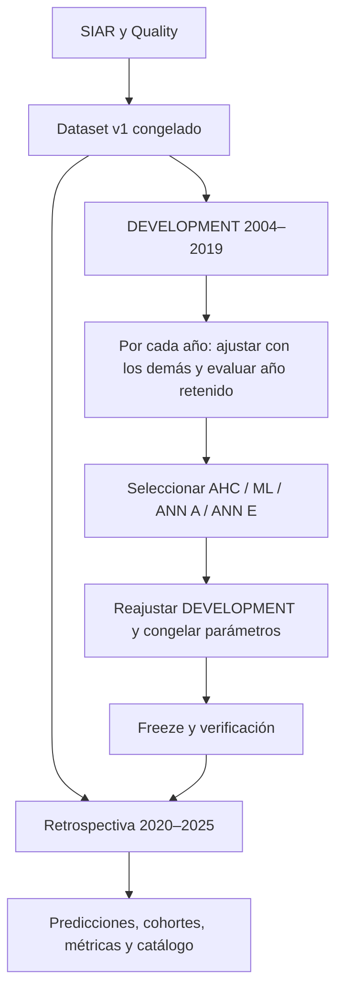
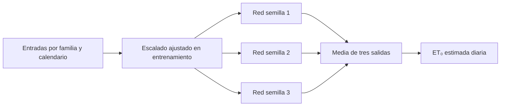

# Estimación de la evapotranspiración de referencia mediante fórmulas empíricas calibradas, aprendizaje automático y redes neuronales

## Desarrollo, validación retrospectiva y análisis comparativo con datos agroclimáticos SIAR de Baleares

**Memoria científica para revisión. No constituye una publicación académica ni una validación instrumental externa.** Código científico ejecutado: [`1e419ad881db1cc9798685ef19f414862461674b`](https://github.com/lependens/Capitulo-1/tree/1e419ad881db1cc9798685ef19f414862461674b). Dataset v1 SHA256 `0ddb10941710f6d3a945eae94fe6b9eca36ae4c12f28203e2364862920a49bbb`. Evaluación retrospectiva: Kaggle `370251881`; freeze SHA256 `97acad7ce7cc39c65d82f6efdc36290ed0325caaef2dedb69d9ffbefe1addfbd`.

## Índice

1. Resumen y abstract · 2. Introducción y antecedentes · 3. Objetivos e hipótesis · 4. Datos y estaciones · 5. Fundamentos matemáticos · 6. Diseño experimental · 7. AHC · 8. Aprendizaje automático clásico · 9. Redes neuronales · 10. Implementación y Kaggle · 11. Evaluación retrospectiva · 12. Resultados · 13. Discusión · 14. Conclusiones · 15. Reproducibilidad y auditoría · 16. Bibliografía · Anexos.

## 1. Resumen y abstract

La estimación de la evapotranspiración de referencia (ET₀) permite relacionar la demanda atmosférica con las necesidades de agua de los cultivos. La fórmula FAO-56 Penman–Monteith (PM) requiere más información meteorológica que otras aproximaciones. Este trabajo investiga hasta qué punto fórmulas empíricas y modelos estadísticos con tres familias de entradas pueden reproducir **una referencia PM calculada**, a partir de datos SIAR de Baleares. No compara las predicciones con evapotranspiración observada por lisímetros.

Se prepararon modelos por estación, familia de entradas y resolución anual, estacional o mensual. El desarrollo abarca 2004–2019, con disponibilidad dependiente de la estación; la evaluación retrospectiva abarca 2020–2025 y nueve estaciones. La selección utilizó validación por año dentro de DEVELOPMENT; los modelos y parámetros se congelaron antes de puntuar la retrospectiva. Se contrastaron la fórmula original, un ajuste multiplicativo por mínimos cuadrados sin intercepto (AHC), siete familias de aprendizaje automático y dos variantes de redes neuronales con tres semillas. Las métricas se calcularon sobre claves comunes, con cobertura propia separada.

En la cohorte anual común de 19.251 pares, HG-Rs produjo RMSE de 0,5670 mm/día; AHC, 0,4127; ML, 0,3809; ANN A, 0,3680; y ANN E, 0,3676. Para HS-Ra, los valores respectivos fueron 0,9491; 0,6307; 0,5530; 0,5331; y 0,5327. Las diferencias entre familias no igualan sus sensores. Estas cifras describen concordancia con PM en el conjunto retrospectivo: no demuestran mayor exactitud física ni extrapolación a estaciones nuevas. Algunas salidas no restringidas son negativas y se conservan sin truncar. Fuente: [resultados retrospectivos](et0_v2_retrospective_results_2026.md) y [evidencia de certificación](et0_v2_certificacion_evidencia.md).

**Abstract.** Reference evapotranspiration supports irrigation water demand assessment. We investigate whether empirical equations, calibrated models, classical machine learning and neural networks can reproduce a calculated FAO-56 Penman–Monteith reference using SIAR weather data from the Balearic Islands. Development spans 2004–2019, subject to station availability, and retrospective evaluation covers 2020–2025 at nine stations. Models are selected within development using held-out years and frozen before evaluation. On 19,251 common annual HG-Rs pairs, RMSE decreases from 0.5670 mm/day for the equation to 0.4127 for multiplicative calibration and 0.3676 for ANN E. Input requirements differ among families. The experiment assesses agreement with a calculated reference, not independent physical accuracy, prospective performance or transfer to unseen stations.

## 2. Introducción y antecedentes

La evapotranspiración combina evaporación y transpiración. FAO-56 define ET₀ sobre una superficie de referencia normalizada, de modo que la demanda climática puede distinguirse de las características de un cultivo concreto. Una aproximación de necesidades del cultivo emplea ETc = Kc · ET₀, con coeficientes y condiciones apropiadas: esta memoria no estima ETc ni recomienda riegos. La metodología FAO emplea PM como procedimiento normalizado y describe el cálculo con datos limitados [1].

Las fórmulas con menos entradas son útiles cuando faltan sensores, pero introducen aproximaciones climáticas. Hargreaves–Samani utiliza temperaturas extremas y radiación extraterrestre calculada [2]. La variante con radiación solar medida tiene requerimientos distintos [3]. La formulación adoptada de Valiantzas combina temperatura y humedad con una estimación de radiación, siguiendo la composición explicitada en la investigación de Martí y colaboradores [4]. Los métodos de calibración pueden reducir discrepancias locales, pero deben evaluarse fuera de las observaciones con las que se ajustaron.

Los árboles, bosques y redes representan relaciones no lineales sin sustituir la necesidad de validación [5, 6]. Aquí aprenden la salida de una fórmula calculada y no una medición física independiente. El trabajo se apoya en el TFG histórico y su legado metodológico, pero constituye una campaña versionada distinta: no traslada automáticamente resultados o decisiones históricas a V2. El protocolo V2 deja un año fuera dentro de DEVELOPMENT; no debe confundirse con la validación rolling de la campaña ML V1.

## 3. Objetivos e hipótesis

El objetivo general es caracterizar la concordancia con PM calculado de alternativas que requieren diferentes variables, mediante un procedimiento reproducible. Objetivos específicos: preservar la procedencia y la calidad de los datos; comparar fórmulas y ajuste multiplicativo; evaluar siete algoritmos y dos variantes ANN; medir errores y cobertura por estación y calendario; y entregar artefactos verificables para análisis posterior.

La hipótesis de trabajo es que una calibración local o una relación no lineal puede reducir discrepancias respecto a las fórmulas sin ajustar. No implica que siempre lo haga en cada estación, época o condición. La comparación entre ANN A y E investiga sensibilidad a la selección interna de época, sin presuponer cuál es superior. La aceptabilidad operativa requiere además criterios de coste, sensores, robustez y validación externa que aquí no se fijaron.

## 4. Datos meteorológicos y estaciones

La fuente es SIAR, cuyos datos fueron preservados y sometidos a un cierre Quality antes de construir el Dataset Observational v1. El SHA256 del dataset se indica en portada. El conjunto conserva datos y banderas, y el pipeline aplica elegibilidad por método sin borrar globalmente una observación. En las fuentes, radiación se interpreta en MJ m⁻² día⁻¹ y viento en m/s; se utiliza directamente como viento a 2 m según la convención SIAR y el legado, sin verificación exhaustiva estación-periodo de la altura efectiva. Temperaturas se expresan en °C y humedad relativa en porcentaje. La media usada en los modelos se calcula como (Tmax + Tmin)/2; no reemplaza la columna original de SIAR.

La vista V2 incluye 12 códigos: IB01–IB11 e IB101, con tratamiento según soporte. IB07, IB09 e IB101 son históricas y no aportan observaciones retrospectivas. IB09 fue admitida únicamente en DEVELOPMENT por decisión de Dirección: periodo de catálogo inclusivo 24-10-2005 a 10-10-2018; Quality V1 sigue FAIL y la verificación oficial independiente del periodo permanece UNRESOLVED. La fila 23-10-2005 se excluyó. Se reconciliaron 4.423 filas de origen, 4.422 interiores, una exterior y 313 ausencias confirmadas; 4.390 fechas comunes elegibles corresponden al inventario V2. Véanse [preparación](et0_v2_preparation.md) y [ejecución](et0_v2_execution.md).

En la tabla siguiente `PM n` cuenta días con referencia y `pred n` salidas presentes de ANN A/HG-Rs anual; el denominador de calendario es 2.192 por estación. Pares y RMSE se refieren a la cohorte común. Las diferencias entre `pred n` y `PM n` son posibles porque la salida puede existir sin referencia. Fuente: `retrospective-metrics.csv` del [catálogo](et0_v2_handoff_web.md), grupos `station`, `HG_RS_V1`, `annual`, `ANN_A`.

| Estación | Días calendario | PM n | Pred n | Pares comunes | RMSE mm/día |
|---|---:|---:|---:|---:|---:|
| IB01 | 2192 | 2192 | 2192 | 2192 | 0,3683 |
| IB02 | 2192 | 2017 | 2018 | 2017 | 0,3933 |
| IB03 | 2192 | 2192 | 2192 | 2192 | 0,3715 |
| IB04 | 2192 | 2124 | 2125 | 2124 | 0,3231 |
| IB05 | 2192 | 2154 | 2154 | 2154 | 0,3283 |
| IB06 | 2192 | 2190 | 2192 | 2190 | 0,3824 |
| IB08 | 2192 | 2097 | 2099 | 2097 | 0,3092 |
| IB10 | 2192 | 2097 | 2103 | 2097 | 0,3406 |
| IB11 | 2192 | 2188 | 2192 | 2188 | 0,4674 |

La localización exacta, altitud, fechas de vigencia y procedencia de cada sensor deben leerse del catálogo de estaciones asociado al dataset; no se infieren coordenadas a partir del código. Las series cortas no tienen la misma capacidad de validación temporal: IB101 presenta solo 246 pares en los ejemplos anuales siguientes y tres celdas mensuales sin soporte de selección.

La siguiente identificación procede de `inputs/estaciones_baleares.csv`, SHA256 `98abd16dcd6ea42ad46a30c331df47150f07dffdca140c14e4445890ce68a357`, y de los metadatos incorporados en Dataset v1. La fecha de instalación o baja es la **de catálogo**, no prueba de funcionamiento continuo ni de validez histórica independiente del periodo. Latitud se expresa en grados decimales norte y altitud en metros.

| Código | Nombre de catálogo | Latitud | Altitud | Instalación | Baja |
|---|---|---:|---:|---|---|
| IB01 | Santa Eulalia | 39,0100 | 120 | 2004-03-30 | — |
| IB02 | Inca | 39,6836 | 78 | 2004-03-31 | — |
| IB03 | Manacor | 39,5458 | 79 | 2004-04-01 | — |
| IB04 | Son Ferriol | 39,5622 | 8 | 2004-04-01 | — |
| IB05 | Felanitx | 39,4753 | 82 | 2004-04-05 | — |
| IB06 | Sa Pobla | 39,8028 | 4 | 2004-04-05 | — |
| IB07 | Sóller | 39,7803 | 44 | 2004-08-11 | 2012-11-13 |
| IB08 | Es Mercadal | 40,0036 | 40 | 2005-10-05 | — |
| IB09 | Artá | 39,6972 | 105 | 2005-10-24 | 2018-10-10 |
| IB10 | Calviá | 39,5511 | 30 | 2005-10-08 | — |
| IB101 | Ciutadella | 39,9653 | 21 | 2008-12-02 | 2009-08-10 |
| IB11 | S' Estany des Peix | 38,7269 | 7 | 2005-10-10 | — |

Las coordenadas se reproducen del dataset sin reinterpretar su fuente; no se ha reconstruido la historia de cambios de emplazamiento. La baja de IB07 coincide con el día RECOVERED `2012-11-13` del ledger corregido. En IB09 la excepción se limita a las fechas de catálogo citadas, no equivale a certificar externamente ese periodo.

## 5. Fundamentos matemáticos

### 5.1. Penman–Monteith de referencia

La implementación diaria [PM](https://github.com/lependens/Capitulo-1/blob/1e419ad881db1cc9798685ef19f414862461674b/scientific_pipeline/src/siar_science/penman_monteith.py) calcula, con G = 0 para el paso diario:

$$ET_0=\frac{0.408\Delta R_n+\gamma\frac{900}{T+273}u_2(e_s-e_a)}{\Delta+\gamma(1+0.34u_2)}.$$

ET₀ está en mm/día; Rn en MJ m⁻² día⁻¹; T en °C; u₂ en m/s; es y ea en kPa; Δ y γ en kPa/°C. El factor 0,408 convierte energía en evaporación equivalente. El modelo calcula radiación extraterrestre Ra a partir de latitud y día, radiación de cielo despejado Rso, radiación neta de onda corta con albedo 0,23 y onda larga. Rs/Rso tiene techo 1; no se aplica un suelo arbitrario al factor de nubosidad. El tratamiento de diferencias diminutas entre es y ea es una tolerancia numérica explícita, no calibración de la fórmula.

La presión atmosférica se estima a partir de la altitud z en metros: `P = 101,3 [(293 − 0,0065 z)/293]^5,26` kPa, y `γ = 0,000665 P`. La presión de vapor saturante a temperatura t es `e°(t) = 0,6108 exp[17,27 t/(t + 237,3)]`. La implementación usa `es = [e°(Tmin) + e°(Tmax)]/2` y `ea = [e°(Tmin) HRmax/100 + e°(Tmax) HRmin/100]/2`; no utiliza e° de la temperatura media para sustituir es. La pendiente Δ se evalúa en T: `4098 e°(T)/(T+237,3)²`. Para el déficit `es − ea`, únicamente un exceso negativo atribuible a redondeo de hasta 10⁻¹² kPa se trata como cero; una diferencia material se rechaza. Fuente: [`atmosphere.py`](https://github.com/lependens/Capitulo-1/blob/1e419ad881db1cc9798685ef19f414862461674b/scientific_pipeline/src/siar_science/atmosphere.py).

La geometría solar emplea el ordinal del día J, latitud φ en radianes, `dr = 1 + 0,033 cos(2πJ/365)`, declinación `δ = 0,409 sin(2πJ/365 − 1,39)` y ángulo horario de puesta `ωs = arccos(−tan φ tan δ)`, con límites numéricos del argumento. La radiación extraterrestre es `Ra = (24·60/π)·0,0820·dr [ωs sin φ sin δ + cos φ cos δ sin ωs]`; `Rso = (0,75 + 2·10⁻⁵ z) Ra`. La aproximación usa 365 también en años bisiestos. Véase [`solar.py`](https://github.com/lependens/Capitulo-1/blob/1e419ad881db1cc9798685ef19f414862461674b/scientific_pipeline/src/siar_science/solar.py).

Para Rnl se usan temperaturas absolutas `Tmin+273,16` y `Tmax+273,16`, constante de Stefan–Boltzmann diaria 4,903·10⁻⁹, término de humedad `(0,34−0,14√ea)` y nubosidad `(1,35 min(Rs/Rso,1)−0,35)`. Luego `Rn = 0,77 Rs − Rnl`. Un factor de nubosidad negativo se conserva y recibe bandera científica; no se corrige silenciosamente. En el término aerodinámico PM el código utiliza `T+273`, que es una convención separada de la conversión Kelvin para onda larga.

### 5.2. Fórmulas con menos entradas

Con D = Tmax − Tmin y T = (Tmax + Tmin)/2:

$$HS\_Ra=0.0023\cdot0.408\,R_a(T+17.8)\sqrt D.$$

$$HG\_Rs=0.0135\cdot0.408\,R_s(T+17.8).$$

Aquí Ra y Rs están en MJ m⁻² día⁻¹ y las salidas en mm/día. HG-Rs utiliza Rs **medida** y no multiplica por la raíz del rango térmico. Para Valiantzas, la composición implementada es:

$$\widehat R_s=0.338R_aD^{0.3}(1.001-HR_{media}/100)^{0.2},\qquad ET_0=0.0135\cdot0.408\,\widehat R_s(T+17.8).$$

El coeficiente expandido es 0,001861704 con Ra en MJ m⁻² día⁻¹. La implementación declara explícitamente la conversión energética y adopta humedad media diaria, no mínima. La composición se basa en las ecuaciones citadas por Martí et al. [4]; no debe interpretarse como transcripción literal de una ecuación escrita con otras unidades. Fuentes ejecutadas: [HS-Ra](https://github.com/lependens/Capitulo-1/blob/1e419ad881db1cc9798685ef19f414862461674b/scientific_pipeline/src/siar_science/hargreaves.py), [HG-Rs](https://github.com/lependens/Capitulo-1/blob/1e419ad881db1cc9798685ef19f414862461674b/scientific_pipeline/src/siar_science/hargreaves_rs.py) y [Valiantzas](https://github.com/lependens/Capitulo-1/blob/1e419ad881db1cc9798685ef19f414862461674b/scientific_pipeline/src/siar_science/valiantzas.py). Ninguna fórmula básica recibe calibración local ni truncado en cero.

El artículo de Martí et al. presenta una ecuación expandida con coeficiente 0,004563 y, por separado, una ecuación que divide la radiación en MJ m⁻² día⁻¹ por λ=2,45 MJ kg⁻¹. La composición ejecutada aplica explícitamente 0,408 ≈ 1/2,45: `0,338·0,0135·0,408=0,001861704`. La relación entre 0,004563 y el coeficiente ejecutado es aproximadamente 2,45. La elección de V2 es la composición documentada, no una afirmación de equivalencia literal con el coeficiente impreso; la interpretación dimensional de esta diferencia permanece señalada para revisión externa de la fuente primaria. El propio artículo original está accesible en el [repositorio de la UIB](https://dspace.uib.es/xmlui/bitstream/handle/11201/168425/170384.pdf?isAllowed=y&sequence=1).

### 5.3. Ajuste y métricas

Para un grupo de entrenamiento, con xᵢ fórmula y yᵢ PM calculado, AHC minimiza Σ(yᵢ − c xᵢ)² sin intercepto:

$$c=\frac{\sum_i x_i y_i}{\sum_i x_i^2},\qquad \widehat y_i=cx_i.$$

El coeficiente es adimensional y exige denominador positivo. No es la media aritmética de cocientes empleada en parte del legado. Para pares comparables, error eᵢ = predicción − referencia: MAE = media |eᵢ|; RMSE = raíz de la media de eᵢ²; sesgo = media eᵢ; R² predictivo = 1 − Σeᵢ²/Σ(yᵢ − ȳ)². MAE, RMSE y sesgo están en mm/día. R² puede ser negativo y no se define con referencia constante; no es correlación al cuadrado. n cuenta pares, incluidos objetivos cero cuando son elegibles.

## 6. Diseño experimental

La unidad de ajuste es estación × familia × resolución. Annual usa un grupo de coeficiente; seasonal usa DJF, MAM, JJA y SON; monthly usa meses 01–12. Las salidas son **diarias** en todas las resoluciones: annual, seasonal y monthly describen la segmentación de la calibración o indicadores de calendario, no una agregación temporal del valor diario.



En cada fold exterior se reserva un año de DEVELOPMENT y se entrena con los demás. Es una validación retrospectiva por años, **no una simulación rolling de pronóstico hacia adelante**: algunos años de entrenamiento pueden ser posteriores al año retenido. Se exigen al menos dos folds soportados; la selección minimiza la media no ponderada de RMSE anual en los años elegibles y usa dispersión y desempates fijados. Las categorías de calendario deben tener soporte en los ajustes internos de A y E; los modelos se puntúan sobre las mismas claves exteriores de cada celda. Los años 2020–2025 no seleccionan parámetros ni modelos.

El código y el protocolo separan entradas por familia: HS-Ra usa Tmin, Tmax y Ra; HG-Rs la media de extremos y Rs; Valiantzas Tmin, Tmax, HRmedia y Ra. El mismo vector base se suministra a AHC indirectamente a través de la fórmula y a ML/ANN directamente; ML/ANN añaden indicadores estacionales o mensuales cuando corresponde. No se puede afirmar igualdad de entradas **entre** familias. Véanse [contrato](et0_v2_preparation.md), [implementación de soporte](https://github.com/lependens/Capitulo-1/blob/1e419ad881db1cc9798685ef19f414862461674b/scientific_pipeline/src/siar_science/et0_v2_support.py) y [protocolo](../experiments/et0-v2-preparation.json).

## 7. Ajuste AHC

En cada fold, los coeficientes se calculan exclusivamente con los años de entrenamiento del fold y se aplican al año retenido. Después se ajustan por grupo con DEVELOPMENT completo y se congelan para la retrospectiva. Un AHC calculado con todo el histórico, incluida la retrospectiva, se publica en una tabla **in-sample** independiente: no sirve para afirmar generalización fuera de muestra.

Ejemplos de coeficientes anuales congelados, extraídos de `frozen-run/AHC/<estación>__<familia>__annual/frozen.json`, campo `ahc.groups.annual`: IB01 HS-Ra 0,893456 (n=5.512), HG-Rs 0,918964 (n=5.512), Valiantzas 0,980209 (n=5.512); IB09 respectivamente 0,803193, 0,840085 y 0,880614 (n=4.390); IB101 1,096818, 0,903114 y 1,130896 (n=246). Son ajustes DEVELOPMENT, no coeficientes de histórico completo. Comparar la precisión de IB101 con IB01 sin tener en cuenta soporte sería improcedente. Integridad: [certificación](et0_v2_certificacion_evidencia.md).

## 8. Aprendizaje automático clásico

Por cada celda soportada se evaluaron 37 configuraciones: regresión lineal (1), Ridge (6), Elastic Net (12), árbol (6), Random Forest (4), Extra Trees (4) e HistGradientBoosting (4). El registro exacto de parámetros está en [ml-v1-classical.json](../experiments/ml-v1-classical.json); V2 reutiliza su malla y orden de complejidad, pero **no** su partición ni su regla rolling V1. La selección V2 utiliza la media anual no ponderada y su dispersión según el protocolo V2.

Los modelos lineales incorporan `StandardScaler` ajustado dentro de cada entrenamiento; los árboles no requieren escalado. Se elige una configuración por algoritmo y una principal por celda; las siete se reajustan con DEVELOPMENT y se serializan. Elastic Net permite 20.000 iteraciones y tolerancia 10⁻⁶. Se registraron 51 candidatos con avisos en folds y siete reajustes que no alcanzaron tolerancia; ninguno era el principal de su celda. Las variantes afectadas conservan esa advertencia y no se modificaron para forzar convergencia. Fuente: [evidencia](et0_v2_certificacion_evidencia.md) y [`et0_v2_models.py`](https://github.com/lependens/Capitulo-1/blob/1e419ad881db1cc9798685ef19f414862461674b/scientific_pipeline/src/siar_science/et0_v2_models.py).

La regresión lineal estima una suma ponderada de entradas; Ridge penaliza magnitudes de coeficientes y Elastic Net combina penalizaciones L1 y L2. Los árboles dividen el espacio de entrada por umbrales; los bosques promedian árboles con aleatoriedad y el boosting suma correctores sucesivos. Estas descripciones explican las familias, pero el resultado concreto depende de su malla y de la muestra. Los árboles candidatos fijan profundidades 4, 8 y 12 con dos políticas de tamaño mínimo; los dos bosques utilizan 200 árboles por configuración; boosting usa 200 iteraciones con tasas 0,05 o 0,1. El protocolo conserva los valores detallados de profundidad, hojas, regularización y semillas. Un `Pipeline` con escalador evita ajustar la escala sobre el año retenido.

## 9. Redes ANN A y ANN E

Se ensayaron cinco arquitecturas ocultas: (16), (32), (64), (64,32) y (64,32,16). Cada una se evaluó con semillas 20261101, 20261102 y 20261103. Se usó MLPRegressor, ReLU, Adam, α=0,0001, tasa inicial 0,001, lote máximo 256 y `shuffle=False`. El escalador se ajusta solo con los datos usados para entrenar los pesos en la fase correspondiente. Una red se entrena por semilla; la predicción es la media de las tres.

Para elegir épocas se separa el 15 % del entrenamiento exterior. ANN A toma las últimas fechas; ANN E selecciona por orden de hash SHA256 con semilla de partición 20261111. E no es una validación externa independiente: ambos métodos mantienen el mismo año exterior retenido. El entrenamiento interno tiene máximo 200 épocas, paciencia 15 y mejora mínima de RMSE 0,0001. Después se reajusta con todo el entrenamiento del fold por el número de épocas elegido y se puntúa el año exterior. La arquitectura se selecciona separadamente para A y E. El ajuste final usa la mediana de las mejores épocas de los folds por semilla, redondeada al entero más próximo con mitades hacia arriba, y se congela con DEVELOPMENT completo.



Las decisiones, soporte de categorías y detalles están en [protocolo V2](../experiments/et0-v2-preparation.json) y código congelado; no se asume que todas las celdas eligieran la misma arquitectura. ReLU describe activaciones ocultas; la salida es de regresión sin restricción no negativa.

## 10. Implementación informática y Kaggle

La campaña se ejecutó en Kaggle CPU sobre una cápsula DEVELOPMENT con SHA256 `0c43f1020a04b0dedeeff84ccb1cbae4285ff00ac20c48473ff6c81b57ecd3e6`. El código separa preparación (`et0_v2.py`), particiones y soporte (`et0_v2_support.py`), entrenamiento (`et0_v2_models.py`), persistencia y reanudación (`et0_v2_campaign.py`) y retrospectiva (`et0_v2_retrospective.py`). Las entradas se validan antes del ajuste; se registran identidades, etapas, candidatos, métricas por fold y modelos serializados.

`make_cell` conserva fechas elegibles de una estación y valida unicidad; `outer_plan` construye folds y categorías; `fit_candidate` entrena y resume RMSE anual; `selections` aplica desempates; `refit` ajusta y emite los modelos elegidos. Para ANN, `_fit_seed` ajusta el escalador al subconjunto interno, determina épocas, vuelve a ajustarlo al entrenamiento exterior y predice el fold. Estos bloques deben leerse con el protocolo, no como una descripción de la implementación V1.

Un ejemplo concreto del flujo preservado —IB01, 2004-03-30— contiene Tmin=10,06 °C, Tmax=15,2 °C y Rs=1,787 MJ m⁻² día⁻¹. La vista V2 registra `Ra=31,616142556...`, entrada HG-Rs `[12,63, 1,787]`, PM calculado `1,186559563...` mm/día y HG-Rs `0,29951628228` mm/día. La observación arrastra las banderas de baja relación Rs/Rso y onda larga neta negativa: es un ejemplo de por qué un dato presente no implica ausencia de advertencias. Fuente: `development.json.gz`, SHA de vista `0f1bb84023dad6b4a261c53a7e6017ceeb92f8fba5b048c8dcc15175e42dcfef`, y dataset de portada. No se debe extrapolar esta diferencia puntual a todo el periodo.

La ejecución por lotes preserva candidatos válidos mediante checkpoints, sin volver a entrenar una etapa cerrada. Se verificaron 3.885 checkpoints ML y 525 por cada ANN. Primer lote conservado con bytes idénticos: ML 3.885 en `368475953`; ANN A 304 en `368475953`, 85 en `369095500` y 136 en `369223074`; ANN E 101 en `369632717`, 101 en `369691836`, 206 en `369788169` y 117 en `369953511`. Primera aparición disponible no demuestra necesariamente creación en ese lote. El sello final identifica 108 celdas AHC y 105 celdas para cada otra etapa; las tres celdas restantes carecían de soporte mensual para IB101.

La identidad exacta de índices y modelos está enlazada desde `freeze.json`. Entorno registrado: Python 3.13.18, NumPy 2.1.3, SciPy 1.16.3, joblib 1.6.0, threadpoolctl 3.7.0 y scikit-learn 1.9.1; el wheel de scikit-learn se verificó por hash, las demás dependencias por versión. El notebook recuperado tiene un SHA distinto del listado inicialmente; se conserva como incidencia de procedencia sin causa demostrada. Código y configuración se contrastan por evidencias independientes. Véanse [ejecución](et0_v2_execution.md) y [certificación](et0_v2_certificacion_evidencia.md).

## 11. Evaluación retrospectiva 2020–2025

La evaluación oficial Kaggle `370251881` verifica el freeze y registra intención y apertura de la retrospectiva. La lectura anterior del dataset completo en Windows para calcular su hash ocurrió después de autorización y antes del journal de Kaggle; ese cálculo no inspeccionó filas ni intervino en selección. El journal describe el acceso del evaluador, no todos los accesos históricos posibles.

En cada familia y resolución la cohorte principal es la intersección de PM válido y salidas FORMULA, AHC, ML principal, ANN A y ANN E. Para variantes individuales ML, la cohorte incorpora además la presencia de esa variante y puede tener otro hash. Cada tabla identifica `common_keys_sha256`; se reconstruyeron los hashes y claves únicas de las 9.612 filas. La cobertura de calendario es `predicted_days/calendar_days`; la de referencia propia es `pm_pairs_own/pm_days`. Las cifras son distintas del denominador de error común. Los 2.081.376 registros expandidos incluyen combinaciones de método y posibles salidas ausentes; no deben interpretarse automáticamente como 2.081.376 predicciones válidas.

Se recalcularon n, MAE, RMSE y sesgo de las 9.612 filas; R² se comprobó salvo grupos indefinidos o casi constantes. También se verificaron los denominadores de calendario y la equivalencia de las salidas CSV/Parquet con las tablas de origen. No se reentrenó ni reseleccionó con métricas retrospectivas. La prueba aislada de inferencia cubrió tres modelos representativos, no todas las celdas [contrato](et0_v2_contrato_inferencia.md).

## 12. Resultados

En el cuadro, los cinco métodos de una fila se puntúan en 19.251 pares comunes; cobertura propia se indica aparte en el informe completo. RMSE en mm/día. Fuente: [45 resultados globales](et0_v2_retrospective_results_2026.md).

| Familia · resolución | Fórmula | AHC | ML | ANN A | ANN E |
|---|---:|---:|---:|---:|---:|
| HS-Ra · annual | 0,9491 | 0,6307 | 0,5530 | 0,5331 | 0,5327 |
| HS-Ra · seasonal | 0,9491 | 0,6212 | 0,5571 | 0,5236 | 0,5238 |
| HS-Ra · monthly | 0,9491 | 0,6202 | 0,5581 | 0,5353 | 0,5357 |
| HG-Rs · annual | 0,5670 | 0,4127 | 0,3809 | 0,3680 | 0,3676 |
| HG-Rs · seasonal | 0,5670 | 0,3987 | 0,3529 | 0,3368 | 0,3355 |
| HG-Rs · monthly | 0,5670 | 0,3953 | 0,3448 | 0,3279 | 0,3285 |
| Valiantzas · annual | 0,6236 | 0,5122 | 0,4388 | 0,4210 | 0,4209 |
| Valiantzas · seasonal | 0,6236 | 0,5094 | 0,4410 | 0,4160 | 0,4161 |
| Valiantzas · monthly | 0,6236 | 0,5072 | 0,4412 | 0,4233 | 0,4232 |

La mejora relativa de ANN E frente a AHC anual es 15,5 % para HS-Ra, 10,9 % para HG-Rs y 17,8 % para Valiantzas. No son diferencias de precisión física demostrada. La cobertura propia de calendario global es 97,66 % en HS-Ra/HG-Rs y 97,58 % en Valiantzas; el denominador y cobertura no son los de la intersección de error. La comparación entre las tres fórmulas en la intersección de claves también usa 19.251 pares: la familia HG-Rs requiere un sensor de radiación que HS-Ra no necesita.

```mermaid
xychart-beta
    title "RMSE retrospectivo anual respecto a PM calculado (mm/día)"
    x-axis ["HS-Ra", "HG-Rs", "Valiantzas"]
    y-axis "RMSE (mm/día)" 0 --> 1
    bar [0.9491, 0.5670, 0.6236]
    bar [0.6307, 0.4127, 0.5122]
    bar [0.5530, 0.3809, 0.4388]
    bar [0.5331, 0.3680, 0.4210]
    bar [0.5327, 0.3676, 0.4209]
```



En cada familia las barras siguen el orden fórmula, AHC, ML, ANN A, ANN E. Es una figura de **concordancia con la referencia**; las familias no requieren los mismos sensores.

En HG-Rs anual ANN A, IB08 muestra 0,3092 e IB11 0,4674 mm/día; no se ha ajustado esta comparación por cobertura o clima. Los valores negativos presentes incluyen ANN A en IB02/2023-01-27/Valiantzas mensual (−0,03365) e IB10/2023-02-27 (−0,02169), y ANN E en la primera clave (−0,03292). Se contaron 377 filas negativas en regresión lineal, 373 en Ridge y 367 en Elastic Net; las filas se distinguen por familia y resolución y no equivalen a fechas únicas. No se truncaron las predicciones ni se recalcularon métricas.

## 13. Discusión

Sobre esta retrospectiva, AHC reduce el RMSE de las tres fórmulas y ML/ANN reducen el error frente a AHC en las comparaciones anuales indicadas. La mejora muestra capacidad de imitar PM con entradas limitadas, no identifica una relación causal ni demuestra mayor exactitud física. La radiación medida aporta información que Ra no contiene por sí sola, pero una comparación de familias mezcla selección de sensores y formulación; no permite atribuir toda la diferencia de RMSE únicamente al sensor.

Las resoluciones modifican la flexibilidad temporal y pueden aumentar el riesgo de sobreajuste con escaso soporte. Las diferencias entre ANN A y E son muy pequeñas en resultados globales y no se ha aplicado un contraste estadístico; no deben presentarse como superioridad significativa. Las estaciones tienen coberturas y condiciones distintas. El objetivo PM depende de los mismos sensores y supuestos de referencia, incluida la convención de viento a 2 m. No se ha demostrado transferencia espacial a estaciones sin entrenamiento, ni rendimiento prospectivo después de 2025, ni validez instrumental con lisímetros.

Un modelo operativo precisa reglas para sensores ausentes, valores físicos negativos, intervalos de aplicabilidad, mantenimiento, costes y calidad de entrada. Cortar predicciones negativas cambiaría el modelo y las métricas; requeriría política y evaluación versionadas. Los avisos de convergencia y la identidad incompleta del notebook deben acompañar cualquier interpretación de los casos afectados.

## 14. Conclusiones y líneas futuras

1. El experimento reproduce una referencia PM calculada mediante familias de entradas diferenciadas y un diseño retrospectivo trazable.
2. En las cohortes y periodos estudiados, el ajuste multiplicativo y los modelos seleccionados redujeron los RMSE globales anuales mostrados frente a sus fórmulas de partida; no se concluye que lo hagan en cada subgrupo.
3. Las redes A y E tuvieron errores globales próximos. La elección entre ellas no queda justificada por diferencias numéricas mínimas sin estabilidad, incertidumbre y coste.
4. Una evaluación independiente con lisímetros, ensayos prospectivos y estaciones no vistas son prioridades antes de afirmar mejora física o transferibilidad.
5. La web debe consultar tablas y catálogos versionados sin recalcular ciencia; inferencia futura, previsiones y ETc son trabajos posteriores, no resultados de esta retrospectiva.

## 15. Reproducibilidad y auditoría

La reproducción requiere el commit de portada, dataset con hash indicado, cápsula DEVELOPMENT, protocolo, handoff IB09, configuraciones y árbol de modelos congelados. El procedimiento y comandos están en [metodología y reproducción](et0_v2_metodologia_y_reproduccion.md) y [ejecución V2](et0_v2_execution.md). Una ejecución posterior debe emplear carpeta nueva, comprobar hashes antes de leer entradas y preservar el original. Las marcas temporales pueden producir manifiestos distintos aunque los resultados científicos coincidan.

El árbol de resultados original se conserva en `/srv/siar-project/scientific-artifacts/et0-v2/original/retrospective-20261116/et0-v2-retrospective-370251881.zip` con SHA256 `2fddd95c2374a95b4bd1885a6d13f4455ed89d45b8e0d9e854e4d846d40cd420`. El catálogo técnico VERIFIED está en `/srv/siar-project/scientific-artifacts/et0-v2-verified-catalog-20261124/catalog.json`, SHA256 `fef85f0a6ae981792d867a9de2b10b9f7787bc680461820d2284cd20453df4ab`; apunta a los derivados de `et0-v2/derived/v1/`. El inventario que lo vincula fue firmado; snapshot cifrado `backup_20261124T160201Z_5a69c7b9`, restauración independiente PASS. Publicación oficial: NOT_PUBLISHED.

Los comprobadores `scientific_pipeline/tools/verify_et0_v2_freeze.py`, `verify_et0_v2_metrics.py`, `verify_et0_v2_cohorts.py` y `verify_et0_v2_coverage.py` permiten repetir controles de integridad, aritmética, cohortes y razones de cobertura. La trazabilidad individual está en el paquete de evidencias, `checkpoint-trace.json`, SHA256 `4165faa41500314caa424f75318dfff5aa3a2e63e0ea05f34b4d7e82ae12f1eb`. La recuperación de los seis archivos de evidencia fue contrastada con sus fuentes y manifiesto; el catálogo y el ZIP retrospectivo tienen pruebas de recuperación separadas.

Ejemplo de verificación **sin recalcular ni modificar modelos**, desde la raíz del repositorio y usando una copia accesible del ZIP original y de las tablas de inspección:

```bash
python scientific_pipeline/tools/verify_et0_v2_freeze.py "$RETROSPECTIVE_ZIP"
python scientific_pipeline/tools/verify_et0_v2_metrics.py "$INSPECTION_DIR"
python scientific_pipeline/tools/verify_et0_v2_cohorts.py "$INSPECTION_DIR"
python scientific_pipeline/tools/verify_et0_v2_coverage.py "$INSPECTION_DIR/retrospective-metrics.csv"
```

El directorio de inspección debe incluir `predictions.csv.gz` y `retrospective-metrics.csv`; los comprobadores no descargan ni construyen por sí solos dichas entradas. Para reproducir la retrospectiva en vez de comprobar sus tablas, utilizar el comando completo documentado en [metodología y reproducción](et0_v2_metodologia_y_reproduccion.md) en una carpeta de salida nueva y tras verificar las identidades de cápsula, dataset y freeze.

Para una repetición autorizada de la **evaluación**, no del entrenamiento, se necesita un checkout limpio del commit científico, el árbol de ejecución congelado y la cápsula. Las variables `CAPSULE`, `RUN`, `DATASET_V1` y `OUTPUT` son rutas locales que debe proporcionar quien reproduce; `OUTPUT` debe ser nuevo. El dataset debe coincidir con el hash de portada y el freeze con `97acad7ce7cc39c65d82f6efdc36290ed0325caaef2dedb69d9ffbefe1addfbd`. Con las versiones registradas en el capítulo 10 y desde la raíz del checkout:

```bash
git rev-parse HEAD
sha256sum "$DATASET_V1"
export PYTHONPATH="$PWD/scientific_pipeline/src"
export OMP_NUM_THREADS=1 OPENBLAS_NUM_THREADS=1 MKL_NUM_THREADS=1
python -m siar_science.et0_v2_retrospective --repo . --capsule "$CAPSULE" --run "$RUN" \
  --dataset "$DATASET_V1" --freeze-sha256 97acad7ce7cc39c65d82f6efdc36290ed0325caaef2dedb69d9ffbefe1addfbd --output "$OUTPUT"
```

El primer comando debe devolver `1e419ad881db1cc9798685ef19f414862461674b`; comprobar además cápsula y modelos con sus manifiestos antes de ejecutar. El resultado original corresponde a Kaggle `370251881`, manifiesto SHA256 `f771dc3564270528c203d9af709b2b88649a552ef7dd831bf4503d04a2fd8daa`. Una nueva ejecución debe confrontarse por claves, valores y hashes de sus propios archivos, sin exigir que el manifiesto sea idéntico cuando contiene tiempos distintos. Esta receta no demuestra por sí sola una reproducción íntegra: esa repetición completa no se ha realizado para esta memoria.

Reproducir la evaluación con modelos conservados no equivale a reconstruir toda la selección, ni a demostrar exactitud física. Para reproducir selección serían necesarios datos, código, dependencias, semilleros, particiones y todas las decisiones de soporte; las dependencias distintas del wheel de scikit-learn están identificadas por versión y no por hash binario exhaustivo.

## 16. Bibliografía

1. Allen, R. G., Pereira, L. S., Raes, D. y Smith, M. (1998). *Crop evapotranspiration: Guidelines for computing crop water requirements*. FAO Irrigation and Drainage Paper 56. [FAO, texto original](https://www.fao.org/4/X0490E/X0490E00.htm).
2. Hargreaves, G. H. y Samani, Z. A. (1985). Reference crop evapotranspiration from temperature. *Applied Engineering in Agriculture*, 1(2), 96–99. [DOI: 10.13031/2013.26773](https://doi.org/10.13031/2013.26773).
3. Hargreaves, G. H. y Allen, R. G. (2003). History and evaluation of Hargreaves evapotranspiration equation. *Journal of Irrigation and Drainage Engineering*, 129(1), 53–63. [DOI: 10.1061/(ASCE)0733-9437(2003)129:1(53)](https://doi.org/10.1061/%28ASCE%290733-9437%282003%29129%3A1%2853%29).
4. Martí, P., López-Urrea, R., Mancha, L. A., González-Altozano, P. y Román, A. (2024). Seasonal assessment of the grass reference evapotranspiration estimation from limited inputs using different calibrating time windows and lysimeter benchmarks. *Agricultural Water Management*, 300, 108903. [DOI: 10.1016/j.agwat.2024.108903](https://doi.org/10.1016/j.agwat.2024.108903); [texto original UIB](https://dspace.uib.es/xmlui/bitstream/handle/11201/168425/170384.pdf?isAllowed=y&sequence=1).
5. Breiman, L. (2001). Random forests. *Machine Learning*, 45, 5–32. [DOI: 10.1023/A:1010933404324](https://doi.org/10.1023/A:1010933404324).
6. Kingma, D. P. y Ba, J. (2015). Adam: A method for stochastic optimization. [arXiv:1412.6980](https://arxiv.org/abs/1412.6980).
7. Valiantzas, J. D. (2013). Simplified forms for the standardized FAO-56 Penman–Monteith reference evapotranspiration using limited weather data. *Journal of Hydrology*, 505, 13–23. [DOI: 10.1016/j.jhydrol.2013.09.005](https://doi.org/10.1016/j.jhydrol.2013.09.005). Se cita como antecedente de fórmulas simplificadas; la composición utilizada en V2 se ha verificado específicamente contra [4] y el código, no se atribuye automáticamente a una ecuación concreta de este artículo.

## Anexos

### A. Contrato de datos y banderas

Las tablas de predicción contienen estación, fecha, método, familia, resolución, predicción, referencia, unidad, cohorte, calidad, identidad de dataset y freeze. `eligibility_status` en la tabla web representa presencia de salida y no sustituye el QC completo. Los campos y una consulta de ejemplo figuran en [handoff web](et0_v2_handoff_web.md). Se preservan las ausencias y las exclusiones; no se imputan variables meteorológicas para producir valores.

### B. Inventario y configuraciones

La [evidencia de certificación](et0_v2_certificacion_evidencia.md) enumera sellos, conteos, hashes y trazabilidad por lote. El [protocolo V2](../experiments/et0-v2-preparation.json) fija arquitecturas, semillas y reglas; el protocolo ML enlazado contiene la malla de 37 candidatos. La malla y el criterio V2 deben interpretarse conjuntamente.

### C. Glosario

**AHC:** multiplicador calibrado; **cohorte:** conjunto exacto de claves estación-fecha comparadas; **DEVELOPMENT:** datos utilizados para ajustar y seleccionar; **fold:** partición de evaluación interna; **freeze:** compromiso verificable de modelos y configuración; **in-sample:** evaluado en datos usados para ajustar; **retrospectiva:** evaluación sobre datos históricos reservados, no prueba prospectiva; **SIAR:** Sistema de Información Agroclimática para el Regadío.

### D. Cuestiones para revisión externa

Revisar la atribución y unidades de la composición Valiantzas–Martí, la idoneidad de la estrategia de años retenidos para el uso previsto, los efectos de dependencia temporal y de faltantes, la sensibilidad a la altura efectiva del viento y la interpretación de salidas negativas. Verificar exhaustivamente la bibliografía y considerar estimación de incertidumbre y contraste pareado antes de cualquier afirmación de significación. Confirmar disponibilidad y licencias antes de difundir datos o imágenes.

