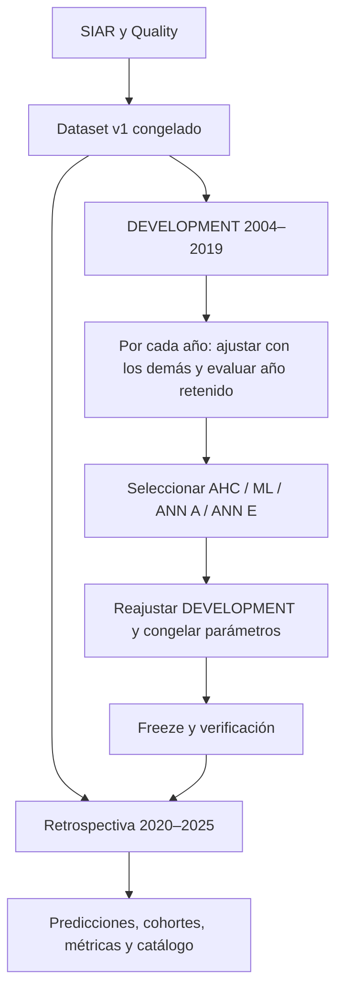
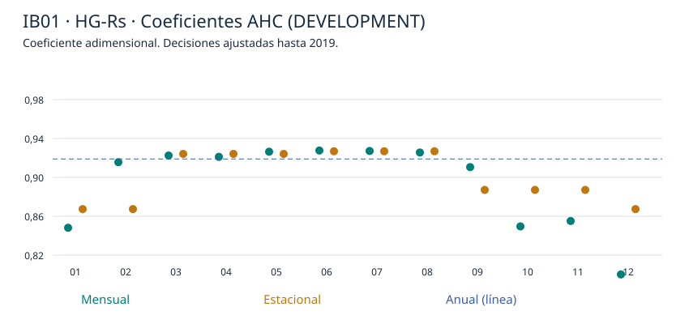
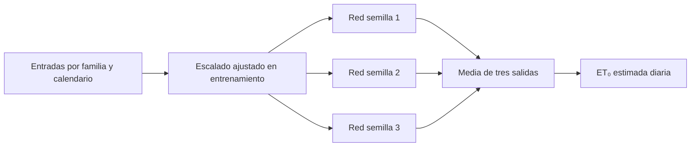
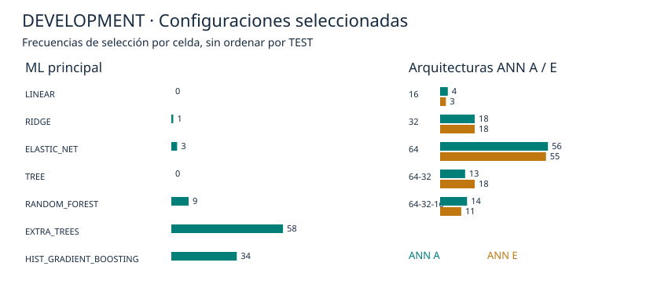
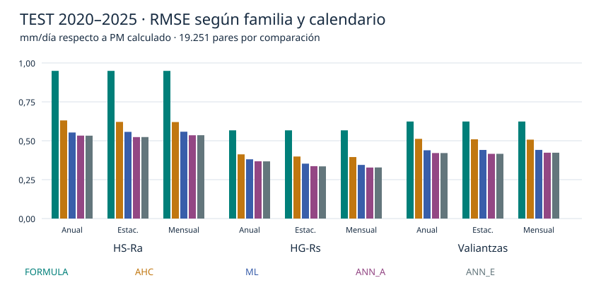
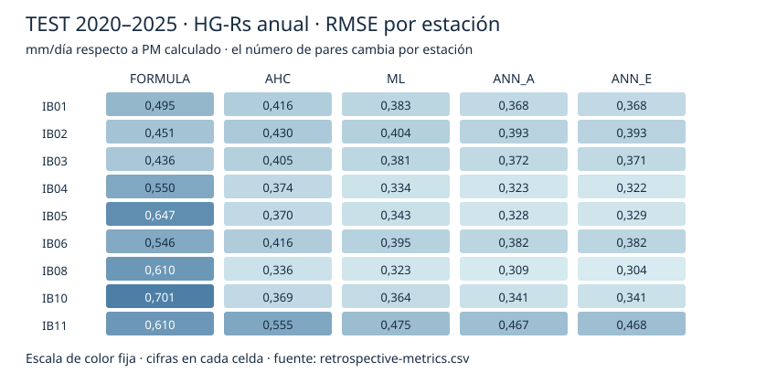
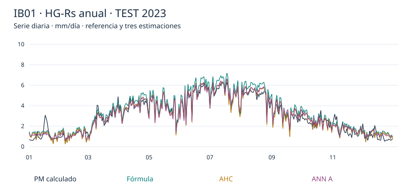
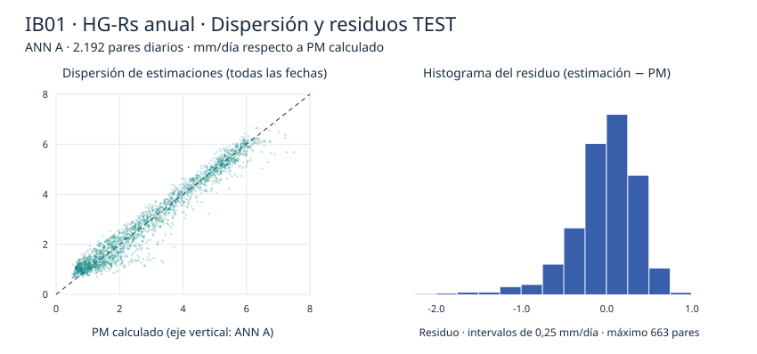

# Estimación de la evapotranspiración de referencia mediante fórmulas empíricas calibradas, aprendizaje automático y redes neuronales

## Desarrollo, validación retrospectiva y análisis comparativo con datos agroclimáticos SIAR de Baleares

> **Complemento de revisión incorporado el 27/11/2026.** La [auditoría científica independiente del TFG y TFM](et0_v2_auditoria_cientifica_tfg_tfm.md) compara los antecedentes y la campaña V2. Identifica concordancia descriptiva con límites de cohorte y referencia, posibles errores en fragmentos históricos y cuestiones abiertas sobre viento, unidades y métricas. Sus hallazgos deben contrastarse con los códigos efectivamente ejecutados y las fuentes originales. La publicación científica V2 permanece NOT_PUBLISHED.

**Memoria científica para revisión. No constituye una publicación académica ni una validación instrumental externa.** Código científico ejecutado: [`1e419ad881db1cc9798685ef19f414862461674b`](https://github.com/lependens/Capitulo-1/tree/1e419ad881db1cc9798685ef19f414862461674b). Dataset v1 SHA256 `0ddb10941710f6d3a945eae94fe6b9eca36ae4c12f28203e2364862920a49bbb`. Evaluación retrospectiva: Kaggle `370251881`; freeze SHA256 `97acad7ce7cc39c65d82f6efdc36290ed0325caaef2dedb69d9ffbefe1addfbd`.

## Índice

1. Resumen y abstract · 2. Introducción y antecedentes · 3. Objetivos e hipótesis · 4. Datos y estaciones · 5. Fundamentos matemáticos · 6. Diseño experimental · 7. AHC · 8. Aprendizaje automático clásico · 9. Redes neuronales · 10. Implementación y Kaggle · 11. Evaluación retrospectiva · 12. Resultados · 13. Discusión · 14. Conclusiones · 15. Reproducibilidad y auditoría · 16. Bibliografía · Anexos.

[Diseño y fold real](#6-diseño-experimental) · [AHC e IB01](#7-ajuste-ahc) · [ML](#8-aprendizaje-automático-clásico) · [ANN](#9-redes-ann-a-y-ann-e) · [Inventario de ajustes](#101-inventario-auditado-de-ajustes-y-artefactos) · [Resultados y figuras](#12-resultados) · [Experimentos futuros](#141-diseños-que-podrían-evaluarse-en-futuras-campañas) · [Reproducción](#15-reproducibilidad-y-auditoría) · [Bibliografía](#16-bibliografía) · [Malla ML](#k-malla-ml-completa) · [Resultados exhaustivos globales](#l-variantes-ml-y-resultados-globales) · [Explotación web](#m-posibilidades-de-explotación-y-web).

## 1. Resumen y abstract

La estimación de la evapotranspiración de referencia (ET₀) permite relacionar la demanda atmosférica con las necesidades de agua de los cultivos. La fórmula FAO-56 Penman–Monteith (PM) requiere más información meteorológica que otras aproximaciones. Este trabajo investiga hasta qué punto fórmulas empíricas y modelos estadísticos con tres familias de entradas pueden reproducir **una referencia PM calculada**, a partir de datos SIAR de Baleares. No compara las predicciones con evapotranspiración observada por lisímetros.

Se prepararon modelos por estación, familia de entradas y resolución anual, estacional o mensual. El desarrollo abarca 2004–2019, con disponibilidad dependiente de la estación; la evaluación retrospectiva abarca 2020–2025 y nueve estaciones. La selección utilizó validación por año dentro de DEVELOPMENT; los modelos y parámetros se congelaron antes de puntuar la retrospectiva. Se contrastaron la fórmula original, un ajuste multiplicativo por mínimos cuadrados sin intercepto (AHC), siete familias de aprendizaje automático y dos variantes de redes neuronales con tres semillas. Las métricas se calcularon sobre claves comunes, con cobertura propia separada.

En la cohorte anual común de 19.251 pares, HG-Rs produjo RMSE de 0,5670 mm/día; AHC, 0,4127; ML, 0,3809; ANN A, 0,3680; y ANN E, 0,3676. Para HS-Ra, los valores respectivos fueron 0,9491; 0,6307; 0,5530; 0,5331; y 0,5327. Las diferencias entre familias no igualan sus sensores. Estas cifras describen concordancia con PM en el conjunto retrospectivo: no demuestran mayor exactitud física ni extrapolación a estaciones nuevas. Algunas salidas no restringidas son negativas y se conservan sin truncar. Fuente: [resultados retrospectivos](et0_v2_retrospective_results_2026.md) y [evidencia de certificación](et0_v2_certificacion_evidencia.md).

**Abstract.** Reference evapotranspiration supports irrigation water demand assessment. We investigate whether empirical equations, calibrated models, classical machine learning and neural networks can reproduce a calculated FAO-56 Penman–Monteith reference using SIAR weather data from the Balearic Islands. Development spans 2004–2019, subject to station availability, and retrospective evaluation covers 2020–2025 at nine stations. Models are selected within development using held-out years and frozen before evaluation. On 19,251 common annual HG-Rs pairs, RMSE decreases from 0.5670 mm/day for the equation to 0.4127 for multiplicative calibration and 0.3676 for ANN E. Input requirements differ among families. The experiment assesses agreement with a calculated reference, not independent physical accuracy, prospective performance or transfer to unseen stations.

## 2. Introducción y antecedentes

La evapotranspiración combina evaporación y transpiración. FAO-56 define ET₀ sobre una superficie de referencia normalizada, de modo que la demanda climática puede distinguirse de las características de un cultivo concreto. Una aproximación de necesidades del cultivo emplea ETc = Kc · ET₀, con coeficientes y condiciones apropiadas: esta memoria no estima ETc ni recomienda riegos. La metodología FAO emplea PM como procedimiento normalizado y describe el cálculo con datos limitados [1].

Las fórmulas con menos entradas son útiles cuando faltan sensores, pero introducen aproximaciones climáticas. Hargreaves–Samani utiliza temperaturas extremas y radiación extraterrestre calculada [2]. La variante con radiación solar medida tiene requerimientos distintos [3]. La formulación adoptada de Valiantzas combina temperatura y humedad con una estimación de radiación, siguiendo la composición explicitada en la investigación de Martí y colaboradores [4]. Los métodos de calibración pueden reducir discrepancias locales, pero deben evaluarse fuera de las observaciones con las que se ajustaron.

Los árboles, bosques y redes representan relaciones no lineales sin sustituir la necesidad de validación [5, 6]. Aquí aprenden la salida de una fórmula calculada y no una medición física independiente. El trabajo se apoya en el TFG histórico y su legado metodológico, pero constituye una campaña versionada distinta: no traslada automáticamente resultados o decisiones históricas a V2. El protocolo V2 deja un año fuera dentro de DEVELOPMENT; no debe confundirse con la validación rolling de la campaña ML V1.

## 3. Objetivos e hipótesis

El objetivo general es caracterizar la concordancia con PM calculado de alternativas que requieren diferentes variables, mediante un procedimiento reproducible. Objetivos específicos: preservar la procedencia y la calidad de los datos; comparar fórmulas y ajuste multiplicativo; evaluar siete algoritmos y dos variantes ANN; medir errores y cobertura por estación y calendario; y entregar artefactos verificables para análisis posterior.

La hipótesis de trabajo es que una calibración local o una relación no lineal puede reducir discrepancias respecto a las fórmulas sin ajustar. No implica que siempre lo haga en cada estación, época o condición. La comparación entre ANN A y E investiga sensibilidad a la selección interna de época, sin presuponer cuál es superior. La aceptabilidad operativa requiere además criterios de coste, sensores, robustez y validación externa que aquí no se fijaron.

## 4. Datos meteorológicos y estaciones

La fuente es SIAR, cuyos datos fueron preservados y sometidos a un cierre Quality antes de construir el Dataset Observational v1. El SHA256 del dataset se indica en portada. El conjunto conserva datos y banderas, y el pipeline aplica elegibilidad por método sin borrar globalmente una observación. En las fuentes, radiación se interpreta en MJ m⁻² día⁻¹ y viento en m/s; se utiliza directamente como viento a 2 m según la convención SIAR y el legado, sin verificación exhaustiva estación-periodo de la altura efectiva. Temperaturas se expresan en °C y humedad relativa en porcentaje. La media usada en los modelos se calcula como (Tmax + Tmin)/2; no reemplaza la columna original de SIAR.

La vista V2 incluye 12 códigos: IB01–IB11 e IB101, con tratamiento según soporte. IB07, IB09 e IB101 son históricas y no aportan observaciones retrospectivas. IB09 fue admitida únicamente en DEVELOPMENT por decisión de Dirección: periodo de catálogo inclusivo 24-10-2005 a 10-10-2018; Quality V1 sigue FAIL y la verificación oficial independiente del periodo permanece UNRESOLVED. La fila 23-10-2005 se excluyó. Se reconciliaron 4.423 filas de origen, 4.422 interiores, una exterior y 313 ausencias confirmadas; 4.390 fechas comunes elegibles corresponden al inventario V2. Véanse [preparación](et0_v2_preparation.md) y [ejecución](et0_v2_execution.md).

En la tabla siguiente `PM n` cuenta días con referencia y `pred n` salidas presentes de ANN A/HG-Rs anual; el denominador de calendario es 2.192 por estación. Pares y RMSE se refieren a la cohorte común. Las diferencias entre `pred n` y `PM n` son posibles porque la salida puede existir sin referencia. Fuente: `retrospective-metrics.csv` del [catálogo](et0_v2_handoff_web.md), grupos `station`, `HG_RS_V1`, `annual`, `ANN_A`.

| Estación | Días calendario | PM n | Pred n | Pares comunes | RMSE mm/día |
|---|---:|---:|---:|---:|---:|
| IB01 | 2192 | 2192 | 2192 | 2192 | 0,3683 |
| IB02 | 2192 | 2017 | 2018 | 2017 | 0,3933 |
| IB03 | 2192 | 2192 | 2192 | 2192 | 0,3715 |
| IB04 | 2192 | 2124 | 2125 | 2124 | 0,3231 |
| IB05 | 2192 | 2154 | 2154 | 2154 | 0,3283 |
| IB06 | 2192 | 2190 | 2192 | 2190 | 0,3824 |
| IB08 | 2192 | 2097 | 2099 | 2097 | 0,3092 |
| IB10 | 2192 | 2097 | 2103 | 2097 | 0,3406 |
| IB11 | 2192 | 2188 | 2192 | 2188 | 0,4674 |

La localización exacta, altitud, fechas de vigencia y procedencia de cada sensor deben leerse del catálogo de estaciones asociado al dataset; no se infieren coordenadas a partir del código. Las series cortas no tienen la misma capacidad de validación temporal: IB101 presenta solo 246 pares en los ejemplos anuales siguientes y tres celdas mensuales sin soporte de selección.

La siguiente identificación procede de `inputs/estaciones_baleares.csv`, SHA256 `98abd16dcd6ea42ad46a30c331df47150f07dffdca140c14e4445890ce68a357`, y de los metadatos incorporados en Dataset v1. La fecha de instalación o baja es la **de catálogo**, no prueba de funcionamiento continuo ni de validez histórica independiente del periodo. Latitud se expresa en grados decimales norte y altitud en metros.

| Código | Nombre de catálogo | Latitud | Altitud | Instalación | Baja |
|---|---|---:|---:|---|---|
| IB01 | Santa Eulalia | 39,0100 | 120 | 2004-03-30 | — |
| IB02 | Inca | 39,6836 | 78 | 2004-03-31 | — |
| IB03 | Manacor | 39,5458 | 79 | 2004-04-01 | — |
| IB04 | Son Ferriol | 39,5622 | 8 | 2004-04-01 | — |
| IB05 | Felanitx | 39,4753 | 82 | 2004-04-05 | — |
| IB06 | Sa Pobla | 39,8028 | 4 | 2004-04-05 | — |
| IB07 | Sóller | 39,7803 | 44 | 2004-08-11 | 2012-11-13 |
| IB08 | Es Mercadal | 40,0036 | 40 | 2005-10-05 | — |
| IB09 | Artá | 39,6972 | 105 | 2005-10-24 | 2018-10-10 |
| IB10 | Calviá | 39,5511 | 30 | 2005-10-08 | — |
| IB101 | Ciutadella | 39,9653 | 21 | 2008-12-02 | 2009-08-10 |
| IB11 | S' Estany des Peix | 38,7269 | 7 | 2005-10-10 | — |

Las coordenadas se reproducen del dataset sin reinterpretar su fuente; no se ha reconstruido la historia de cambios de emplazamiento. La baja de IB07 coincide con el día RECOVERED `2012-11-13` del ledger corregido. En IB09 la excepción se limita a las fechas de catálogo citadas, no equivale a certificar externamente ese periodo.

## 5. Fundamentos matemáticos

### 5.1. Penman–Monteith de referencia

La implementación diaria [PM](https://github.com/lependens/Capitulo-1/blob/1e419ad881db1cc9798685ef19f414862461674b/scientific_pipeline/src/siar_science/penman_monteith.py) calcula, con G = 0 para el paso diario:

$$ET_0=\frac{0.408\Delta R_n+\gamma\frac{900}{T+273}u_2(e_s-e_a)}{\Delta+\gamma(1+0.34u_2)}.$$

ET₀ está en mm/día; Rn en MJ m⁻² día⁻¹; T en °C; u₂ en m/s; es y ea en kPa; Δ y γ en kPa/°C. El factor 0,408 convierte energía en evaporación equivalente. El modelo calcula radiación extraterrestre Ra a partir de latitud y día, radiación de cielo despejado Rso, radiación neta de onda corta con albedo 0,23 y onda larga. Rs/Rso tiene techo 1; no se aplica un suelo arbitrario al factor de nubosidad. El tratamiento de diferencias diminutas entre es y ea es una tolerancia numérica explícita, no calibración de la fórmula.

La presión atmosférica se estima a partir de la altitud z en metros: `P = 101,3 [(293 − 0,0065 z)/293]^5,26` kPa, y `γ = 0,000665 P`. La presión de vapor saturante a temperatura t es `e°(t) = 0,6108 exp[17,27 t/(t + 237,3)]`. La implementación usa `es = [e°(Tmin) + e°(Tmax)]/2` y `ea = [e°(Tmin) HRmax/100 + e°(Tmax) HRmin/100]/2`; no utiliza e° de la temperatura media para sustituir es. La pendiente Δ se evalúa en T: `4098 e°(T)/(T+237,3)²`. Para el déficit `es − ea`, únicamente un exceso negativo atribuible a redondeo de hasta 10⁻¹² kPa se trata como cero; una diferencia material se rechaza. Fuente: [`atmosphere.py`](https://github.com/lependens/Capitulo-1/blob/1e419ad881db1cc9798685ef19f414862461674b/scientific_pipeline/src/siar_science/atmosphere.py).

La geometría solar emplea el ordinal del día J, latitud φ en radianes, `dr = 1 + 0,033 cos(2πJ/365)`, declinación `δ = 0,409 sin(2πJ/365 − 1,39)` y ángulo horario de puesta `ωs = arccos(−tan φ tan δ)`, con límites numéricos del argumento. La radiación extraterrestre es `Ra = (24·60/π)·0,0820·dr [ωs sin φ sin δ + cos φ cos δ sin ωs]`; `Rso = (0,75 + 2·10⁻⁵ z) Ra`. La aproximación usa 365 también en años bisiestos. Véase [`solar.py`](https://github.com/lependens/Capitulo-1/blob/1e419ad881db1cc9798685ef19f414862461674b/scientific_pipeline/src/siar_science/solar.py).

Para Rnl se usan temperaturas absolutas `Tmin+273,16` y `Tmax+273,16`, constante de Stefan–Boltzmann diaria 4,903·10⁻⁹, término de humedad `(0,34−0,14√ea)` y nubosidad `(1,35 min(Rs/Rso,1)−0,35)`. Luego `Rn = 0,77 Rs − Rnl`. Un factor de nubosidad negativo se conserva y recibe bandera científica; no se corrige silenciosamente. En el término aerodinámico PM el código utiliza `T+273`, que es una convención separada de la conversión Kelvin para onda larga.

### 5.2. Fórmulas con menos entradas

Con D = Tmax − Tmin y T = (Tmax + Tmin)/2:

$$HS\_Ra=0.0023\cdot0.408\,R_a(T+17.8)\sqrt D.$$

$$HG\_Rs=0.0135\cdot0.408\,R_s(T+17.8).$$

Aquí Ra y Rs están en MJ m⁻² día⁻¹ y las salidas en mm/día. HG-Rs utiliza Rs **medida** y no multiplica por la raíz del rango térmico. Para Valiantzas, la composición implementada es:

$$\widehat R_s=0.338R_aD^{0.3}(1.001-HR_{media}/100)^{0.2},\qquad ET_0=0.0135\cdot0.408\,\widehat R_s(T+17.8).$$

El coeficiente expandido es 0,001861704 con Ra en MJ m⁻² día⁻¹. La implementación declara explícitamente la conversión energética y adopta humedad media diaria, no mínima. La composición se basa en las ecuaciones citadas por Martí et al. [4]; no debe interpretarse como transcripción literal de una ecuación escrita con otras unidades. Fuentes ejecutadas: [HS-Ra](https://github.com/lependens/Capitulo-1/blob/1e419ad881db1cc9798685ef19f414862461674b/scientific_pipeline/src/siar_science/hargreaves.py), [HG-Rs](https://github.com/lependens/Capitulo-1/blob/1e419ad881db1cc9798685ef19f414862461674b/scientific_pipeline/src/siar_science/hargreaves_rs.py) y [Valiantzas](https://github.com/lependens/Capitulo-1/blob/1e419ad881db1cc9798685ef19f414862461674b/scientific_pipeline/src/siar_science/valiantzas.py). Ninguna fórmula básica recibe calibración local ni truncado en cero.

El artículo de Martí et al. presenta una ecuación expandida con coeficiente 0,004563 y, por separado, una ecuación que divide la radiación en MJ m⁻² día⁻¹ por λ=2,45 MJ kg⁻¹. La composición ejecutada aplica explícitamente 0,408 ≈ 1/2,45: `0,338·0,0135·0,408=0,001861704`. La relación entre 0,004563 y el coeficiente ejecutado es aproximadamente 2,45. La elección de V2 es la composición documentada, no una afirmación de equivalencia literal con el coeficiente impreso; la interpretación dimensional de esta diferencia permanece señalada para revisión externa de la fuente primaria. El propio artículo original está accesible en el [repositorio de la UIB](https://dspace.uib.es/xmlui/bitstream/handle/11201/168425/170384.pdf?isAllowed=y&sequence=1).

### 5.3. Ajuste y métricas

Para un grupo de entrenamiento, con xᵢ fórmula y yᵢ PM calculado, AHC minimiza Σ(yᵢ − c xᵢ)² sin intercepto:

$$c=\frac{\sum_i x_i y_i}{\sum_i x_i^2},\qquad \widehat y_i=cx_i.$$

El coeficiente es adimensional y exige denominador positivo. No es la media aritmética de cocientes empleada en parte del legado. Para pares comparables, error eᵢ = predicción − referencia: MAE = media |eᵢ|; RMSE = raíz de la media de eᵢ²; sesgo = media eᵢ; R² predictivo = 1 − Σeᵢ²/Σ(yᵢ − ȳ)². MAE, RMSE y sesgo están en mm/día. R² puede ser negativo y no se define con referencia constante; no es correlación al cuadrado. n cuenta pares, incluidos objetivos cero cuando son elegibles.

## 6. Diseño experimental

La unidad de ajuste es estación × familia × resolución. Annual usa un grupo de coeficiente; seasonal usa DJF, MAM, JJA y SON; monthly usa meses 01–12. Las salidas son **diarias** en todas las resoluciones: annual, seasonal y monthly describen la segmentación de la calibración o indicadores de calendario, no una agregación temporal del valor diario.



En cada fold exterior se reserva un año de DEVELOPMENT y se entrena con los demás. Es una validación retrospectiva por años, **no una simulación rolling de pronóstico hacia adelante**: algunos años de entrenamiento pueden ser posteriores al año retenido. Se exigen al menos dos folds soportados; la selección minimiza la media no ponderada de RMSE anual en los años elegibles y usa dispersión y desempates fijados. Las categorías de calendario deben tener soporte en los ajustes internos de A y E; los modelos se puntúan sobre las mismas claves exteriores de cada celda. Los años 2020–2025 no seleccionan parámetros ni modelos.

El código y el protocolo separan entradas por familia: HS-Ra usa Tmin, Tmax y Ra; HG-Rs la media de extremos y Rs; Valiantzas Tmin, Tmax, HRmedia y Ra. El mismo vector base se suministra a AHC indirectamente a través de la fórmula y a ML/ANN directamente; ML/ANN añaden indicadores estacionales o mensuales cuando corresponde. No se puede afirmar igualdad de entradas **entre** familias. Véanse [contrato](et0_v2_preparation.md), [implementación de soporte](https://github.com/lependens/Capitulo-1/blob/1e419ad881db1cc9798685ef19f414862461674b/scientific_pipeline/src/siar_science/et0_v2_support.py) y [protocolo](../experiments/et0-v2-preparation.json).

### 6.1. Cómo se cuentan las combinaciones

~~~mermaid
flowchart LR
    S["12 estaciones"] --> F["3 familias meteorológicas por estación"]
    F --> C["3 configuraciones de calendario por familia"]
    C --> X["108 celdas potenciales"]
    X --> A["108 fichas AHC · coeficientes por grupo"]
    X --> B["105 celdas con ≥2 folds puntuables"]
    X --> U["3 celdas de IB101 mensual · sin selección"]
    B --> M["37 candidatos ML por celda"]
    B --> N["5 arquitecturas × 3 semillas por variante ANN"]
    M --> R["Reajuste DEVELOPMENT · 7 variantes ML"]
    N --> T["Reajuste DEVELOPMENT · 1 ensemble por variante"]
~~~

La unidad de comparación es una **celda**, la clave estación × familia × configuración temporal. Una fórmula calcula ET₀ diaria con una ecuación y su conjunto de variables. AHC multiplica esa estimación por un **coeficiente** de su grupo temporal. Un **algoritmo ML** es una clase de estimador y una **configuración** fija sus hiperparámetros. Una **arquitectura ANN** fija las capas, mientras que la **semilla** gobierna la inicialización dentro de una ejecución. El **fold** delimita las fechas de ajuste y puntuación.

Un **checkpoint** de candidato recoge los resultados de todos los folds válidos y, para ANN, las tres semillas por fold. Un **ajuste** corresponde a entrenar un estimador o una red en una partición. La **selección** decide la configuración con métricas DEVELOPMENT y el **reajuste** produce el objeto ajustado con todo DEVELOPMENT elegible. Una **red individual** produce una salida y el **ensemble** combina las tres salidas de una variante. El **modelo congelado** enlaza a los archivos ajustados por hash, con su configuración y selección. Una **predicción retrospectiva** es una salida diaria de ese objeto aplicada a una fecha del periodo reservado.

Las tres celdas IB101 × familia × mensual existen para AHC y contienen grupos identificables sobre todo DEVELOPMENT, pero carecen de dos años exteriores puntuables. Los meses presentes en 2008 y 2009 no se solapan. El soporte de AHC, la disponibilidad del grupo en ambos ajustes internos y el mínimo de dos folds se aplican antes de seleccionar. IB101 conserva soporte anual y estacional en las tres familias. [Soporte y criterios congelados](https://github.com/lependens/Capitulo-1/blob/1e419ad881db1cc9798685ef19f414862461674b/scientific_pipeline/src/siar_science/et0_v2_support.py#L44-L100).

| Estación | Folds por celda | Celdas | Alcance |
| --- | --- | --- | --- |
| IB01 | 16 | 9 | Todas las soportadas de esta estación |
| IB02 | 16 | 9 | Todas las soportadas de esta estación |
| IB03 | 16 | 9 | Todas las soportadas de esta estación |
| IB04 | 16 | 9 | Todas las soportadas de esta estación |
| IB05 | 16 | 9 | Todas las soportadas de esta estación |
| IB06 | 16 | 9 | Todas las soportadas de esta estación |
| IB07 | 9 | 9 | Todas las soportadas de esta estación |
| IB08 | 15 | 9 | Todas las soportadas de esta estación |
| IB09 | 14 | 9 | Todas las soportadas de esta estación |
| IB101 | 2 | 6 | Todas las soportadas de esta estación |
| IB10 | 15 | 9 | Todas las soportadas de esta estación |
| IB11 | 15 | 9 | Todas las soportadas de esta estación |

### 6.2. De los sensores al vector de entradas

| Familia | Entradas originales y sensor | Variables derivadas | Razón de diseño |
| --- | --- | --- | --- |
| HS-Ra | Tmin, Tmax en °C, termómetro | Ra en MJ m⁻² día⁻¹, calculada a partir de latitud y fecha | Contrasta un escenario con temperatura y metadatos, sin radiómetro. |
| HG-Rs | Tmin, Tmax en °C y Rs en MJ m⁻² día⁻¹, termómetro y radiómetro | Tmedia de extremos = (Tmin + Tmax)/2, en °C | Contrasta el escenario con radiación solar incidente medida. |
| Valiantzas | Tmin, Tmax en °C y HR media en %, termómetro e higrómetro | Ra calculada de latitud y fecha. La fórmula deriva una Rs estimada, pero los predictores ML/ANN reciben Ra y HR directamente. | Evalúa la disponibilidad de humedad en ausencia de radiómetro. |

| Familia | Vector base y orden | Calendario anual | Calendario estacional | Calendario mensual |
| --- | --- | --- | --- | --- |
| HS-Ra | [Tmin, Tmax, Ra] | 3 entradas, +0 | 7 entradas, +4 | 15 entradas, +12 |
| HG-Rs | [Tmedia de extremos, Rs] | 2 entradas, +0 | 6 entradas, +4 | 14 entradas, +12 |
| Valiantzas | [Tmin, Tmax, HRmedia, Ra] | 4 entradas, +0 | 8 entradas, +4 | 16 entradas, +12 |

Ejemplo real de IB01 el 30 de marzo de 2004. El vector HS-Ra anual es `[10,06; 15,20; 31,616142556]`. El estacional añade `[0, 1, 0, 0]` en orden DJF–MAM–JJA–SON y el mensual añade doce indicadores con un 1 en la tercera posición. Pasa al modelo propio de la celda de esa resolución. **ML y ANN ajustan un estimador o ensemble por celda y usan los indicadores como entradas, no un modelo independiente por mes o estación climática.** AHC sí aplica un multiplicador distinto para cada grupo disponible. Las tres salidas corresponden a **ET₀ diaria en mm/día**. [Construcción de entradas](https://github.com/lependens/Capitulo-1/blob/1e419ad881db1cc9798685ef19f414862461674b/scientific_pipeline/src/siar_science/et0_v2.py#L33-L49) · [Indicadores y grupos](https://github.com/lependens/Capitulo-1/blob/1e419ad881db1cc9798685ef19f414862461674b/scientific_pipeline/src/siar_science/et0_v2_support.py#L9-L24).

### 6.3. Un fold real de IB01

Para HG-Rs, la cápsula contiene **5.524 filas** IB01 de DEVELOPMENT. **5.512** tienen salida objetivo PM válida y entradas de la familia disponibles. Las otras 12 no forman pares para esta familia. Se muestra el último año exterior como ejemplo, con la disponibilidad original del año intacta.

~~~mermaid
flowchart LR
    A["2004–2018 · IB01 · 5.147 pares"] --> B["A o E · 4.374 ajuste interno + 773 validación"]
    B --> C["Elegir épocas y reajustar sobre los 5.147"]
    C --> D["2019 retenido · 365 pares · puntuación exterior"]
    D --> E["Selección con todos los folds · 5.512 pares para reajuste final"]
    E --> F["Freeze global"]
    F --> G["2020–2025 · TEST reservado"]
~~~

| Ámbito | Filas / pares | Uso |
| --- | --- | --- |
| DEVELOPMENT IB01/HG-Rs | 5.524 filas; 5.512 pares; 12 excluidas de ese pareado | Fuente de los folds y del reajuste posterior. |
| Entrenamiento exterior 2004–2018 | 5.147 pares | Ajuste de AHC/ML y conjunto del que salen las particiones internas ANN. |
| Interior A y E | 4.374 + 773 pares en cada regla | A toma los últimos 773 días elegibles ordenados, E toma 773 por orden de hash. Conjuntos de igual tamaño y criterio de selección distinto. |
| Retenido 2019 | 365 filas de cápsula, 365 elegibles, 0 excluidas; 365 puntuables en las tres resoluciones | Calcula el error exterior. Queda fuera del ajuste de pesos, escala y épocas de ese fold. |
| Ajuste final y TEST | 5.512 pares para ajustar, TEST posterior al freeze | Para redes se fijan arquitectura y épocas por semilla antes del ajuste final. TEST se usa solo para evaluar las configuraciones congeladas. |

El plan de 2019 tiene SHA256 `75588fc8d86dfe8cbdb1981e4b775fdd6e4cb2d654581fa914ac896de0905352` en `support-inventory.json`. En otros folds pueden entrenar años posteriores al retenido, siempre dentro de 2004–2019. En rolling-origin solo entrenan fechas anteriores a cada corte. El ejemplo terminal de 2019 comparte ese orden por construcción, pero no convierte la selección de V2 en rolling-origin. El bloqueo debe corresponder a si se quiere evaluar transferencia temporal o espacial [12].

## 7. Ajuste AHC

En cada fold, los coeficientes se calculan exclusivamente con los años de entrenamiento del fold y se aplican al año retenido. Después se ajustan por grupo con DEVELOPMENT completo y se congelan para la retrospectiva. Un AHC calculado con todo el histórico, incluida la retrospectiva, se publica en una tabla **in-sample** independiente: no sirve para afirmar generalización fuera de muestra.

Ejemplos de coeficientes anuales congelados, extraídos de `frozen-run/AHC/<estación>__<familia>__annual/frozen.json`, campo `ahc.groups.annual`: IB01 HS-Ra 0,893456 (n=5.512), HG-Rs 0,918964 (n=5.512), Valiantzas 0,980209 (n=5.512); IB09 respectivamente 0,803193, 0,840085 y 0,880614 (n=4.390); IB101 1,096818, 0,903114 y 1,130896 (n=246). Son ajustes DEVELOPMENT, no coeficientes de histórico completo. Comparar la precisión de IB101 con IB01 sin tener en cuenta soporte sería improcedente. Integridad: [certificación](et0_v2_certificacion_evidencia.md).

### 7.1. Inventario de coeficientes


| Configuración | Celdas | Folds puntuados | Grupos finales registrados | Grupos esperables | c finales identificados | Grupos registrados en folds | c identificados en folds |
| --- | --- | --- | --- | --- | --- | --- | --- |
| Anual | 36 | 498 | 36 | 36 | 36 | 498 | 498 |
| Estacional | 36 | 498 | 141 | 144 | 141 | 1980 | 1980 |
| Mensual | 36 | 492 | 423 | 432 | 423 | 5904 | 5904 |

Se verificaron **600 coeficientes congelados** y **8.382 coeficientes de fold**. Los grupos finales ausentes son 12 de 612 esperables, todos de IB101, con SON y septiembre–noviembre sin pares para cada familia. En los folds puntuados hay 8.394 huecos teóricos de grupos, 12 sin datos: las tres celdas estacionales IB101 aportan dos folds y dos grupos ausentes por fold. Esta comparación se limita a folds que el ejecutor puntúa. En el histórico completo aparecen **36 coeficientes anuales** descriptivos, separados de las 600 estimaciones DEVELOPMENT. Algunos históricos no añaden TEST porque sus estaciones terminaron antes de 2020. Fuente `AHC/index.json`, `AHC/<celda>/frozen.json` y `ahc-full-history-in-sample.csv`.

### 7.2. IB01 y HG-Rs desde el dato hasta el error

1. En `IB01_datos_completos.csv`, fila de origen 2 del 30-03-2004, Dataset v1 conserva Tmin 10,06 °C, Tmax 15,20 °C, HR mínima/máxima 66,11/96,4 %, Rs 1,787 MJ m⁻² día⁻¹ y viento 2,011 m/s. El código obtiene presión a 120 m, radiación neta y presiones de vapor y aplica la ecuación diaria del capítulo 5. La salida PM de la cápsula es **1,186559563 mm/día**. Los supuestos de radiación y viento y las banderas de esta fecha aparecen en §10. [Implementación PM](https://github.com/lependens/Capitulo-1/blob/1e419ad881db1cc9798685ef19f414862461674b/scientific_pipeline/src/siar_science/penman_monteith.py#L68-L110).
2. Con media de extremos 12,63 °C, `HG-Rs = 0,0135 × 0,408 × 1,787 × (12,63 + 17,8)` da **0,299516282 mm/día**. La estimación empírica es $x_i$, la salida PM es $y_i$. Solo entran fechas con ambas estimaciones disponibles y válidas según las reglas de la celda.
3. El coeficiente anual minimiza `Σ(yᵢ − c xᵢ)²`. La derivada es `−2Σxᵢ(yᵢ − c xᵢ)`; al anularla se obtiene `c = Σ(xᵢ yᵢ) / Σ(xᵢ²)` si el denominador es positivo. Anualmente, `Σxᵢ² = 82.240,863781` y el numerador deducido de los valores archivados es `≈75.576,365507`, con **c = 0,918963664**. En el fold 2019 el ajuste usó 5.147 pares y dio **0,918719833** (Σx² = 77.055,410064), con RMSE exterior **0,4206515 mm/día** en 365 días.
4. Tras cerrar los folds se ajusta con todo DEVELOPMENT. Las tablas siguientes reproducen los coeficientes finales a partir de `AHC/IB01__HG_RS_V1__{annual,seasonal,monthly}/frozen.json → ahc.groups`, verificados contra su índice. El ajuste es 30-03-2004 a 31-12-2019 según la disponibilidad de esa estación. El anexo B recoge los enlaces de trazabilidad. El histórico completo de esta celda produjo **0,921039617** sobre 7.704 pares e incluye los 2.192 días de TEST, por lo que su error es dentro de muestra.


| Configuración | Grupo | Meses | n | Σx² | c |
| --- | --- | --- | --- | --- | --- |
| Anual | annual | Ene–dic | 5512 | 82240,86 | 0,91896366 |
| Estacional | DJF | Dic–feb | 1251 | 2455,46 | 0,86739016 |
| Estacional | JJA | Jun–ago | 1470 | 47803,33 | 0,92689110 |
| Estacional | MAM | Mar–may | 1367 | 20680,26 | 0,92417549 |
| Estacional | SON | Sep–nov | 1424 | 11301,81 | 0,88710125 |
| Mensual | 01 | 01 | 422 | 704,05 | 0,84817731 |
| Mensual | 02 | 02 | 365 | 1136,68 | 0,91564361 |
| Mensual | 03 | 03 | 408 | 3210,29 | 0,92252525 |
| Mensual | 04 | 04 | 473 | 6404,92 | 0,92116285 |
| Mensual | 05 | 05 | 486 | 11065,04 | 0,92639811 |
| Mensual | 06 | 06 | 480 | 16319,27 | 0,92766775 |
| Mensual | 07 | 07 | 495 | 17894,66 | 0,92716407 |
| Mensual | 08 | 08 | 495 | 13589,41 | 0,92559898 |
| Mensual | 09 | 09 | 480 | 6851,54 | 0,91056260 |
| Mensual | 10 | 10 | 496 | 3334,11 | 0,84958576 |
| Mensual | 11 | 11 | 448 | 1116,16 | 0,85514758 |
| Mensual | 12 | 12 | 464 | 614,73 | 0,80017044 |



El coeficiente estacional se repite en los meses de su grupo. Los puntos mensuales muestran cuánto cambia la escala entre meses dentro de una misma estación climática. Se aprecia variación de escala, pero la figura por sí sola no demuestra una reducción de error fuera de muestra.

Se eligieron el primer, el mediano superior y el último día elegible de TEST IB01/HG-Rs. Se cotejó para las tres fechas `c × fórmula` con las salidas preservadas hasta tolerancia numérica de 10⁻¹². Las estimaciones y errores están en mm/día, con signo estimación − PM.

| Fecha | PM | Fórmula | Error fórmula | c anual | c estacional | c mensual | Anual / error | Estacional / error | Mensual / error |
| --- | --- | --- | --- | --- | --- | --- | --- | --- | --- |
| 2020-01-01 | 0,5892 | 0,7332 | 0,1440 | 0,918964 | 0,867390 | 0,848177 | 0,6738 / 0,0846 | 0,6360 / 0,0467 | 0,6219 / 0,0327 |
| 2023-01-01 | 0,7116 | 1,4740 | 0,7624 | 0,918964 | 0,867390 | 0,848177 | 1,3546 / 0,6429 | 1,2785 / 0,5669 | 1,2502 / 0,5386 |
| 2025-12-31 | 0,5853 | 1,0489 | 0,4636 | 0,918964 | 0,867390 | 0,800170 | 0,9639 / 0,3786 | 0,9098 / 0,3245 | 0,8393 / 0,2540 |


| Configuración | n | MAE | RMSE | Sesgo | R² | Cob. |
| --- | --- | --- | --- | --- | --- | --- |
| Anual | 2192 | 0,3111 | 0,4156 | -0,0522 | 0,9416 | 100,00 % |
| Estacional | 2192 | 0,3006 | 0,4095 | -0,0741 | 0,9433 | 100,00 % |
| Mensual | 2192 | 0,2980 | 0,4094 | -0,0817 | 0,9434 | 100,00 % |

En los mismos 2.192 pares, pasar de un coeficiente a cuatro reduce el RMSE 0,0061 mm/día y añadir ocho más cambia aproximadamente 0,0001. Al mismo tiempo el sesgo se vuelve más negativo. Este resultado ilustra que una reducción del RMSE no implica mejorar en todas las métricas. Fuente `retrospective-metrics.csv`, estación IB01, familia HG-Rs.

## 8. Aprendizaje automático clásico

Por cada celda soportada se evaluaron 37 configuraciones: regresión lineal (1), Ridge (6), Elastic Net (12), árbol (6), Random Forest (4), Extra Trees (4) e HistGradientBoosting (4). El registro exacto de parámetros está en [ml-v1-classical.json](../experiments/ml-v1-classical.json); V2 reutiliza su malla y orden de complejidad, pero **no** su partición ni su regla rolling V1. La selección V2 utiliza la media anual no ponderada y su dispersión según el protocolo V2.

Los modelos lineales incorporan `StandardScaler` ajustado dentro de cada entrenamiento; los árboles no requieren escalado. Se elige una configuración por algoritmo y una principal por celda; las siete se reajustan con DEVELOPMENT y se serializan. Elastic Net permite 20.000 iteraciones y tolerancia 10⁻⁶. Se registraron 51 candidatos con avisos en folds y siete reajustes que no alcanzaron tolerancia; ninguno era el principal de su celda. Las variantes afectadas conservan esa advertencia y no se modificaron para forzar convergencia. Fuente: [evidencia](et0_v2_certificacion_evidencia.md) y [`et0_v2_models.py`](https://github.com/lependens/Capitulo-1/blob/1e419ad881db1cc9798685ef19f414862461674b/scientific_pipeline/src/siar_science/et0_v2_models.py).

La regresión lineal estima una suma ponderada de entradas; Ridge penaliza magnitudes de coeficientes y Elastic Net combina penalizaciones L1 y L2. Los árboles dividen el espacio de entrada por umbrales; los bosques promedian árboles con aleatoriedad y el boosting suma correctores sucesivos. Estas descripciones explican las familias, pero el resultado concreto depende de su malla y de la muestra. Los árboles candidatos fijan profundidades 4, 8 y 12 con dos políticas de tamaño mínimo; los dos bosques utilizan 200 árboles por configuración; boosting usa 200 iteraciones con tasas 0,05 o 0,1. El protocolo conserva los valores detallados de profundidad, hojas, regularización y semillas. Un `Pipeline` con escalador evita ajustar la escala sobre el año retenido.

### 8.1. Siete estimadores y 37 candidatos

| Identificador | Modelo y fundamento | Flexibilidad y coste relativo | Ventaja y límite para ET₀ |
| --- | --- | --- | --- |
| LINEAR | Mínimos cuadrados con intercepto sobre variables estandarizadas | Aditivo y lineal; un ajuste barato | Referencia interpretable; no representa interacciones no lineales salvo que estén codificadas. |
| RIDGE | Mínimos cuadrados más penalización L2 | Aditivo, lineal; coste bajo | Estabiliza coeficientes con entradas correlacionadas; mayor penalización puede subajustar. |
| ELASTIC_NET | Pérdida cuadrática con combinación L1 y L2 | Aditivo y lineal; optimización iterativa | Puede reducir coeficientes a cero; sensibilidad a escala, penalización y convergencia. |
| TREE | Divisiones recursivas minimizando error cuadrático dentro de nodos | No lineal con interacciones; coste moderado | Umbrales fáciles de inspeccionar; modelo por tramos y sensible a datos del nodo. |
| RANDOM_FOREST | Promedio de árboles con bootstrap y selección de variables por nodo | No lineal; 200 árboles por candidato | Reduce varianza del árbol individual; mayor coste y memoria, extrapolación limitada. |
| EXTRA_TREES | Árboles con umbrales aleatorizados, sin bootstrap en este protocolo | No lineal; 200 árboles por candidato | Puede reducir correlación entre árboles; añade aleatoriedad y conserva límites de extrapolación. |
| HIST_GRADIENT_BOOSTING | Suma de árboles que corrigen el error usando variables agrupadas en bins | No lineal; 200 iteraciones de corrección secuencial | Capta interacciones; profundidad efectiva y tasa de aprendizaje condicionan el ajuste. |

El escalado forma parte del `Pipeline` de LINEAR, RIDGE y ELASTIC_NET y se ajusta en cada entrenamiento del fold. Para árboles y ensembles se introducen los valores directamente. La malla se lee del protocolo ML V1 fijado por hash, pero la validación y la selección se rigen por V2. Son 1 + 6 + 12 + 6 + 4 + 4 + 4 combinaciones **por celda**. Véase el [registro exacto de la malla](#k-malla-ml-completa) y [make_estimator](https://github.com/lependens/Capitulo-1/blob/1e419ad881db1cc9798685ef19f414862461674b/scientific_pipeline/src/siar_science/ml_classical.py#L167-L186).

~~~mermaid
flowchart LR
    A["37 candidatos"] --> B["Ajustar por fold exterior"]
    B --> C["RMSE medio por año DEVELOPMENT"]
    C --> D["Un seleccionado por algoritmo · siete por celda"]
    D --> E["Selección principal entre los siete"]
    D --> F["Reajuste de los siete sobre todo DEVELOPMENT"]
    E --> G["El índice señala uno de los siete como ML principal"]
    F --> G
    G --> H["Freeze"]
~~~

V2 calcula la media **no ponderada** de RMSE de los años comunes y su desviación poblacional. Para ML, entran en el desempate candidatos que se apartan como máximo **0,1 %** del RMSE medio mínimo. En ese conjunto se prefiere menor desviación y, si persiste empate, menor rango de complejidad declarado y orden de ID. Se aplica dentro de cada algoritmo y luego entre los siete seleccionados. La elección principal reutiliza el artefacto del algoritmo correspondiente. [Selección](https://github.com/lependens/Capitulo-1/blob/1e419ad881db1cc9798685ef19f414862461674b/scientific_pipeline/src/siar_science/et0_v2_support.py#L102-L147) · [Selección y reajuste](https://github.com/lependens/Capitulo-1/blob/1e419ad881db1cc9798685ef19f414862461674b/scientific_pipeline/src/siar_science/et0_v2_models.py#L179-L214).

### 8.2. IB01, HG-Rs anual y resultados de las variantes

La validación comparó 37 candidatos en 16 folds. Se muestran los siete reajustados, con puntuación DEVELOPMENT en mm/día. El principal fue **HIST_GRADIENT_BOOSTING** con 0,339113, seguido de Extra Trees con 0,339786, fuera del intervalo del 0,1 %. El checkpoint completo tiene en `selected` el ID y los folds, y en `models` el hash de cada modelo. Fuente `ML/IB01__HG_RS_V1__annual/frozen.json`.

| Algoritmo | Configuración seleccionada | Folds | Media RMSE | DE RMSE | ID abreviado |
| --- | --- | --- | --- | --- | --- |
| LINEAR | {} | 16 | 0,418292 | 0,022361 | mlc-089f43ed4db8ea2… |
| RIDGE | {"alpha":10.0} | 16 | 0,418317 | 0,022283 | mlc-4fb41a35c4d4bd1… |
| ELASTIC_NET | {"alpha":0.01,"l1_ratio":0.9} | 16 | 0,418538 | 0,021782 | mlc-8bebfd57ff02713… |
| TREE | {"max_depth":8,"min_samples_leaf":20,"min_samples_split":20} | 16 | 0,362274 | 0,019965 | mlc-a89dd690e8ba463… |
| RANDOM_FOREST | {"max_depth":12,"max_features":0.7,"min_samples_leaf":5,"min_samples_split":10,"n_estimators":200} | 16 | 0,342969 | 0,020683 | mlc-1dc36049df1519b… |
| EXTRA_TREES | {"max_depth":null,"max_features":1.0,"min_samples_leaf":5,"min_samples_split":10,"n_estimators":200} | 16 | 0,339786 | 0,019100 | mlc-8bdf4e9e05def60… |
| HIST_GRADIENT_BOOSTING | {"l2_regularization":0.0,"learning_rate":0.05,"max_iter":200,"max_leaf_nodes":15} | 16 | 0,339113 | 0,019227 | mlc-e5014ca0d4e77f2… |


| Algoritmo | Total | HS-Ra | HG-Rs | Valiantzas | Anual | Estacional | Mensual |
| --- | --- | --- | --- | --- | --- | --- | --- |
| LINEAR | 0 | 0 | 0 | 0 | 0 | 0 | 0 |
| RIDGE | 1 | 1 | 0 | 0 | 0 | 1 | 0 |
| ELASTIC_NET | 3 | 1 | 0 | 2 | 2 | 1 | 0 |
| TREE | 0 | 0 | 0 | 0 | 0 | 0 | 0 |
| RANDOM_FOREST | 9 | 5 | 2 | 2 | 2 | 4 | 3 |
| EXTRA_TREES | 58 | 23 | 12 | 23 | 26 | 13 | 19 |
| HIST_GRADIENT_BOOSTING | 34 | 5 | 21 | 8 | 6 | 17 | 11 |

En TEST anual, los siete errores de cada familia se comparan sobre claves idénticas, verificadas por `common_keys_sha256` y n. Extra Trees tiene el menor RMSE global descriptivo de las tres familias en ese calendario. Los modelos lineales dan los mayores errores en HG-Rs y los ensembles mejoran sobre el árbol aislado; en Valiantzas el árbol aislado queda cerca de la regresión lineal. La capacidad de modelar interacciones es una explicación plausible, no una causa aislada por diseño. El cuadro de [variantes ML](#l-variantes-ml-y-resultados-globales) permite revisar sesgo, MAE y cobertura. La comparación TEST no sustituye la selección por celda.

Se registraron avisos en **51 checkpoints de candidatos Elastic Net en 31 celdas**. El número cuenta resúmenes con avisos y no llamadas que avisaron, porque el ejecutor conserva mensajes únicos por candidato. La certificación documenta aparte siete reajustes de Elastic Net que no alcanzaron la tolerancia. Se conserva la configuración evaluada, `max_iter=20000` y `tol=10⁻⁶`, y conviene interpretar el ajuste como aproximación del optimizador. Una sensibilidad a la tolerancia requeriría una campaña nueva y no puede simularse cambiando retrospectivamente el modelo. [Evidencia de certificación](et0_v2_certificacion_evidencia.md).

## 9. Redes ANN A y ANN E

Se ensayaron cinco arquitecturas ocultas: (16), (32), (64), (64,32) y (64,32,16). Cada una se evaluó con semillas 20261101, 20261102 y 20261103. Se usó MLPRegressor, ReLU, Adam, α=0,0001, tasa inicial 0,001, lote máximo 256 y `shuffle=False`. El escalador se ajusta solo con los datos usados para entrenar los pesos en la fase correspondiente. Una red se entrena por semilla; la predicción es la media de las tres.

Para elegir épocas se separa el 15 % del entrenamiento exterior. ANN A toma las últimas fechas; ANN E selecciona por orden de hash SHA256 con semilla de partición 20261111. E no es una validación externa independiente: ambos métodos mantienen el mismo año exterior retenido. El entrenamiento interno tiene máximo 200 épocas, paciencia 15 y mejora mínima de RMSE 0,0001. Después se reajusta con todo el entrenamiento del fold por el número de épocas elegido y se puntúa el año exterior. La arquitectura se selecciona separadamente para A y E. El ajuste final usa la mediana de las mejores épocas de los folds por semilla, redondeada al entero más próximo con mitades hacia arriba, y se congela con DEVELOPMENT completo.



Las decisiones, soporte de categorías y detalles están en [protocolo V2](../experiments/et0-v2-preparation.json) y código congelado; no se asume que todas las celdas eligieran la misma arquitectura. ReLU describe activaciones ocultas; la salida es de regresión sin restricción no negativa.

### 9.1. Dimensiones y parámetros de cada red

Una capa densa de (p) entradas y (q) unidades suma (pq) pesos y (q) sesgos. Por ello una red con tamaños ([d,h_1,dots,1]) tiene **Σ(p+1)q** parámetros. La dimensión (d) depende del vector de sensor y calendario. La salida es un escalar diario. Ejemplo con HG-Rs anual, (d=2) y 64 ocultas: ((2+1)64+(64+1)1=257).

| Ocultas | Capas ocultas | d = 2 | d = 3 | d = 4 | d = 6 | d = 7 | d = 8 | d = 14 | d = 15 | d = 16 |
| --- | --- | --- | --- | --- | --- | --- | --- | --- | --- | --- |
| 16 | 1 | 65 | 81 | 97 | 129 | 145 | 161 | 257 | 273 | 289 |
| 32 | 1 | 129 | 161 | 193 | 257 | 289 | 321 | 513 | 545 | 577 |
| 64 | 1 | 257 | 321 | 385 | 513 | 577 | 641 | 1025 | 1089 | 1153 |
| 64-32 | 2 | 2305 | 2369 | 2433 | 2561 | 2625 | 2689 | 3073 | 3137 | 3201 |
| 64-32-16 | 3 | 2817 | 2881 | 2945 | 3073 | 3137 | 3201 | 3585 | 3649 | 3713 |

~~~mermaid
flowchart LR
    X["Vector de d entradas · StandardScaler"] --> A["16 ReLU"]
    X --> B["32 ReLU"]
    X --> C["64 ReLU"]
    X --> D["64 → 32 ReLU"]
    X --> E["64 → 32 → 16 ReLU"]
    A --> Y["Una salida lineal por candidato"]
    B --> Y
    C --> Y
    D --> Y
    E --> Y
~~~

Cada red ajusta pesos con pérdida cuadrática de regresión y penalización L2, mediante Adam. El escalado centra y divide por la desviación de entrenamiento, se vuelve a estimar al cambiar el conjunto de ajuste y se conserva en el ensemble final. Las épocas se eligen con el **RMSE en validación interna**, distinto de la función de pérdida con regularización que actualiza los pesos. El tamaño de lote se limita a 256, con `shuffle=False`. La red permite resultados negativos por su salida lineal. [Constructor y épocas](https://github.com/lependens/Capitulo-1/blob/1e419ad881db1cc9798685ef19f414862461674b/scientific_pipeline/src/siar_science/ann_modern.py#L46-L58) · [Ajuste V2](https://github.com/lependens/Capitulo-1/blob/1e419ad881db1cc9798685ef19f414862461674b/scientific_pipeline/src/siar_science/et0_v2_models.py#L118-L148).

~~~mermaid
flowchart LR
    T["Entrenamiento exterior"] --> A["A · último 15 % de fechas"]
    T --> E["E · 15 % por orden de hash"]
    A --> S["Tres semillas · entrenar hasta 200 épocas"]
    E --> S
    S --> P["RMSE interno · mejora mínima 0,0001 · paciencia 15"]
    P --> R["Reajuste exterior por semilla con épocas elegidas"]
    R --> V["Media de tres predicciones · error del año retenido"]
    V --> C["Comparación de arquitecturas en todos los folds"]
    C --> F["Mediana de épocas por semilla · ajustar DEVELOPMENT"]
    F --> Z["Tres redes + escalador · ensemble congelado"]
~~~

### 9.2. Selección real de arquitectura

Se elige por estación, familia y resolución, por separado para A y E. Se compara el RMSE medio de los años retenidos comunes, calculado tras promediar las tres estimaciones diarias en cada fold. Candidatos en el margen absoluto de **10⁻¹²** respecto al mínimo se desempatan por menor desviación de RMSE, después menor número de parámetros y finalmente orden lexicográfico de arquitectura. Para cada semilla se redondea la mediana de sus mejores épocas exteriores al entero más próximo, con mitades hacia arriba, y se ajusta una nueva red durante ese número de épocas en todo DEVELOPMENT. [Criterio](https://github.com/lependens/Capitulo-1/blob/1e419ad881db1cc9798685ef19f414862461674b/scientific_pipeline/src/siar_science/et0_v2_support.py#L102-L147) · [Agregación y reajuste](https://github.com/lependens/Capitulo-1/blob/1e419ad881db1cc9798685ef19f414862461674b/scientific_pipeline/src/siar_science/et0_v2_models.py#L151-L214) · [Mediana](https://github.com/lependens/Capitulo-1/blob/1e419ad881db1cc9798685ef19f414862461674b/scientific_pipeline/src/siar_science/ann_modern.py#L128-L135).

Ejemplo real IB01/HG-Rs anual. Puntuación DEVELOPMENT en mm/día, extraída de los diez checkpoints por arquitectura y regla.

| Regla | Arquitectura | Folds | Media RMSE | DE RMSE | Seleccionada |
| --- | --- | --- | --- | --- | --- |
| ANN_A | 16 | 16 | 0,3379808 | 0,0224790 |  |
| ANN_A | 32 | 16 | 0,3371444 | 0,0214272 |  |
| ANN_A | 64 | 16 | 0,3357316 | 0,0212311 | Sí |
| ANN_A | 64-32 | 16 | 0,3439282 | 0,0231655 |  |
| ANN_A | 64-32-16 | 16 | 0,3498068 | 0,0250683 |  |
| ANN_E | 16 | 16 | 0,3377427 | 0,0219730 |  |
| ANN_E | 32 | 16 | 0,3370018 | 0,0215025 |  |
| ANN_E | 64 | 16 | 0,3357177 | 0,0212573 | Sí |
| ANN_E | 64-32 | 16 | 0,3395894 | 0,0217928 |  |
| ANN_E | 64-32-16 | 16 | 0,3429648 | 0,0234630 |  |

Ambas eligieron una capa de 64 neuronas. Las tres semillas 20261101, 20261102 y 20261103 fijaron épocas **199/188/191** en A y **199/194/198** en E. Cada ensemble conserva las tres redes y el escalador. Los RMSE de TEST de esas dos selecciones fueron aproximadamente **0,368297** en A y **0,368318** en E, sobre 2.192 pares. Las arquitecturas descartadas solo disponen de métricas de DEVELOPMENT. Las frecuencias siguientes cuentan selecciones, con 105 celdas por variante.

| Regla | Arquitectura | Total | HS-Ra | HG-Rs | Valiantzas | Anual | Estacional | Mensual |
| --- | --- | --- | --- | --- | --- | --- | --- | --- |
| ANN_A | 16 | 4 | 2 | 1 | 1 | 2 | 2 | 0 |
| ANN_A | 32 | 18 | 3 | 9 | 6 | 3 | 2 | 13 |
| ANN_A | 64 | 56 | 19 | 17 | 20 | 22 | 22 | 12 |
| ANN_A | 64-32 | 13 | 4 | 7 | 2 | 3 | 5 | 5 |
| ANN_A | 64-32-16 | 14 | 7 | 1 | 6 | 6 | 5 | 3 |
| ANN_E | 16 | 3 | 2 | 1 | 0 | 2 | 1 | 0 |
| ANN_E | 32 | 18 | 1 | 9 | 8 | 2 | 3 | 13 |
| ANN_E | 64 | 55 | 21 | 15 | 19 | 23 | 19 | 13 |
| ANN_E | 64-32 | 18 | 6 | 9 | 3 | 5 | 9 | 4 |
| ANN_E | 64-32-16 | 11 | 5 | 1 | 5 | 4 | 4 | 3 |



La capa única de 64 aparece en 56 celdas A y 55 E. En mensual, la capa única de 32 aparece 13 veces en cada variante. Las frecuencias cambian con familia y calendario, que también cambian las dimensiones de entrada. No aíslan el efecto de tamaño ni justifican afirmar que más capas aumenten la exactitud. Los diez candidatos del ejemplo IB01 permiten ver que las redes profundas tuvieron mayor RMSE medio que la seleccionada en esa celda.

## 10. Implementación informática y Kaggle

La campaña se ejecutó en Kaggle CPU sobre una cápsula DEVELOPMENT con SHA256 `0c43f1020a04b0dedeeff84ccb1cbae4285ff00ac20c48473ff6c81b57ecd3e6`. El código separa preparación (`et0_v2.py`), particiones y soporte (`et0_v2_support.py`), entrenamiento (`et0_v2_models.py`), persistencia y reanudación (`et0_v2_campaign.py`) y retrospectiva (`et0_v2_retrospective.py`). Las entradas se validan antes del ajuste; se registran identidades, etapas, candidatos, métricas por fold y modelos serializados.

`make_cell` conserva fechas elegibles de una estación y valida unicidad; `outer_plan` construye folds y categorías; `fit_candidate` entrena y resume RMSE anual; `selections` aplica desempates; `refit` ajusta y emite los modelos elegidos. Para ANN, `_fit_seed` ajusta el escalador al subconjunto interno, determina épocas, vuelve a ajustarlo al entrenamiento exterior y predice el fold. Estos bloques deben leerse con el protocolo, no como una descripción de la implementación V1.

Un ejemplo concreto del flujo preservado —IB01, 2004-03-30— contiene Tmin=10,06 °C, Tmax=15,2 °C y Rs=1,787 MJ m⁻² día⁻¹. La vista V2 registra `Ra=31,616142556...`, entrada HG-Rs `[12,63, 1,787]`, PM calculado `1,186559563...` mm/día y HG-Rs `0,29951628228` mm/día. La observación arrastra las banderas de baja relación Rs/Rso y onda larga neta negativa: es un ejemplo de por qué un dato presente no implica ausencia de advertencias. Fuente: `development.json.gz`, SHA de vista `0f1bb84023dad6b4a261c53a7e6017ceeb92f8fba5b048c8dcc15175e42dcfef`, y dataset de portada. No se debe extrapolar esta diferencia puntual a todo el periodo.

La ejecución por lotes preserva candidatos válidos mediante checkpoints, sin volver a entrenar una etapa cerrada. Se verificaron 3.885 checkpoints ML y 525 por cada ANN. Primer lote conservado con bytes idénticos: ML 3.885 en `368475953`; ANN A 304 en `368475953`, 85 en `369095500` y 136 en `369223074`; ANN E 101 en `369632717`, 101 en `369691836`, 206 en `369788169` y 117 en `369953511`. Primera aparición disponible no demuestra necesariamente creación en ese lote. El sello final identifica 108 celdas AHC y 105 celdas para cada otra etapa; las tres celdas restantes carecían de soporte mensual para IB101.

La identidad exacta de índices y modelos está enlazada desde `freeze.json`. Entorno registrado: Python 3.13.18, NumPy 2.1.3, SciPy 1.16.3, joblib 1.6.0, threadpoolctl 3.7.0 y scikit-learn 1.9.1; el wheel de scikit-learn se verificó por hash, las demás dependencias por versión. El notebook recuperado tiene un SHA distinto del listado inicialmente; se conserva como incidencia de procedencia sin causa demostrada. Código y configuración se contrastan por evidencias independientes. Véanse [ejecución](et0_v2_execution.md) y [certificación](et0_v2_certificacion_evidencia.md).

### 10.1. Inventario auditado de ajustes y artefactos

| Etapa | Celdas efectivas | Checkpoints de candidatos | Ajustes de validación acreditados por registros y código | Reajustes finales acreditados | Resultado congelado |
| --- | ---: | ---: | ---: | ---: | --- |
| AHC | 108 | 0 | 8.382 coeficientes de fold | 600 coeficientes de grupos DEVELOPMENT | 108 JSON de celda, 600 coeficientes |
| ML | 105 | 3.885 | 55.056 llamadas de ajuste implicadas por los folds de candidato | 735 estimadores | 735 estimadores, de los cuales 105 son principales |
| ANN A | 105 | 525 | 44.640 ajustes de red implicados por 22.320 registros de semilla-fold | 315 redes | 105 ensembles de tres redes |
| ANN E | 105 | 525 | 44.640 ajustes de red implicados por 22.320 registros de semilla-fold | 315 redes | 105 ensembles de tres redes |
| AHC histórico completo | 36 pares estación–familia | 0 | — | 36 coeficientes anuales descriptivos | Tabla separada dentro de muestra |

Los **4.935 checkpoints únicos** se contaron una sola vez por fase, celda y candidato, partiendo de los hashes del índice final. Se comprobaron los bytes de 423 fichas de celda, sus 4.935 checkpoints y 945 archivos serializados, siguiendo los cuatro índices de `freeze.json`. No se cargaron los binarios para este inventario. Se usaron los tres miembros por ensemble según el código de reajuste y metadatos de semillas. El test de carga independiente anterior cubre tres modelos representativos.

ML suma `37 × 1.488 = 55.056` ajustes exteriores más 735 finales, **55.791** en total. Para cada regla ANN, `5 × 1.488 = 7.440` candidato-folds. Cada uno conserva tres registros de semilla. Cada semilla implica dos ajustes de una red nueva, interior para épocas y exterior para puntuación: `22.320 × 2 = 44.640`. Sumando 315 redes de ajuste final se obtienen **44.955 por variante** y **89.910 para ambas**. El total que el código y los registros acreditan para ML y ANN es **145.701 ajustes de estimadores o redes**, incluidos los reajustes. No es un registro de llamadas real con precisión forense: ejecuciones fallidas o interrumpidas antes de escribir un checkpoint pueden añadir intentos. El piloto queda fuera y una época, un árbol de ensemble o una copia de un checkpoint en otro lote no equivalen a un ajuste adicional de este inventario.

En ML resultan 105 modelos por algoritmo, 245 por familia y 252/252/231 para anual/estacional/mensual. El principal se identifica por ID entre los siete ajustados, sin crear un octavo modelo. Para cada regla ANN hay 35 ensembles por familia y 36/36/33 por calendario. La tabla por estación y familia está en [inventario detallado](#j-inventario-por-estación-y-familia). Fuentes `freeze.json`, `<fase>/index.json`, `frozen.json` y `candidates/*.json`. [Malla y ajuste](https://github.com/lependens/Capitulo-1/blob/1e419ad881db1cc9798685ef19f414862461674b/scientific_pipeline/src/siar_science/et0_v2_models.py#L102-L176) · [Reajuste](https://github.com/lependens/Capitulo-1/blob/1e419ad881db1cc9798685ef19f414862461674b/scientific_pipeline/src/siar_science/et0_v2_models.py#L200-L214).

## 11. Evaluación retrospectiva 2020–2025

La evaluación oficial Kaggle `370251881` verifica el freeze y registra intención y apertura de la retrospectiva. La lectura anterior del dataset completo en Windows para calcular su hash ocurrió después de autorización y antes del journal de Kaggle; ese cálculo no inspeccionó filas ni intervino en selección. El journal describe el acceso del evaluador, no todos los accesos históricos posibles.

En cada familia y resolución la cohorte principal es la intersección de PM válido y salidas FORMULA, AHC, ML principal, ANN A y ANN E. Para variantes individuales ML, la cohorte incorpora además la presencia de esa variante y puede tener otro hash. Cada tabla identifica `common_keys_sha256`; se reconstruyeron los hashes y claves únicas de las 9.612 filas. La cobertura de calendario es `predicted_days/calendar_days`; la de referencia propia es `pm_pairs_own/pm_days`. Las cifras son distintas del denominador de error común. Los 2.081.376 registros expandidos incluyen combinaciones de método y posibles salidas ausentes; no deben interpretarse automáticamente como 2.081.376 predicciones válidas.

Se recalcularon n, MAE, RMSE y sesgo de las 9.612 filas; R² se comprobó salvo grupos indefinidos o casi constantes. También se verificaron los denominadores de calendario y la equivalencia de las salidas CSV/Parquet con las tablas de origen. No se reentrenó ni reseleccionó con métricas retrospectivas. La prueba aislada de inferencia cubrió tres modelos representativos, no todas las celdas [contrato](et0_v2_contrato_inferencia.md).

## 12. Resultados

En el cuadro, los cinco métodos de una fila se puntúan en 19.251 pares comunes; cobertura propia se indica aparte en el informe completo. RMSE en mm/día. Fuente: [45 resultados globales](et0_v2_retrospective_results_2026.md).

| Familia · resolución | Fórmula | AHC | ML | ANN A | ANN E |
|---|---:|---:|---:|---:|---:|
| HS-Ra · annual | 0,9491 | 0,6307 | 0,5530 | 0,5331 | 0,5327 |
| HS-Ra · seasonal | 0,9491 | 0,6212 | 0,5571 | 0,5236 | 0,5238 |
| HS-Ra · monthly | 0,9491 | 0,6202 | 0,5581 | 0,5353 | 0,5357 |
| HG-Rs · annual | 0,5670 | 0,4127 | 0,3809 | 0,3680 | 0,3676 |
| HG-Rs · seasonal | 0,5670 | 0,3987 | 0,3529 | 0,3368 | 0,3355 |
| HG-Rs · monthly | 0,5670 | 0,3953 | 0,3448 | 0,3279 | 0,3285 |
| Valiantzas · annual | 0,6236 | 0,5122 | 0,4388 | 0,4210 | 0,4209 |
| Valiantzas · seasonal | 0,6236 | 0,5094 | 0,4410 | 0,4160 | 0,4161 |
| Valiantzas · monthly | 0,6236 | 0,5072 | 0,4412 | 0,4233 | 0,4232 |

La mejora relativa de ANN E frente a AHC anual es 15,5 % para HS-Ra, 10,9 % para HG-Rs y 17,8 % para Valiantzas. No son diferencias de precisión física demostrada. La cobertura propia de calendario global es 97,66 % en HS-Ra/HG-Rs y 97,58 % en Valiantzas; el denominador y cobertura no son los de la intersección de error. La comparación entre las tres fórmulas en la intersección de claves también usa 19.251 pares: la familia HG-Rs requiere un sensor de radiación que HS-Ra no necesita.

En HG-Rs anual ANN A, IB08 muestra 0,3092 e IB11 0,4674 mm/día; no se ha ajustado esta comparación por cobertura o clima. Los valores negativos presentes incluyen ANN A en IB02/2023-01-27/Valiantzas mensual (−0,03365) e IB10/2023-02-27 (−0,02169), y ANN E en la primera clave (−0,03292). Se contaron 377 filas negativas en regresión lineal, 373 en Ridge y 367 en Elastic Net; las filas se distinguen por familia y resolución y no equivalen a fechas únicas. No se truncaron las predicciones ni se recalcularon métricas.

### 12.1. Comparación de mejoras y coste de segmentar



La figura usa las mismas 19.251 claves por comparación de métodos. Dentro de cada familia, se verificó el mismo hash de claves al comparar las tres segmentaciones. La disponibilidad de entradas propias se informa por separado. Se define la mejora absoluta como RMSE base − RMSE comparado y la relativa como 100 × mejora absoluta / RMSE base. El signo negativo indica que el método comparado empeora. [Resultados globales, incluidas las otras métricas](#l-variantes-ml-y-resultados-globales).

| Familia | Configuración | AHC / Fórmula | ML / AHC | A / AHC | E / AHC | A / ML | E / ML |
| --- | --- | --- | --- | --- | --- | --- | --- |
| HS-Ra | Anual | 0,3184 / 33,55 % | 0,0776 / 12,31 % | 0,0976 / 15,48 % | 0,0980 / 15,54 % | 0,0200 / 3,61 % | 0,0204 / 3,69 % |
| HS-Ra | Estacional | 0,3279 / 34,55 % | 0,0641 / 10,31 % | 0,0976 / 15,71 % | 0,0974 / 15,67 % | 0,0335 / 6,02 % | 0,0333 / 5,98 % |
| HS-Ra | Mensual | 0,3289 / 34,65 % | 0,0621 / 10,01 % | 0,0849 / 13,69 % | 0,0845 / 13,63 % | 0,0228 / 4,09 % | 0,0224 / 4,02 % |
| HG-Rs | Anual | 0,1543 / 27,22 % | 0,0318 / 7,71 % | 0,0446 / 10,81 % | 0,0451 / 10,92 % | 0,0128 / 3,36 % | 0,0133 / 3,48 % |
| HG-Rs | Estacional | 0,1683 / 29,68 % | 0,0459 / 11,50 % | 0,0619 / 15,53 % | 0,0633 / 15,87 % | 0,0160 / 4,55 % | 0,0174 / 4,94 % |
| HG-Rs | Mensual | 0,1717 / 30,28 % | 0,0505 / 12,78 % | 0,0674 / 17,05 % | 0,0668 / 16,91 % | 0,0169 / 4,89 % | 0,0163 / 4,73 % |
| Valiantzas | Anual | 0,1114 / 17,87 % | 0,0734 / 14,33 % | 0,0913 / 17,81 % | 0,0913 / 17,83 % | 0,0179 / 4,07 % | 0,0179 / 4,08 % |
| Valiantzas | Estacional | 0,1142 / 18,32 % | 0,0684 / 13,43 % | 0,0934 / 18,34 % | 0,0933 / 18,32 % | 0,0250 / 5,67 % | 0,0249 / 5,64 % |
| Valiantzas | Mensual | 0,1164 / 18,67 % | 0,0660 / 13,01 % | 0,0839 / 16,55 % | 0,0840 / 16,57 % | 0,0179 / 4,07 % | 0,0181 / 4,09 % |


| Familia | Método | Estacional / anual | Mensual / anual | Sesgo anual | Sesgo estacional | Sesgo mensual |
| --- | --- | --- | --- | --- | --- | --- |
| HS-Ra | AHC | 0,0095 / 1,51 % | 0,0105 / 1,66 % | 0,1969 | 0,1635 | 0,1611 |
| HS-Ra | ML | -0,0041 / -0,73 % | -0,0051 / -0,91 % | 0,1736 | 0,1845 | 0,1855 |
| HS-Ra | ANN_A | 0,0095 / 1,78 % | -0,0022 / -0,41 % | 0,1452 | 0,1336 | 0,1440 |
| HS-Ra | ANN_E | 0,0089 / 1,66 % | -0,0030 / -0,57 % | 0,1444 | 0,1337 | 0,1453 |
| HG-Rs | AHC | 0,0139 / 3,37 % | 0,0174 / 4,21 % | -0,0040 | -0,0227 | -0,0296 |
| HG-Rs | ML | 0,0280 / 7,35 % | 0,0361 / 9,48 % | 0,0669 | 0,0790 | 0,0815 |
| HG-Rs | ANN_A | 0,0312 / 8,48 % | 0,0402 / 10,91 % | 0,0427 | 0,0480 | 0,0638 |
| HG-Rs | ANN_E | 0,0321 / 8,75 % | 0,0391 / 10,65 % | 0,0389 | 0,0461 | 0,0670 |
| Valiantzas | AHC | 0,0028 / 0,55 % | 0,0050 / 0,98 % | 0,1347 | 0,1342 | 0,1387 |
| Valiantzas | ML | -0,0022 / -0,49 % | -0,0024 / -0,54 % | 0,1129 | 0,1207 | 0,1222 |
| Valiantzas | ANN_A | 0,0050 / 1,18 % | -0,0023 / -0,55 % | 0,0879 | 0,0866 | 0,1047 |
| Valiantzas | ANN_E | 0,0048 / 1,14 % | -0,0023 / -0,54 % | 0,0878 | 0,0891 | 0,1064 |

- **AHC.** Ajustar un multiplicador anual reduce el error global de las tres fórmulas. Para HG-Rs, pasar a cuatro coeficientes reduce otro 3,37 % respecto al anual y pasar a doce reduce 4,21 %. En Valiantzas los cambios son menores al 1 %. El AHC mensual en HG-Rs reduce RMSE, pero aumenta la infraestimación media. El ejemplo IB01 muestra un beneficio mensual marginal frente al estacional. Con pocas fechas o cambios de sensor, conviene valorar el soporte de cada grupo antes de pagar el coste de mantener más coeficientes. Este experimento no fijó un umbral de utilidad.
- **ML.** Los siete algoritmos de la tabla anual tienen coberturas propias iguales dentro de cada familia. Con HG-Rs, las tres regresiones lineales superan 0,440 mm/día, frente a 0,3809 para Extra Trees y 0,3829 para boosting. El AHC anual queda en 0,4127. En HS-Ra y Valiantzas, segmentar más el ML principal empeora ligeramente el RMSE global. Las diferencias ensamblan efectos del calendario, de la malla elegida y del ajuste por estación. Los experimentos no separan causalmente esos factores.
- **ANN.** Para HG-Rs, ambas variantes mejoran globalmente con calendario mensual. Para HS-Ra y Valiantzas, el estacional tiene menor RMSE que el mensual. Los cambios entre A y E en una misma familia y configuración son del orden de milésimas o menos, sin estimación de incertidumbre. A y E pueden invertir orden en IB01 y en el promedio regional. La capa de 64 fue la más frecuente en DEVELOPMENT y la arquitectura de tres capas se eligió en 14 celdas A y 11 E. La selección más frecuente expresa el resultado de la malla y la regla elegidas, sin una prueba causal de superioridad de profundidad.
- **Uso práctico.** Añadir indicadores permite representar diferencias estacionales de PM y las entradas, pero amplía el espacio de respuestas e incrementa parámetros en ANN. En AHC divide directamente el número de pares por grupo. Un calendario flexible puede corregir sesgo por estación climática y al mismo tiempo aumentar inestabilidad ante faltantes o cambios meteorológicos. Estas son hipótesis compatibles con los patrones, no diagnósticos comprobados. La decisión operativa exige además coste de sensores, cobertura mínima y criterios prospectivos.

### 12.2. Variación entre estaciones y diagnóstico de residuos



Para cada estación se cotejaron las claves comunes de los cinco métodos en HG-Rs anual. El color siempre representa error frente a PM. Los extremos siguientes son observados entre las nueve estaciones con pares, sobre cohortes que cambian de una estación a otra. IB07, IB09 e IB101 quedan fuera de esta tabla por ausencia de observaciones retrospectivas.

| Familia anual | Método | Menor RMSE observado (estación, n) | Mayor RMSE observado (estación, n) |
| --- | --- | --- | --- |
| HS-Ra | AHC | 0,5529 (IB03, 2.192) | 0,8700 (IB11, 2.188) |
| HS-Ra | ANN A | 0,4694 (IB04, 2.124) | 0,6067 (IB11, 2.188) |
| HG-Rs | AHC | 0,3363 (IB08, 2.097) | 0,5548 (IB11, 2.188) |
| HG-Rs | ANN A | 0,3092 (IB08, 2.097) | 0,4674 (IB11, 2.188) |
| Valiantzas | AHC | 0,4476 (IB05, 2.154) | 0,6561 (IB11, 2.188) |
| Valiantzas | ANN A | 0,3882 (IB03, 2.192) | 0,5060 (IB11, 2.188) |

Fuente `retrospective-metrics.csv`, grupo `station`, error en mm/día. IB11 presenta un error relativamente alto en varios métodos de la tabla. Cobertura, clima de la estación, sensores y rango de PM pueden contribuir, pero esta tabla no identifica una causa. No usar extremos de TEST para modificar selecciones.



Se muestran los 365 días de 2023, el año de la fecha mediana superior del ejemplo IB01, sin suavizar la serie. Se aprecia la variación estacional de PM y que las diferencias ocurren también entre días próximos. Las curvas omiten dos métodos para mantener legibilidad. Los 365 días cumplen la intersección de los cinco métodos principales.



En el panel izquierdo, cada punto compara PM y ANN A y la línea discontinua marca igualdad. A la derecha se cuentan los residuos en intervalos de 0,25 mm/día. Se muestran los 2.192 pares comunes de 2020–2025, sin inferir independencia entre días. Ambas figuras se derivan de `predictions.csv.gz` usando IB01/HG-Rs/anual, PM presente y las cinco salidas principales presentes. Para reproducir el histograma, agrupar por `floor((ANN_A − PM)/0.25)`; para la serie, formar trazos con fecha ISO ascendente y las columnas originales. Estas figuras describen concordancia con la referencia calculada.

## 13. Discusión

Sobre esta retrospectiva, AHC reduce el RMSE de las tres fórmulas y ML/ANN reducen el error frente a AHC en las comparaciones anuales indicadas. La mejora muestra capacidad de imitar PM con entradas limitadas, no identifica una relación causal ni demuestra mayor exactitud física. La radiación medida aporta información que Ra no contiene por sí sola, pero una comparación de familias mezcla selección de sensores y formulación; no permite atribuir toda la diferencia de RMSE únicamente al sensor.

Las resoluciones modifican la flexibilidad temporal y pueden aumentar el riesgo de sobreajuste con escaso soporte. Las diferencias entre ANN A y E son muy pequeñas en resultados globales y no se ha aplicado un contraste estadístico; no deben presentarse como superioridad significativa. Las estaciones tienen coberturas y condiciones distintas. El objetivo PM depende de los mismos sensores y supuestos de referencia, incluida la convención de viento a 2 m. No se ha demostrado transferencia espacial a estaciones sin entrenamiento, ni rendimiento prospectivo después de 2025, ni validez instrumental con lisímetros.

Un modelo operativo precisa reglas para sensores ausentes, valores físicos negativos, intervalos de aplicabilidad, mantenimiento, costes y calidad de entrada. Cortar predicciones negativas cambiaría el modelo y las métricas; requeriría política y evaluación versionadas. Los avisos de convergencia y la identidad incompleta del notebook deben acompañar cualquier interpretación de los casos afectados.

## 14. Conclusiones y líneas futuras

1. El experimento reproduce una referencia PM calculada mediante familias de entradas diferenciadas y un diseño retrospectivo trazable.
2. En las cohortes y periodos estudiados, el ajuste multiplicativo y los modelos seleccionados redujeron los RMSE globales anuales mostrados frente a sus fórmulas de partida; no se concluye que lo hagan en cada subgrupo.
3. Las redes A y E tuvieron errores globales próximos. La elección entre ellas no queda justificada por diferencias numéricas mínimas sin estabilidad, incertidumbre y coste.
4. Una evaluación independiente con lisímetros, ensayos prospectivos y estaciones no vistas son prioridades antes de afirmar mejora física o transferibilidad.
5. La web debe consultar tablas y catálogos versionados sin recalcular ciencia; inferencia futura, previsiones y ETc son trabajos posteriores, no resultados de esta retrospectiva.

### 14.1. Diseños que podrían evaluarse en futuras campañas

Las propuestas abordan preguntas distintas y se evaluarían con un protocolo predeclarado y datos independientes del ajuste. El bloqueo por tiempo y espacio debe alinearse con la extrapolación que se quiera medir [12].

| Línea | Problema y beneficio esperado | Riesgo | Datos y coste | Evaluación propuesta |
| --- | --- | --- | --- | --- |
| AHC con regularización parcial o estacionalidad continua | Meses escasos generan coeficientes frágiles. Suavizar o acercar al anual puede estabilizar el ajuste. | Aplana cambios estacionales reales. | Pares diarios y soporte por grupo. Coste bajo o medio y selección de penalización. | Folds cronológicos y análisis por meses escasos, con referencia anual. |
| AHC con intercepto o restricciones físicas | Un solo factor no corrige offset. Puede mejorar sesgo o evitar estimaciones negativas. | El intercepto altera comportamiento cerca de cero; restringir puede aumentar error. | Pares de baja ET₀, reglas físicas y pérdida fijadas. Coste bajo. | Comparar todos los pares además de bajas tasas; informar sesgo antes y después. |
| ML con malla ampliada o variables derivadas | Las mallas discretas pueden quedar cortas. Interacciones físicas y modelos adicionales pueden mejorar ajuste. | Búsqueda extensa puede sobreajustar a los folds y elevar dependencia de sensores. | Inventario de variables, coste de sensores, registro de búsqueda. Coste alto si crece la malla. | Ablación sobre cohortes idénticas, búsqueda interior y test reservado independiente. |
| ML interpretable o con restricciones | Salidas lineales pueden ser negativas y los ensembles son menos transparentes. | Restricciones globales simplifican relaciones físicas condicionadas por otras variables. | Variables físicas y condiciones de aplicabilidad. Coste medio. | Validar restricciones y residuos por régimen. Comparar cobertura y coste de inferencia. |
| ANN con regularización, salida no negativa o nuevas arquitecturas | Robustez al sobreajuste y coherencia cerca de cero. | Más parámetros, nuevas fuentes de variabilidad y desviación del ajuste original. | Muestras comparables, semillas, trazas de épocas y recursos de cómputo. Coste alto. | Selección anidada por tiempo y sensibilidad a semillas, más evaluación por rango de PM. |
| ANN con contexto temporal o pooling espacial | Captar estacionalidad y aprovechar estaciones cortas. | Fuga por vecindad temporal o contaminación de la estación retenida. | Series alineadas, metadatos y estaciones reservadas. Coste alto. | Ventanas causales, separación de estación y evaluación en años posteriores. |
| Validación prospectiva y espacial | Medir estabilidad futura y transferencia a estaciones nuevas. | Cambios observacionales y cobertura desigual. | Años futuros y red de estaciones independientes. Coste de observación alto. | Congelar antes de observar, predeclarar fechas y criterios, auditar cohortes y faltantes. |
| Validación instrumental e incertidumbre | Medir ET₀ física y tamaño de diferencias. | Pocas observaciones independientes y sesgos de emplazamiento. | Lisímetros comparables, QA, bloques estación-año. Coste alto. | Errores frente a instrumento, intervalos pareados bloqueados y sensibilidad a dependencia. |

## 15. Reproducibilidad y auditoría

La reproducción requiere el commit de portada, dataset con hash indicado, cápsula DEVELOPMENT, protocolo, handoff IB09, configuraciones y árbol de modelos congelados. El procedimiento y comandos están en [metodología y reproducción](et0_v2_metodologia_y_reproduccion.md) y [ejecución V2](et0_v2_execution.md). Una ejecución posterior debe emplear carpeta nueva, comprobar hashes antes de leer entradas y preservar el original. Las marcas temporales pueden producir manifiestos distintos aunque los resultados científicos coincidan.

El árbol de resultados original se conserva en `/srv/siar-project/scientific-artifacts/et0-v2/original/retrospective-20261116/et0-v2-retrospective-370251881.zip` con SHA256 `2fddd95c2374a95b4bd1885a6d13f4455ed89d45b8e0d9e854e4d846d40cd420`. El catálogo técnico VERIFIED está en `/srv/siar-project/scientific-artifacts/et0-v2-verified-catalog-20261124/catalog.json`, SHA256 `fef85f0a6ae981792d867a9de2b10b9f7787bc680461820d2284cd20453df4ab`; apunta a los derivados de `et0-v2/derived/v1/`. El inventario que lo vincula fue firmado; snapshot cifrado `backup_20261124T160201Z_5a69c7b9`, restauración independiente PASS. Publicación oficial: NOT_PUBLISHED.

Los comprobadores `scientific_pipeline/tools/verify_et0_v2_freeze.py`, `verify_et0_v2_metrics.py`, `verify_et0_v2_cohorts.py` y `verify_et0_v2_coverage.py` permiten repetir controles de integridad, aritmética, cohortes y razones de cobertura. La trazabilidad individual está en el paquete de evidencias, `checkpoint-trace.json`, SHA256 `4165faa41500314caa424f75318dfff5aa3a2e63e0ea05f34b4d7e82ae12f1eb`. La recuperación de los seis archivos de evidencia fue contrastada con sus fuentes y manifiesto; el catálogo y el ZIP retrospectivo tienen pruebas de recuperación separadas.

Ejemplo de verificación **sin recalcular ni modificar modelos**, desde la raíz del repositorio y usando una copia accesible del ZIP original y de las tablas de inspección:

```bash
python scientific_pipeline/tools/verify_et0_v2_freeze.py "$RETROSPECTIVE_ZIP"
python scientific_pipeline/tools/verify_et0_v2_metrics.py "$INSPECTION_DIR"
python scientific_pipeline/tools/verify_et0_v2_cohorts.py "$INSPECTION_DIR"
python scientific_pipeline/tools/verify_et0_v2_coverage.py "$INSPECTION_DIR/retrospective-metrics.csv"
```

El directorio de inspección debe incluir `predictions.csv.gz` y `retrospective-metrics.csv`; los comprobadores no descargan ni construyen por sí solos dichas entradas. Para reproducir la retrospectiva en vez de comprobar sus tablas, utilizar el comando completo documentado en [metodología y reproducción](et0_v2_metodologia_y_reproduccion.md) en una carpeta de salida nueva y tras verificar las identidades de cápsula, dataset y freeze.

Para una repetición autorizada de la **evaluación**, no del entrenamiento, se necesita un checkout limpio del commit científico, el árbol de ejecución congelado y la cápsula. Las variables `CAPSULE`, `RUN`, `DATASET_V1` y `OUTPUT` son rutas locales que debe proporcionar quien reproduce; `OUTPUT` debe ser nuevo. El dataset debe coincidir con el hash de portada y el freeze con `97acad7ce7cc39c65d82f6efdc36290ed0325caaef2dedb69d9ffbefe1addfbd`. Con las versiones registradas en el capítulo 10 y desde la raíz del checkout:

```bash
git rev-parse HEAD
sha256sum "$DATASET_V1"
export PYTHONPATH="$PWD/scientific_pipeline/src"
export OMP_NUM_THREADS=1 OPENBLAS_NUM_THREADS=1 MKL_NUM_THREADS=1
python -m siar_science.et0_v2_retrospective --repo . --capsule "$CAPSULE" --run "$RUN" \
  --dataset "$DATASET_V1" --freeze-sha256 97acad7ce7cc39c65d82f6efdc36290ed0325caaef2dedb69d9ffbefe1addfbd --output "$OUTPUT"
```

El primer comando debe devolver `1e419ad881db1cc9798685ef19f414862461674b`; comprobar además cápsula y modelos con sus manifiestos antes de ejecutar. El resultado original corresponde a Kaggle `370251881`, manifiesto SHA256 `f771dc3564270528c203d9af709b2b88649a552ef7dd831bf4503d04a2fd8daa`. Una nueva ejecución debe confrontarse por claves, valores y hashes de sus propios archivos, sin exigir que el manifiesto sea idéntico cuando contiene tiempos distintos. Esta receta no demuestra por sí sola una reproducción íntegra: esa repetición completa no se ha realizado para esta memoria.

Reproducir la evaluación con modelos conservados no equivale a reconstruir toda la selección, ni a demostrar exactitud física. Para reproducir selección serían necesarios datos, código, dependencias, semilleros, particiones y todas las decisiones de soporte; las dependencias distintas del wheel de scikit-learn están identificadas por versión y no por hash binario exhaustivo.

## 16. Bibliografía

1. Allen, R. G., Pereira, L. S., Raes, D. y Smith, M. (1998). *Crop evapotranspiration: Guidelines for computing crop water requirements*. FAO Irrigation and Drainage Paper 56. [FAO, texto original](https://www.fao.org/4/X0490E/X0490E00.htm).
2. Hargreaves, G. H. y Samani, Z. A. (1985). Reference crop evapotranspiration from temperature. *Applied Engineering in Agriculture*, 1(2), 96–99. [DOI: 10.13031/2013.26773](https://doi.org/10.13031/2013.26773).
3. Hargreaves, G. H. y Allen, R. G. (2003). History and evaluation of Hargreaves evapotranspiration equation. *Journal of Irrigation and Drainage Engineering*, 129(1), 53–63. [DOI: 10.1061/(ASCE)0733-9437(2003)129:1(53)](https://doi.org/10.1061/%28ASCE%290733-9437%282003%29129%3A1%2853%29).
4. Martí, P., López-Urrea, R., Mancha, L. A., González-Altozano, P. y Román, A. (2024). Seasonal assessment of the grass reference evapotranspiration estimation from limited inputs using different calibrating time windows and lysimeter benchmarks. *Agricultural Water Management*, 300, 108903. [DOI: 10.1016/j.agwat.2024.108903](https://doi.org/10.1016/j.agwat.2024.108903); [texto original UIB](https://dspace.uib.es/xmlui/bitstream/handle/11201/168425/170384.pdf?isAllowed=y&sequence=1).
5. Breiman, L. (2001). Random forests. *Machine Learning*, 45, 5–32. [DOI: 10.1023/A:1010933404324](https://doi.org/10.1023/A:1010933404324).
6. Kingma, D. P. y Ba, J. (2015). Adam: A method for stochastic optimization. [arXiv:1412.6980](https://arxiv.org/abs/1412.6980).
7. Valiantzas, J. D. (2013). Simplified forms for the standardized FAO-56 Penman–Monteith reference evapotranspiration using limited weather data. *Journal of Hydrology*, 505, 13–23. [DOI: 10.1016/j.jhydrol.2013.09.005](https://doi.org/10.1016/j.jhydrol.2013.09.005). Se cita como antecedente de fórmulas simplificadas; la composición utilizada en V2 se ha verificado específicamente contra [4] y el código, no se atribuye automáticamente a una ecuación concreta de este artículo.
8. Valiantzas, J. D. (2018). Modification of the Hargreaves–Samani model for estimating solar radiation from temperature and humidity data. *Journal of Irrigation and Drainage Engineering*, 144(1), 06017014. [DOI: 10.1061/(ASCE)IR.1943-4774.0001275](https://doi.org/10.1061/%28ASCE%29IR.1943-4774.0001275). Fuente de la estimación de radiación atribuida en [4], no de una validación independiente de la composición ET₀ V2.
9. Ferreira, A., Cameira, M. R. y Rolim, J. (2024). Methodology for obtaining ETo data for climate change studies: quality analysis and calibration of the Hargreaves–Samani equation. *Climate*, 12, 205. [DOI: 10.3390/cli12120205](https://doi.org/10.3390/cli12120205).
10. Bergmeir, C., Hyndman, R. J. y Koo, B. (2018). A note on the validity of cross-validation for evaluating autoregressive time series prediction. *Computational Statistics & Data Analysis*, 120, 70–83. [DOI: 10.1016/j.csda.2017.11.003](https://doi.org/10.1016/j.csda.2017.11.003).
11. Raimondi, G., Bonato, J. y Maucieri, C. (2026). Machine learning models for reference evapotranspiration estimation in new locations under data-limited conditions in Northeastern Italy. *European Journal of Agronomy*, 178, 128132. [DOI: 10.1016/j.eja.2026.128132](https://doi.org/10.1016/j.eja.2026.128132).

12. Roberts, D. R. et al. (2017). Cross-validation strategies for data with temporal, spatial, hierarchical, or phylogenetic structure. *Ecography*, 40, 913–929. [DOI: 10.1111/ecog.02881](https://doi.org/10.1111/ecog.02881).

## Anexos

### A. Contrato de datos y banderas

Las tablas de predicción contienen estación, fecha, método, familia, resolución, predicción, referencia, unidad, cohorte, calidad, identidad de dataset y freeze. `eligibility_status` en la tabla web representa presencia de salida y no sustituye el QC completo. Los campos y una consulta de ejemplo figuran en [handoff web](et0_v2_handoff_web.md). Se preservan las ausencias y las exclusiones; no se imputan variables meteorológicas para producir valores.

### B. Inventario y configuraciones

La [evidencia de certificación](et0_v2_certificacion_evidencia.md) enumera sellos, conteos, hashes y trazabilidad por lote. El [protocolo V2](../experiments/et0-v2-preparation.json) fija arquitecturas, semillas y reglas; el protocolo ML enlazado contiene la malla de 37 candidatos. La malla y el criterio V2 deben interpretarse conjuntamente.

### C. Glosario

**AHC:** multiplicador calibrado; **cohorte:** conjunto exacto de claves estación-fecha comparadas; **DEVELOPMENT:** datos utilizados para ajustar y seleccionar; **fold:** partición de evaluación interna; **freeze:** compromiso verificable de modelos y configuración; **in-sample:** evaluado en datos usados para ajustar; **retrospectiva:** evaluación sobre datos históricos reservados, no prueba prospectiva; **SIAR:** Sistema de Información Agroclimática para el Regadío.

### D. Cuestiones para revisión externa

Revisar la atribución y unidades de la composición Valiantzas–Martí, la idoneidad de la estrategia de años retenidos para el uso previsto, los efectos de dependencia temporal y de faltantes, la sensibilidad a la altura efectiva del viento y la interpretación de salidas negativas. Verificar exhaustivamente la bibliografía y considerar estimación de incertidumbre y contraste pareado antes de cualquier afirmación de significación. Confirmar disponibilidad y licencias antes de difundir datos o imágenes.

### E. Reproducción integral desde las entradas preservadas

**Alcance de esta receta.** La campaña histórica se ejecutó, se selló y sus artefactos se auditaron; **esta receta ampliada se ha cotejado con los argumentos y funciones del commit, pero no se ha ejecutado de extremo a extremo para esta revisión**. El piloto histórico, las verificaciones de métricas y la prueba puntual de inferencia están documentados aparte. Reconstruir de nuevo puede consumir muchas horas, producir tiempos y hashes de modelos distintos y requiere autorización y recursos suficientes. No sustituir las salidas oficiales ni usar el TEST para rediseñar el procedimiento. Los ejemplos son para Linux/Kaggle CPU y rutas locales elegidas por quien reproduce.

1. **Recuperación e identidad.** Recuperar una copia íntegra de `siar-balears-observational-v1/dataset.json` del paquete Dataset v1 preservado, junto con su manifiesto y fuentes/POST identificados en él. En el puesto donde se preparó consta el archivo `scientific-results/dataset-v1-20261021T055924Z/dataset.json` y su `dataset-build-manifest.json`; esa ruta es local a aquel puesto, no una URL pública. Si se restaura de otro almacenamiento, comparar bytes con el hash siguiente, no confiar en el nombre. El manifiesto identifica audit SHA `18e6d893d119d7a6bd2959d6fdeb69fbdfa2c865`, source SHA `2c4874c73b6f818793cd2e0af42eeeb4cea9a6e9`, Quality POST `SIAR-QA-POST-20261020T193140Z` y catálogo SHA `98abd16dcd6ea42ad46a30c331df47150f07dffdca140c14e4445890ce68a357`. Comprobar con el manifiesto de origen los 12 hashes de CSV y los informes POST; la identidad histórica de los bytes del catálogo se conserva aunque Git pueda alterar finales de línea.

2. **Checkout y dependencias.** Usar una copia limpia, sin modificar los archivos del commit ni publicar credenciales. El handoff IB09 debe estar presente en la ruta versionada y debe haber revisión efectiva de que no existe contradicción oficial; el indicador CLI no reemplaza esa revisión humana. El entorno histórico fue Python 3.13.18, NumPy 2.1.3, SciPy 1.16.3, joblib 1.6.0, threadpoolctl 3.7.0 y scikit-learn 1.9.1. El wheel Linux CPython 3.13 verificado tenía SHA256 `55e79d6e9b0923f1a978179822bd43d7f5543f45e970a00fe861f43486380aba`; las demás dependencias se fijaron por versión, no por identidad binaria exhaustiva.

```bash
git clone https://github.com/lependens/Capitulo-1.git et0-v2-repro
cd et0-v2-repro
git checkout --detach 1e419ad881db1cc9798685ef19f414862461674b
test "$(git rev-parse HEAD)" = 1e419ad881db1cc9798685ef19f414862461674b
git status --porcelain
export DATASET_V1=/ruta/recuperada/dataset.json
echo "0ddb10941710f6d3a945eae94fe6b9eca36ae4c12f28203e2364862920a49bbb  $DATASET_V1" | sha256sum -c -
echo "9c14247a67ea6fd870d63f985e96c25b02860ccf41bf7beea9b27ccc20b9ca92  data_quality/siar/ib09-handoff-v2-development/handoff.json" | sha256sum -c -
python3.13 -m venv /ruta/nueva/et0-v2-venv
. /ruta/nueva/et0-v2-venv/bin/activate
python -m pip install numpy==2.1.3 scipy==1.16.3 joblib==1.6.0 threadpoolctl==3.7.0
# Instalar el wheel de scikit-learn 1.9.1 para la plataforma CPU correspondiente
# después de contrastar su SHA histórico; no sustituirlo silenciosamente.
python -m pip install --no-deps /ruta/verificada/scikit_learn-1.9.1-cp313-cp313-manylinux_2_27_x86_64.manylinux_2_28_x86_64.whl
export PYTHONPATH="$PWD/scientific_pipeline/src"
export OMP_NUM_THREADS=1 OPENBLAS_NUM_THREADS=1 MKL_NUM_THREADS=1
```

3. **Cápsula.** Definir un directorio que no exista, con padre existente, y construir una vista de DEVELOPMENT. El preparador verifica Dataset v1 y handoff, revisa reconciliación y calcula soporte; lee el dataset íntegro para su validación y preparación, aunque la vista emitida sea DEVELOPMENT. Esto no es un procedimiento para afirmar que nadie ha leído bytes de TEST: el aislamiento relevante para la selección es que las filas retrospectivas no entren en el ajuste ni en los criterios. En la reproducción histórica con IB09, solo usar el flag después de revisar la evidencia oficial:

```bash
export CAPSULE=/ruta/nueva/capsule
python -m siar_science.et0_v2 --repo . --dataset "$DATASET_V1" \
  --ib09-handoff data_quality/siar/ib09-handoff-v2-development/handoff.json \
  --official-evidence-reviewed-no-contradiction --output "$CAPSULE"
sha256sum "$CAPSULE/manifest.json" "$CAPSULE/development.json.gz" "$CAPSULE/support-inventory.json"
```

Esperar `manifest.json`, `development.json.gz` y `support-inventory.json`, sin modelos ni predicciones TEST. El ejecutor oficial **exige** como identidad de cápsula el manifiesto SHA256 `0c43f1020a04b0dedeeff84ccb1cbae4285ff00ac20c48473ff6c81b57ecd3e6`; la vista preservada tiene SHA256 `0f1bb84023dad6b4a261c53a7e6017ceeb92f8fba5b048c8dcc15175e42dcfef`. Si una reconstrucción no coincide, detenerse y recuperar/verificar la cápsula oficial; no cambiar la constante del código ni afirmar reproducibilidad por semejanza. El inventario comprueba la excepción IB09 y soporte por celda.

4. **Configuración.** No seleccionar estaciones con cambios manuales de código: `scientific_pipeline/experiments/et0-v2-preparation.json`, el inventario y los periodos de catálogo determinan las estaciones admitidas, tres familias y calendarios `annual`, `seasonal`, `monthly`. Configuración mínima ilustrativa, extraída del protocolo: DEVELOPMENT `2004-01-01..2019-12-31`, retrospectiva `2020-01-01..2025-12-31`; HS-Ra=[Tmin,Tmax,Ra], HG-Rs=[Tmedia de extremos,Rs], Valiantzas=[Tmin,Tmax,HRmedia,Ra]. La semilla y malla no se editan para esta réplica. El soporte determina si una celda puede entrenarse; 108 celdas AHC frente a 105 por cada fase de ML y ANN en la ejecución oficial.

5. **Piloto y fases.** Montar solo código y cápsula de desarrollo para el piloto y el ajuste. Usar carpetas nuevas y separadas; en Kaggle elegir sesión privada CPU y preservar configuración, versión, salida y registro. La opción `--through` limita la última fase; cada invocación verifica sellos anteriores y continúa las fases necesarias en orden. No ejecutar este ejemplo en el árbol oficial.

```bash
export PILOT=/ruta/nueva/pilot
export RUN=/ruta/nueva/run
python -m siar_science.et0_v2_campaign --repo . --capsule "$CAPSULE" --run "$PILOT" pilot
python -m siar_science.et0_v2_campaign --repo . --capsule "$CAPSULE" --run "$RUN" init
python -m siar_science.et0_v2_campaign --repo . --capsule "$CAPSULE" --run "$RUN" drive --workers 4 --wall-seconds 28800 --through AHC
python -m siar_science.et0_v2_campaign --repo . --capsule "$CAPSULE" --run "$RUN" drive --workers 4 --wall-seconds 28800 --through ML
python -m siar_science.et0_v2_campaign --repo . --capsule "$CAPSULE" --run "$RUN" drive --workers 4 --wall-seconds 28800 --through ANN_A
python -m siar_science.et0_v2_campaign --repo . --capsule "$CAPSULE" --run "$RUN" drive --workers 4 --wall-seconds 28800 --through ANN_E
```

Los tiempos son límites suaves entre candidatos, no garantía de finalización. Un lote puede detenerse antes de cerrar una fase; repetir el mismo `drive` hasta completarla. Para reanudar en otra sesión, montar la **versión exacta** anterior, conservarla inmutable y copiar su árbol a un área escribible; el ejecutor exige que `identity.json` coincida con código, cápsula y versiones. Verifica configuración, hashes de planes y de resumen antes de reutilizar candidatos; no sobreescribir checkpoints válidos ni correr dos trabajadores sobre la misma celda. Conservar por separado salidas y manifiestos de cada lote. Los números de los lotes históricos y su primera aparición verificable están en el capítulo 10.

6. **Sello y freeze.** Los cierres normales los realiza `drive` al concluir cada fase; pueden verificarse explícitamente, en orden, con la CLI siguiente. La identidad, índices y modelos deben comprobarse antes de cualquier retrospectiva. El freeze histórico fija `97acad7ce7cc39c65d82f6efdc36290ed0325caaef2dedb69d9ffbefe1addfbd`; una reconstrucción independiente no se debe declarar idéntica sin comparar sus bytes y artefactos.

```bash
for stage in AHC ML ANN_A ANN_E; do
  python -m siar_science.et0_v2_campaign --repo . --capsule "$CAPSULE" --run "$RUN" seal --stage "$stage"
done
python -m siar_science.et0_v2_campaign --repo . --capsule "$CAPSULE" --run "$RUN" freeze
sha256sum "$RUN/freeze.json" "$RUN"/{AHC,ML,ANN_A,ANN_E}/index.json
```

7. **Evaluación y tablas.** Solo tras congelar, verificar y obtener la autorización correspondiente, usar el comando retrospectivo del capítulo 15 con `FREEZE_SHA` igual al hash **de esa ejecución**. El evaluador registra intención, verifica integridad de freeze, carga modelos sin reajuste y produce predicciones comprimidas, métricas, AHC de histórico completo marcado in-sample, informe y manifiesto. Guardar registro de acceso y comparar cada SHA del manifiesto. El evaluador crea registros de acceso en el árbol de ejecución: por ello se usa una copia de trabajo, no el original de solo lectura. Los derivados web se crean y verifican con los procedimientos y esquemas de [handoff web](et0_v2_handoff_web.md); después, ejecutar los verificadores del capítulo 15. El original histórico tiene 9.612 filas de métricas y 2.081.376 registros expandidos, no todos con predicción presente.

La reproducción de ajustes y selección requiere además fuentes, decisiones de calidad y todas las dependencias; los resultados dependerán de plataforma y bibliotecas. La receta no equivale a una restauración verificada ni a haber reproducido desde cero los 4.935 checkpoints.

### F. Lectura comentada del código científico

Los siguientes extractos son literales del commit científico enlazado; se han omitido líneas entre fragmentos, señaladas por la ubicación indicada. La explicación está fuera de los bloques para distinguirla del código realmente ejecutado.


**Entradas: `et0_v2.py`, función `_inputs`; la temperatura HG-Rs procede de extremos.** [Fuente, líneas 33–39](https://github.com/lependens/Capitulo-1/blob/1e419ad881db1cc9798685ef19f414862461674b/scientific_pipeline/src/siar_science/et0_v2.py#L33-L39).

```python
def _inputs(row, name):
    values = row["values"]
    tmin, tmax = values["TempMin"], values["TempMax"]
    if name == "HG_RS_V1":
        return [(tmin + tmax) / 2, values["Radiacion"]]
    ra = row["model_diagnostics"][name]["ra_mj_m2_day"]
    return [tmin, tmax, ra] if name == "HS_RA_V1" else [tmin, tmax, values["HumedadMedia"], ra]
```

**Validación interna: `et0_v2_support.py`, `inner_split`; A usa cola cronológica y E ordena por hash.** [Fuente, líneas 27–41](https://github.com/lependens/Capitulo-1/blob/1e419ad881db1cc9798685ef19f414862461674b/scientific_pipeline/src/siar_science/et0_v2_support.py#L27-L41).

```python
def inner_split(train, rule, *, station, family, year, seed):
    train = sorted(train)
    if len(train) < 2 or len(set(train)) != len(train):
        raise ValueError("Inner validation requires at least two unique keys")
    n_valid = (3 * len(train) + 19) // 20  # ceil(15%)
    if rule == "A":
        valid = train[-n_valid:]
    elif rule == "E":
        def rank(day):
            return sha256(f"{seed}:{station}:{family}:{year}:{day}".encode("ascii")).digest(), day

        valid = sorted(sorted(train, key=rank)[:n_valid])
    else:
        raise ValueError("Unknown ANN rule")
    return sorted(set(train).difference(valid)), valid
```

**Folds: `et0_v2_support.py`, `outer_plan`; el año retenido se excluye, pero pueden quedar años posteriores en entrenamiento.** [Fuente, líneas 44–54](https://github.com/lependens/Capitulo-1/blob/1e419ad881db1cc9798685ef19f414862461674b/scientific_pipeline/src/siar_science/et0_v2_support.py#L44-L54).

```python
def outer_plan(pairs, *, station, family, protocol):
    """Return exact date keys by fold. Values are used only for AHC support."""
    start, end = protocol["development"]
    if any(not start <= day <= end for day in pairs):
        raise ValueError("Outer planner accepts only DEVELOPMENT dates")
    by_year = defaultdict(list)
    for day in sorted(pairs):
        by_year[day[:4]].append(day)
    for year, held_out in sorted(by_year.items()):
        train = sorted(set(pairs).difference(held_out))
        if len(train) < 2:
```

**Coeficiente AHC: `et0_v2_models.py`, `ahc_coefficients`; evita dividir si la suma de cuadrados es nula.** [Fuente, líneas 67–76](https://github.com/lependens/Capitulo-1/blob/1e419ad881db1cc9798685ef19f414862461674b/scientific_pipeline/src/siar_science/et0_v2_models.py#L67-L76).

```python
def ahc_coefficients(groups, empirical, targets):
    samples = defaultdict(list)
    for group, x, y in zip(groups, empirical, targets, strict=True):
        samples[group].append((float(x), float(y)))
    result = {}
    for group, pairs in sorted(samples.items()):
        denominator = fsum(x*x for x, _ in pairs)
        result[group] = {"n": len(pairs), "sum_x2": denominator,
                         "coefficient": fsum(x*y for x, y in pairs) / denominator if denominator > 0 else None}
    return result
```

**Evaluación de candidato: `et0_v2_models.py`, `fit_candidate`; ML se ajusta por fold y ANN promedia semillas; el criterio primario es la media anual no ponderada.** [Fuente, líneas 151–174](https://github.com/lependens/Capitulo-1/blob/1e419ad881db1cc9798685ef19f414862461674b/scientific_pipeline/src/siar_science/et0_v2_models.py#L151-L174).

```python
def fit_candidate(stage, cell, plans, config, ml_protocol):
    started = perf_counter()
    folds = []
    with warnings.catch_warnings(record=True) as caught:
        warnings.simplefilter("always")
        for plan in plans:
            if stage == "ML":
                train = cell.indices(plan["train"])
                valid = cell.indices(plan["score"][cell.calendar])
                estimator = make_estimator(config["algorithm"], config["parameters"], ml_protocol)
                estimator.fit(cell.x[train], cell.y[train])
                folds.append(score_fold(cell, plan, estimator.predict(cell.x[valid])))
                del estimator
            else:
                fits = [_fit_seed(cell, plan, stage[-1], config["architecture"], seed)
                        for seed in cell.protocol["ann"]["seeds"]]
                folds.append({**score_fold(cell, plan, np.mean([pred for pred, _ in fits], axis=0)),
                              "seeds": [scores for _, scores in fits]})
    n = sum(fold["n"] for fold in folds)
    average = fsum(fold["rmse"] for fold in folds) / len(folds)
    return {**config, "folds": folds, "n": n,
            "mean_annual_rmse": average,
            "sd_annual_rmse": sqrt(fsum((fold["rmse"] - average) ** 2 for fold in folds) / len(folds)),
            "pooled_rmse": sqrt(fsum(fold["n"] * fold["rmse"] ** 2 for fold in folds) / n),
```

**ANN: `et0_v2_models.py`, `_fit_seed`; la escala interna no ve validación, la mejor época se elige con RMSE y después se reajusta sobre todo el entrenamiento exterior.** [Fuente, líneas 123–148](https://github.com/lependens/Capitulo-1/blob/1e419ad881db1cc9798685ef19f414862461674b/scientific_pipeline/src/siar_science/et0_v2_models.py#L123-L148).

```python
def _fit_seed(cell, plan, rule, architecture, seed):
    inner_fit, inner_valid = map(cell.indices, plan["inner"][rule])
    train = cell.indices(plan["train"])
    validation = cell.indices(plan["score"][cell.calendar])
    scale = StandardScaler().fit(cell.x[inner_fit])
    fit, valid = scale.transform(cell.x[inner_fit]), scale.transform(cell.x[inner_valid])
    model = _network(cell, architecture, seed, len(fit))
    settings = cell.protocol["ann"]["early_stopping"]
    best, best_epoch, stale = float("inf"), 0, 0
    for epoch in range(1, settings["max_epochs"] + 1):
        model.partial_fit(fit, cell.y[inner_fit])
        loss = sqrt(float(np.mean((model.predict(valid) - cell.y[inner_valid]) ** 2)))
        if not isfinite(loss):
            raise ValueError("Nonfinite ANN inner RMSE")
        if loss < best - settings["min_delta_rmse"]:
            best, best_epoch, stale = loss, epoch, 0
        else:
            stale += 1
        if stale >= settings["patience"]:
            break
    scale = StandardScaler().fit(cell.x[train])
    model = _epochs(_network(cell, architecture, seed, len(train)),
                    scale.transform(cell.x[train]), cell.y[train], best_epoch)
    prediction = model.predict(scale.transform(cell.x[validation]))
    return prediction, {"seed": seed, "best_epoch": best_epoch, "epochs_run": epoch,
                        "inner_rmse": best, **metrics(cell.y[validation].tolist(), prediction.tolist())}
```

**Selección: `et0_v2_models.py`, `selections`; ML conserva un candidato por algoritmo y uno principal; A y E se seleccionan por separado.** [Fuente, líneas 179–197](https://github.com/lependens/Capitulo-1/blob/1e419ad881db1cc9798685ef19f414862461674b/scientific_pipeline/src/siar_science/et0_v2_models.py#L179-L197).

```python
def selections(stage, cell, summaries):
    records = [{**item, "yearly_rmse": {fold["year"]: fold["rmse"] for fold in item["folds"]}}
               for item in summaries]
    years = [int(plan["year"]) for plan in cell.plans]
    by_id = {item["candidate_id"]: item for item in summaries}

    def choose(group):
        return choose_candidate(group, family_type="ml" if stage == "ML" else "ann",
                                protocol=cell.protocol, supported_years=years)

    if stage == "ML":
        chosen = {algorithm: choose([item for item in records if item["algorithm"] == algorithm])
                  for algorithm in cell.protocol["ml"]["complexity_rank"]}
        ids = {item["candidate_id"] for item in chosen.values()}
        principal = choose([item for item in records if item["candidate_id"] in ids])
    else:
        principal = choose(records)
        chosen = {stage: principal}
    return principal, {label: {**by_id[item["candidate_id"]], **item} for label, item in chosen.items()}
```

**Freeze: `et0_v2_campaign.py`, `freeze`; verifica los cuatro índices y fija identidad y orden.** [Fuente, líneas 291–304](https://github.com/lependens/Capitulo-1/blob/1e419ad881db1cc9798685ef19f414862461674b/scientific_pipeline/src/siar_science/et0_v2_campaign.py#L291-L304).

```python
def freeze(repo, capsule, run):
    identifier = run_context(repo, capsule, run, "official")
    protocol, _ = load_protocol(repo)
    inventory = read_json(capsule / "support-inventory.json")
    stage_hashes = {stage: _verify_stage(run, stage, cells(inventory, stage, protocol, "official"), "official")
                    for stage in STAGES}
    path = run / "freeze.json"
    entry = {"status": "FROZEN_BEFORE_RETROSPECTIVE_ACCESS", "identity": identifier, "stages": stage_hashes,
             "stage_order": list(STAGES)}
    if path.exists():
        require(read_json(path) == entry, "Frozen campaign identity changed")
    else:
        write_json(path, entry)
    return sha_file(path)
```

**Inferencia: `et0_v2_retrospective.py`, `_frozen_predictions`; carga modelos guardados y promedia las tres salidas ANN.** [Fuente, líneas 72–79](https://github.com/lependens/Capitulo-1/blob/1e419ad881db1cc9798685ef19f414862461674b/scientific_pipeline/src/siar_science/et0_v2_retrospective.py#L72-L79).

```python
        for label, config in meta["selected"].items():
            model = joblib.load(path / f"{label}.joblib")
            if stage == "ML":
                pred = model.predict(x)
            else:
                transformed = model["scale"].transform(x)
                pred = np.mean([member.predict(transformed) for member in model["models"]], axis=0)
            require(pred.shape == (len(x),) and np.isfinite(pred).all(), "Invalid frozen retrospective prediction")
```

**Métricas: `et0_v2_retrospective.py`, `retrospective_metrics`; separa cobertura propia de puntuación sobre claves comunes.** [Fuente, líneas 114–130](https://github.com/lependens/Capitulo-1/blob/1e419ad881db1cc9798685ef19f414862461674b/scientific_pipeline/src/siar_science/et0_v2_retrospective.py#L114-L130).

```python
    for (kind, group), denominator in sorted(calendar_days.items()):
        records = grouped[kind, group]
        target_rows = [r for r in records if r["target"] is not None]
        common = [r for r in target_rows if all(r.get(method) is not None for method in CONTRAST)]
        cohort_hash = digest(json_bytes([[r["station_code"], r["date"]] for r in common]))
        for method in methods:
            emitted = sum(r.get(method) is not None for r in records)
            paired = sum(r.get(method) is not None for r in target_rows)
            scored = [r for r in common if r.get(method) is not None]
            yield {
                "group": kind, "key": group, "method": method, "calendar_days": denominator,
                "pm_days": len(target_rows), "predicted_days": emitted, "pm_pairs_own": paired,
                "coverage_calendar": emitted / denominator if denominator else None,
                "coverage_pm_own": paired / len(target_rows) if target_rows else None,
                "common_keys_sha256": cohort_hash if len(scored) == len(common) else
                digest(json_bytes([[r["station_code"], r["date"]] for r in scored])),
                **metrics([r["target"] for r in scored], [r[method] for r in scored]),
```

### G. Nota dimensional y límites de interpretación de Valiantzas–Martí

La ecuación 3 de Martí et al. [4] atribuye a Valiantzas [8] una estimación de radiación solar en función de radiación extraterrestre, temperatura y humedad; en la misma publicación se describen Ra y Rs en MJ m⁻² día⁻¹ y λ=2,45 MJ kg⁻¹. El artículo declara que su ecuación 4 se obtiene al sustituir la ecuación 3 en la 1b, pero **imprime** 0,004563. Esa cifra coincide exactamente con 0,0135×0,338; si Ra se introduce en las unidades energéticas declaradas, la sustitución explícita de 1b incorpora además 1/λ y da 0,004563/2,45 ≈ 0,00186245. V2 utiliza 0,408 en lugar de 1/2,45 y obtiene 0,001861704; la diferencia entre 0,408 y 1/2,45 es una aproximación pequeña, mientras que 0,004563/0,001861704 ≈ 2,451. Sin una aclaración de los autores o material original adicional, no es posible saber si la ecuación impresa omitió una conversión, empleó una convención no explicitada u obedece a otra causa. No se afirma una errata demostrada.

Para un mismo vector válido, sustituir numéricamente el coeficiente V2 por el impreso sin cambiar unidades multiplicaría la fórmula no calibrada aproximadamente por 2,451. Es una diferencia **material** para la interpretación de la fórmula sin ajustar y su comparación con el artículo; las métricas publicadas corresponden a la implementación V2, no a una ejecución de la fórmula impresa. Esta observación no invalida los cálculos V2 descritos ni identifica cuál convención utilizar en una futura versión; cualquier cambio sería versionado y evaluado aparte.

En AHC por mínimos cuadrados sin intercepto, si x′=k x con k positivo constante para todos los pares elegibles y Σx²>0, entonces c′=Σx′y/Σx′²=c/k y c′x′=cx. Así, una diferencia multiplicativa pura queda absorbida **solo** si permanecen idénticos pares, agrupación, soporte y reglas numéricas; no se extrapola esta invariancia a cambios de humedad, exponentes, exclusiones, redondeos o modelos distintos. Los modelos ML/ANN V2 reciben directamente Tmin, Tmax, HR y Ra, no la salida de la fórmula como entrada: cambiar únicamente el coeficiente empírico no exige suponer que sus predicciones existentes cambian, pero podría afectar elegibilidad o soporte si cambiara más que una escala positiva. No se han ejecutado contrafactuales ni recalculado métricas.

### H. Diferencias pequeñas y alcance temporal

En el calendario anual, el RMSE de ANN E menos el de ANN A es −0,000424 mm/día en HS-Ra, −0,000438 en HG-Rs y −0,000062 en Valiantzas. La comparación utiliza los valores sin redondear de `retrospective-metrics.csv`. La incertidumbre de esas diferencias permanece sin cuantificar.

**Por qué más segmentos no aseguran mejora.** Los indicadores mensuales permiten diferencias sistemáticas entre meses, pero fraccionan el soporte de calibración y aumentan parámetros o flexibilidad respecto al ajuste anual. Pueden reducir sesgo estacional, pero también aumentar varianza y fragilidad frente a meses con pocos pares. En los datos globales, ANN A de HS-Ra pasa de 0,5331 anual a 0,5353 mensual, mientras HG-Rs baja de 0,3680 a 0,3279; los valores no establecen por sí solos la causa de esas diferencias. Los autores Ferreira et al. [9] examinaron calibración y complejidad en otra región; no es una validación de la causalidad en Baleares.

Dejar un año fuera puede usar años posteriores al retenido en el entrenamiento. Por ello mide estabilidad entre años del periodo de desarrollo y no simula estrictamente una predicción operativa hacia el futuro. Bergmeir et al. [10] estudian condiciones específicas bajo las que cierta validación cruzada puede aplicarse a modelos autorregresivos; esas condiciones no se han demostrado aquí. El TEST 2020–2025 permanece posterior al desarrollo, pero es retrospectivo y las estaciones se conocían. Un ensayo prospectivo y una prueba espacial con estaciones no vistas responden a preguntas adicionales [11].

### I. Límite de la evidencia de entrenamiento

La cadena de integridad permite identificar ajustes concluidos a partir de archivos, índices y resultados por fold. Las llamadas que pudieron interrumpirse antes de terminar quedan fuera del recuento. Los registros de épocas de ANN se refieren a la validación interna y al reajuste por semilla. El número de refits por algoritmo se obtiene de los objetos archivados, no de un contador global de CPU o de tiempo de ejecución.

### J. Inventario por estación y familia

Los conteos corresponden a modelos serializados en el árbol congelado. Cada configuración soportada cuenta una celda por etapa. AHC presenta 3 fichas por estación y familia, con las excepciones de **grupos** descritas en el capítulo 7. Un ensemble por regla tiene tres redes. Las estaciones históricas figuran aquí por su contribución a DEVELOPMENT.

| Estación | Familia | Configuraciones con selección | ML serializados | Ensembles A | Ensembles E | Redes finales A + E |
| --- | --- | --- | --- | --- | --- | --- |
| IB01 | HS-Ra | Anual, Estacional, Mensual | 21 | 3 | 3 | 18 |
| IB01 | HG-Rs | Anual, Estacional, Mensual | 21 | 3 | 3 | 18 |
| IB01 | Valiantzas | Anual, Estacional, Mensual | 21 | 3 | 3 | 18 |
| IB02 | HS-Ra | Anual, Estacional, Mensual | 21 | 3 | 3 | 18 |
| IB02 | HG-Rs | Anual, Estacional, Mensual | 21 | 3 | 3 | 18 |
| IB02 | Valiantzas | Anual, Estacional, Mensual | 21 | 3 | 3 | 18 |
| IB03 | HS-Ra | Anual, Estacional, Mensual | 21 | 3 | 3 | 18 |
| IB03 | HG-Rs | Anual, Estacional, Mensual | 21 | 3 | 3 | 18 |
| IB03 | Valiantzas | Anual, Estacional, Mensual | 21 | 3 | 3 | 18 |
| IB04 | HS-Ra | Anual, Estacional, Mensual | 21 | 3 | 3 | 18 |
| IB04 | HG-Rs | Anual, Estacional, Mensual | 21 | 3 | 3 | 18 |
| IB04 | Valiantzas | Anual, Estacional, Mensual | 21 | 3 | 3 | 18 |
| IB05 | HS-Ra | Anual, Estacional, Mensual | 21 | 3 | 3 | 18 |
| IB05 | HG-Rs | Anual, Estacional, Mensual | 21 | 3 | 3 | 18 |
| IB05 | Valiantzas | Anual, Estacional, Mensual | 21 | 3 | 3 | 18 |
| IB06 | HS-Ra | Anual, Estacional, Mensual | 21 | 3 | 3 | 18 |
| IB06 | HG-Rs | Anual, Estacional, Mensual | 21 | 3 | 3 | 18 |
| IB06 | Valiantzas | Anual, Estacional, Mensual | 21 | 3 | 3 | 18 |
| IB07 | HS-Ra | Anual, Estacional, Mensual | 21 | 3 | 3 | 18 |
| IB07 | HG-Rs | Anual, Estacional, Mensual | 21 | 3 | 3 | 18 |
| IB07 | Valiantzas | Anual, Estacional, Mensual | 21 | 3 | 3 | 18 |
| IB08 | HS-Ra | Anual, Estacional, Mensual | 21 | 3 | 3 | 18 |
| IB08 | HG-Rs | Anual, Estacional, Mensual | 21 | 3 | 3 | 18 |
| IB08 | Valiantzas | Anual, Estacional, Mensual | 21 | 3 | 3 | 18 |
| IB09 | HS-Ra | Anual, Estacional, Mensual | 21 | 3 | 3 | 18 |
| IB09 | HG-Rs | Anual, Estacional, Mensual | 21 | 3 | 3 | 18 |
| IB09 | Valiantzas | Anual, Estacional, Mensual | 21 | 3 | 3 | 18 |
| IB10 | HS-Ra | Anual, Estacional, Mensual | 21 | 3 | 3 | 18 |
| IB10 | HG-Rs | Anual, Estacional, Mensual | 21 | 3 | 3 | 18 |
| IB10 | Valiantzas | Anual, Estacional, Mensual | 21 | 3 | 3 | 18 |
| IB101 | HS-Ra | Anual, Estacional | 14 | 2 | 2 | 12 |
| IB101 | HG-Rs | Anual, Estacional | 14 | 2 | 2 | 12 |
| IB101 | Valiantzas | Anual, Estacional | 14 | 2 | 2 | 12 |
| IB11 | HS-Ra | Anual, Estacional, Mensual | 21 | 3 | 3 | 18 |
| IB11 | HG-Rs | Anual, Estacional, Mensual | 21 | 3 | 3 | 18 |
| IB11 | Valiantzas | Anual, Estacional, Mensual | 21 | 3 | 3 | 18 |

### K. Malla ML completa

Cada objeto representa la configuración adicional de un candidato. Parámetros fijos se combinan con cada objeto y los restantes valores los proporciona la versión fijada de scikit-learn. `null` significa profundidad sin cota explícita. Se conservan todas las combinaciones exactas, incluidas las cuatro de cada bosque y las cuatro de boosting. [Protocolo ML base fijado](https://github.com/lependens/Capitulo-1/blob/1e419ad881db1cc9798685ef19f414862461674b/scientific_pipeline/experiments/ml-v1-classical.json).

| Algoritmo | N | Ejes o combinaciones | Parámetros fijos explícitos |
| --- | --- | --- | --- |
| LINEAR | 1 | `{}` | `{}` |
| RIDGE | 6 | `{"alpha":0.001}`<br>`{"alpha":0.01}`<br>`{"alpha":0.1}`<br>`{"alpha":1}`<br>`{"alpha":10}`<br>`{"alpha":100}` | `{}` |
| ELASTIC_NET | 12 | `{"alpha":0.0001,"l1_ratio":0.1}`<br>`{"alpha":0.0001,"l1_ratio":0.5}`<br>`{"alpha":0.0001,"l1_ratio":0.9}`<br>`{"alpha":0.001,"l1_ratio":0.1}`<br>`{"alpha":0.001,"l1_ratio":0.5}`<br>`{"alpha":0.001,"l1_ratio":0.9}`<br>`{"alpha":0.01,"l1_ratio":0.1}`<br>`{"alpha":0.01,"l1_ratio":0.5}`<br>`{"alpha":0.01,"l1_ratio":0.9}`<br>`{"alpha":0.1,"l1_ratio":0.1}`<br>`{"alpha":0.1,"l1_ratio":0.5}`<br>`{"alpha":0.1,"l1_ratio":0.9}` | `{"max_iter":20000,"tol":1e-06,"selection":"cyclic"}` |
| TREE | 6 | `{"max_depth":4,"min_samples_leaf":20,"min_samples_split":20}`<br>`{"max_depth":4,"min_samples_leaf":80,"min_samples_split":100}`<br>`{"max_depth":8,"min_samples_leaf":20,"min_samples_split":20}`<br>`{"max_depth":8,"min_samples_leaf":80,"min_samples_split":100}`<br>`{"max_depth":12,"min_samples_leaf":20,"min_samples_split":20}`<br>`{"max_depth":12,"min_samples_leaf":80,"min_samples_split":100}` | `{"criterion":"squared_error","random_state":20261025}` |
| RANDOM_FOREST | 4 | `{"n_estimators":200,"max_depth":12,"min_samples_leaf":1,"min_samples_split":2,"max_features":1}`<br>`{"n_estimators":200,"max_depth":12,"min_samples_leaf":5,"min_samples_split":10,"max_features":0.7}`<br>`{"n_estimators":200,"max_depth":null,"min_samples_leaf":1,"min_samples_split":2,"max_features":0.7}`<br>`{"n_estimators":200,"max_depth":null,"min_samples_leaf":5,"min_samples_split":10,"max_features":1}` | `{"criterion":"squared_error","bootstrap":true,"random_state":20261025,"n_jobs":1}` |
| EXTRA_TREES | 4 | `{"n_estimators":200,"max_depth":12,"min_samples_leaf":1,"min_samples_split":2,"max_features":1}`<br>`{"n_estimators":200,"max_depth":12,"min_samples_leaf":5,"min_samples_split":10,"max_features":0.7}`<br>`{"n_estimators":200,"max_depth":null,"min_samples_leaf":1,"min_samples_split":2,"max_features":0.7}`<br>`{"n_estimators":200,"max_depth":null,"min_samples_leaf":5,"min_samples_split":10,"max_features":1}` | `{"criterion":"squared_error","bootstrap":false,"random_state":20261025,"n_jobs":1}` |
| HIST_GRADIENT_BOOSTING | 4 | `{"max_iter":200,"learning_rate":0.05,"max_leaf_nodes":15,"l2_regularization":0}`<br>`{"max_iter":200,"learning_rate":0.05,"max_leaf_nodes":31,"l2_regularization":1}`<br>`{"max_iter":200,"learning_rate":0.1,"max_leaf_nodes":15,"l2_regularization":1}`<br>`{"max_iter":200,"learning_rate":0.1,"max_leaf_nodes":31,"l2_regularization":0}` | `{"loss":"squared_error","early_stopping":false,"random_state":20261025}` |

### L. Variantes ML y resultados globales

Las siete variantes se comparan por familia en calendario anual. Se comprobó que cada bloque coincide en n y hash de claves. La cobertura propia es de calendario, y los errores están en mm/día. R² es predictivo. Las métricas corresponden al candidato de cada algoritmo elegido en DEVELOPMENT y reajustado con esos datos. Se conservan las 9.612 filas completas para el resto de calendarios y cortes.

| Familia anual | Algoritmo | n | MAE | RMSE | Sesgo | R² | Cob. propia |
| --- | --- | --- | --- | --- | --- | --- | --- |
| HS-Ra | LINEAR | 19251 | 0,4672 | 0,6221 | 0,1776 | 0,8674 | 97,66 % |
| HS-Ra | RIDGE | 19251 | 0,4674 | 0,6220 | 0,1775 | 0,8674 | 97,66 % |
| HS-Ra | ELASTIC_NET | 19251 | 0,4671 | 0,6218 | 0,1775 | 0,8675 | 97,66 % |
| HS-Ra | TREE | 19251 | 0,4191 | 0,5772 | 0,1728 | 0,8858 | 97,66 % |
| HS-Ra | RANDOM_FOREST | 19251 | 0,4036 | 0,5587 | 0,1766 | 0,8930 | 97,66 % |
| HS-Ra | EXTRA_TREES | 19251 | 0,3993 | 0,5531 | 0,1725 | 0,8952 | 97,66 % |
| HS-Ra | HIST_GRADIENT_BOOSTING | 19251 | 0,4030 | 0,5560 | 0,1775 | 0,8941 | 97,66 % |
| HG-Rs | LINEAR | 19251 | 0,3460 | 0,4406 | 0,0767 | 0,9335 | 97,66 % |
| HG-Rs | RIDGE | 19251 | 0,3463 | 0,4411 | 0,0768 | 0,9333 | 97,66 % |
| HG-Rs | ELASTIC_NET | 19251 | 0,3464 | 0,4409 | 0,0767 | 0,9334 | 97,66 % |
| HG-Rs | TREE | 19251 | 0,3133 | 0,4012 | 0,0676 | 0,9448 | 97,66 % |
| HG-Rs | RANDOM_FOREST | 19251 | 0,3021 | 0,3867 | 0,0709 | 0,9488 | 97,66 % |
| HG-Rs | EXTRA_TREES | 19251 | 0,2971 | 0,3809 | 0,0646 | 0,9503 | 97,66 % |
| HG-Rs | HIST_GRADIENT_BOOSTING | 19251 | 0,2989 | 0,3829 | 0,0696 | 0,9498 | 97,66 % |
| Valiantzas | LINEAR | 19251 | 0,3723 | 0,4960 | 0,1088 | 0,9157 | 97,58 % |
| Valiantzas | RIDGE | 19251 | 0,3723 | 0,4960 | 0,1087 | 0,9157 | 97,58 % |
| Valiantzas | ELASTIC_NET | 19251 | 0,3723 | 0,4959 | 0,1084 | 0,9157 | 97,58 % |
| Valiantzas | TREE | 19251 | 0,3502 | 0,4938 | 0,1166 | 0,9164 | 97,58 % |
| Valiantzas | RANDOM_FOREST | 19251 | 0,3099 | 0,4421 | 0,1135 | 0,9330 | 97,58 % |
| Valiantzas | EXTRA_TREES | 19251 | 0,3052 | 0,4388 | 0,1129 | 0,9340 | 97,58 % |
| Valiantzas | HIST_GRADIENT_BOOSTING | 19251 | 0,3128 | 0,4463 | 0,1161 | 0,9317 | 97,58 % |

Métricas globales de los cinco métodos principales, por familia y calendario. Fuente `retrospective-metrics.csv`, grupo `global`, clave `all`.

| Familia | Configuración | Método | n | MAE | RMSE | Sesgo | R² | Cobertura |
| --- | --- | --- | --- | --- | --- | --- | --- | --- |
| HS-Ra | Anual | FORMULA | 19251 | 0,7873 | 0,9491 | 0,5780 | 0,6913 | 97,66 % |
| HS-Ra | Anual | AHC | 19251 | 0,4938 | 0,6307 | 0,1969 | 0,8637 | 97,66 % |
| HS-Ra | Anual | ML | 19251 | 0,3996 | 0,5530 | 0,1736 | 0,8952 | 97,66 % |
| HS-Ra | Anual | ANN_A | 19251 | 0,3854 | 0,5331 | 0,1452 | 0,9026 | 97,66 % |
| HS-Ra | Anual | ANN_E | 19251 | 0,3850 | 0,5327 | 0,1444 | 0,9028 | 97,66 % |
| HS-Ra | Estacional | FORMULA | 19251 | 0,7873 | 0,9491 | 0,5780 | 0,6913 | 97,66 % |
| HS-Ra | Estacional | AHC | 19251 | 0,4712 | 0,6212 | 0,1635 | 0,8678 | 97,66 % |
| HS-Ra | Estacional | ML | 19251 | 0,4027 | 0,5571 | 0,1845 | 0,8936 | 97,66 % |
| HS-Ra | Estacional | ANN_A | 19251 | 0,3794 | 0,5236 | 0,1336 | 0,9061 | 97,66 % |
| HS-Ra | Estacional | ANN_E | 19251 | 0,3796 | 0,5238 | 0,1337 | 0,9060 | 97,66 % |
| HS-Ra | Mensual | FORMULA | 19251 | 0,7873 | 0,9491 | 0,5780 | 0,6913 | 97,66 % |
| HS-Ra | Mensual | AHC | 19251 | 0,4684 | 0,6202 | 0,1611 | 0,8682 | 97,66 % |
| HS-Ra | Mensual | ML | 19251 | 0,4036 | 0,5581 | 0,1855 | 0,8933 | 97,66 % |
| HS-Ra | Mensual | ANN_A | 19251 | 0,3895 | 0,5353 | 0,1440 | 0,9018 | 97,66 % |
| HS-Ra | Mensual | ANN_E | 19251 | 0,3902 | 0,5357 | 0,1453 | 0,9017 | 97,66 % |
| HG-Rs | Anual | FORMULA | 19251 | 0,4743 | 0,5670 | 0,2941 | 0,8898 | 97,66 % |
| HG-Rs | Anual | AHC | 19251 | 0,3146 | 0,4127 | -0,0040 | 0,9416 | 97,66 % |
| HG-Rs | Anual | ML | 19251 | 0,2973 | 0,3809 | 0,0669 | 0,9503 | 97,66 % |
| HG-Rs | Anual | ANN_A | 19251 | 0,2849 | 0,3680 | 0,0427 | 0,9536 | 97,66 % |
| HG-Rs | Anual | ANN_E | 19251 | 0,2839 | 0,3676 | 0,0389 | 0,9537 | 97,66 % |
| HG-Rs | Estacional | FORMULA | 19251 | 0,4743 | 0,5670 | 0,2941 | 0,8898 | 97,66 % |
| HG-Rs | Estacional | AHC | 19251 | 0,3009 | 0,3987 | -0,0227 | 0,9455 | 97,66 % |
| HG-Rs | Estacional | ML | 19251 | 0,2713 | 0,3529 | 0,0790 | 0,9573 | 97,66 % |
| HG-Rs | Estacional | ANN_A | 19251 | 0,2548 | 0,3368 | 0,0480 | 0,9611 | 97,66 % |
| HG-Rs | Estacional | ANN_E | 19251 | 0,2534 | 0,3355 | 0,0461 | 0,9614 | 97,66 % |
| HG-Rs | Mensual | FORMULA | 19251 | 0,4743 | 0,5670 | 0,2941 | 0,8898 | 97,66 % |
| HG-Rs | Mensual | AHC | 19251 | 0,2966 | 0,3953 | -0,0296 | 0,9465 | 97,66 % |
| HG-Rs | Mensual | ML | 19251 | 0,2638 | 0,3448 | 0,0815 | 0,9593 | 97,66 % |
| HG-Rs | Mensual | ANN_A | 19251 | 0,2491 | 0,3279 | 0,0638 | 0,9632 | 97,66 % |
| HG-Rs | Mensual | ANN_E | 19251 | 0,2505 | 0,3285 | 0,0670 | 0,9630 | 97,66 % |
| Valiantzas | Anual | FORMULA | 19251 | 0,4701 | 0,6236 | 0,2371 | 0,8667 | 97,58 % |
| Valiantzas | Anual | AHC | 19251 | 0,3832 | 0,5122 | 0,1347 | 0,9101 | 97,58 % |
| Valiantzas | Anual | ML | 19251 | 0,3052 | 0,4388 | 0,1129 | 0,9340 | 97,58 % |
| Valiantzas | Anual | ANN_A | 19251 | 0,2941 | 0,4210 | 0,0879 | 0,9393 | 97,58 % |
| Valiantzas | Anual | ANN_E | 19251 | 0,2940 | 0,4209 | 0,0878 | 0,9393 | 97,58 % |
| Valiantzas | Estacional | FORMULA | 19251 | 0,4701 | 0,6236 | 0,2371 | 0,8667 | 97,58 % |
| Valiantzas | Estacional | AHC | 19251 | 0,3780 | 0,5094 | 0,1342 | 0,9111 | 97,58 % |
| Valiantzas | Estacional | ML | 19251 | 0,3071 | 0,4410 | 0,1207 | 0,9334 | 97,58 % |
| Valiantzas | Estacional | ANN_A | 19251 | 0,2903 | 0,4160 | 0,0866 | 0,9407 | 97,58 % |
| Valiantzas | Estacional | ANN_E | 19251 | 0,2906 | 0,4161 | 0,0891 | 0,9407 | 97,58 % |
| Valiantzas | Mensual | FORMULA | 19251 | 0,4701 | 0,6236 | 0,2371 | 0,8667 | 97,58 % |
| Valiantzas | Mensual | AHC | 19251 | 0,3764 | 0,5072 | 0,1387 | 0,9118 | 97,58 % |
| Valiantzas | Mensual | ML | 19251 | 0,3076 | 0,4412 | 0,1222 | 0,9333 | 97,58 % |
| Valiantzas | Mensual | ANN_A | 19251 | 0,2963 | 0,4233 | 0,1047 | 0,9386 | 97,58 % |
| Valiantzas | Mensual | ANN_E | 19251 | 0,2964 | 0,4232 | 0,1064 | 0,9386 | 97,58 % |

**Extremos descriptivos entre las siete variantes seleccionadas en DEVELOPMENT.** Se cotejaron n y hash en cada fila, tanto por familia y configuración (primer bloque, global) como por estación en HG-Rs anual (segundo bloque). Hist Gradient Boosting queda por delante de Extra Trees en HS-Ra estacional y mensual y en IB02/HG-Rs anual. En las restantes estaciones HG-Rs anuales, el mínimo es Extra Trees. Estos mínimos observados en TEST sirven para describir variabilidad y no sustituyen el principal congelado. Elastic Net aparece entre los mayores errores en varias estaciones, pero el diseño no permite atribuir ese resultado a convergencia.

| Ámbito | Configuración | n | Menor RMSE | mm/día | Mayor RMSE | mm/día |
| --- | --- | ---: | --- | ---: | --- | ---: |
| HS_RA_V1 | annual | 19251 | EXTRA_TREES | 0,5531 | LINEAR | 0,6221 |
| HS_RA_V1 | seasonal | 19251 | HIST_GRADIENT_BOOSTING | 0,5554 | LINEAR | 0,6024 |
| HS_RA_V1 | monthly | 19251 | HIST_GRADIENT_BOOSTING | 0,5542 | LINEAR | 0,6031 |
| HG_RS_V1 | annual | 19251 | EXTRA_TREES | 0,3809 | RIDGE | 0,4411 |
| HG_RS_V1 | seasonal | 19251 | EXTRA_TREES | 0,3522 | RIDGE | 0,3935 |
| HG_RS_V1 | monthly | 19251 | EXTRA_TREES | 0,3402 | RIDGE | 0,3804 |
| VALIANTZAS_V1 | annual | 19251 | EXTRA_TREES | 0,4388 | LINEAR | 0,4960 |
| VALIANTZAS_V1 | seasonal | 19251 | EXTRA_TREES | 0,4375 | TREE | 0,4936 |
| VALIANTZAS_V1 | monthly | 19251 | EXTRA_TREES | 0,4390 | TREE | 0,4940 |

| Ámbito | Configuración | n | Menor RMSE | mm/día | Mayor RMSE | mm/día |
| --- | --- | ---: | --- | ---: | --- | ---: |
| IB01 | annual | 2192 | EXTRA_TREES | 0,3823 | ELASTIC_NET | 0,4380 |
| IB02 | annual | 2017 | HIST_GRADIENT_BOOSTING | 0,4043 | ELASTIC_NET | 0,4647 |
| IB03 | annual | 2192 | EXTRA_TREES | 0,3798 | ELASTIC_NET | 0,4290 |
| IB04 | annual | 2124 | EXTRA_TREES | 0,3337 | ELASTIC_NET | 0,4105 |
| IB05 | annual | 2154 | EXTRA_TREES | 0,3429 | ELASTIC_NET | 0,4165 |
| IB06 | annual | 2190 | EXTRA_TREES | 0,3938 | ELASTIC_NET | 0,4556 |
| IB08 | annual | 2097 | EXTRA_TREES | 0,3234 | ELASTIC_NET | 0,3926 |
| IB10 | annual | 2097 | EXTRA_TREES | 0,3643 | RIDGE | 0,4367 |
| IB11 | annual | 2188 | EXTRA_TREES | 0,4747 | ELASTIC_NET | 0,5142 |

### M. Posibilidades de explotación y web

Las tablas de predicción y métricas pueden consultarse con el [contrato de lectura](et0_v2_handoff_web.md). Los checkpoints y metadatos de modelos son evidencias DEVELOPMENT, con acceso separado del catálogo web. Antes de comparar dos grupos, mostrar disponibilidad, claves, denominador y recuento. Las propuestas que requieren derivación deben versionarse y conservar origen, unidades y lógica explícita.

| Comparativa | Datos necesarios | Artefacto | Disponible | Límite y derivación |
| --- | --- | --- | --- | --- |
| Entre estaciones | RMSE, MAE, sesgo, R², n y días calendario | `retrospective-metrics.csv`, `station` | Sí | Cohortes distintas entre estaciones. Mostrar cobertura y señalar históricas sin TEST. |
| Familias y fórmulas | Predicción de fórmula y PM por estación-fecha | `predictions.csv.gz` o Parquet particionado | Sí | Sensores diferentes. Para comparación transversal, intersectar claves y registrar hash. |
| Fórmula, AHC, ML y ANN | Salidas del grupo principal y referencia | Métricas y catálogo | Sí | Usar `common_core` dentro de familia/calendario. |
| Siete algoritmos ML | Columnas `ML_*`, n y hash | Predicciones y métricas por variante | Sí | Comprobar igualdad de hash. Si difiere, calcular métricas descriptivas sobre nueva intersección. |
| Candidatos ANN | Arquitectura, semillas, épocas, folds y métricas | `ANN_A/ANN_E/<celda>/candidates/*.json` | Sí, con acceso a evidencia DEVELOPMENT | Solo DEVELOPMENT; los descartados carecen de evaluación TEST. Requiere una tabla ligera de metadatos si se integra en web. |
| Arquitecturas seleccionadas, ANN A y E | ID, parámetros, épocas, métricas y salida diaria | `frozen.json`, `index.json`, `retrospective-metrics.csv` | Sí | Unir por estación/familia/calendario y variante, verificando freeze. Evitar cargar los binarios en la web. |
| Calendario anual, estacional y mensual | Método, calendario, claves comparables y cobertura | Métricas y predicciones | Sí | Resolución de ajuste, estimación diaria. Comprobar intersección antes de atribuir diferencias. |
| Años, meses y estaciones climáticas | Dimensiones guardadas de calendario | `retrospective-metrics.csv` | Sí | Para cruces adicionales, seleccionar fechas y recalcular solo métricas descriptivas en las mismas predicciones. |
| Coeficientes AHC | Coeficientes por grupo, n, suma de cuadrados, scope | `AHC/<celda>/frozen.json` y `ahc-full-history-in-sample.csv` | Sí | Indicar ámbito DEVELOPMENT o histórico completo dentro de muestra. Exportación futura por claves de grupo. |
| Cobertura y calidad | Calendario, pares de referencia, presentes y estados | Métricas, predicciones, catálogo | Sí | No derivar QC completo a partir de `eligibility_status` web. |
| Error por condición meteorológica | Variables diarias, referencia y salida | Dataset v1 de hash fijado, predicciones por estación-fecha | Insumos sí, tabla pendiente | Requiere unión y bins predefinidos, control de faltantes y cohortes. El portafolio actual no demuestra causalidad. |
| Estaciones nuevas o validación instrumental | Predicciones y referencia independiente | Sin cobertura V2 | No | Requiere nueva recogida o campaña autorizada. |

El [generador de figuras](et0-v2-figuras/generar_figuras.py) toma una copia del árbol congelado y la carpeta original de retrospectiva. Verifica el freeze, los índices, las fichas utilizadas y los hashes de métricas y predicciones. Escribe seis SVG en un directorio nuevo.

~~~bash
python scientific_pipeline/docs/et0-v2-figuras/generar_figuras.py \
  --run /ruta/et0-v2-official-20261111 \
  --retrospective /ruta/retrospectiva-370251881 \
  --output /ruta/nueva/figuras
~~~

Artefactos de referencia en esta ampliación. `retrospective-metrics.csv` SHA256 `18381641c03e80c97a3880726c1a593d44773ab0d2d8b0adef30432424b6618d`. `predictions.csv.gz` SHA256 `bc9d2ff65122edd44229ce9baf8a7a39257f67126c24486ba0293a761ae8b969`. `ahc-full-history-in-sample.csv` SHA256 `0be2ce0f8e9534251743a3aea091ba1c530d4aa52305694cc43b8814a712b70d`. El archivo de predicciones original es ancho y tiene **173.448** filas estación-fecha-familia-calendario. Sus 12 columnas de métodos explican las **2.081.376** filas del derivado largo, incluidas salidas ausentes.
