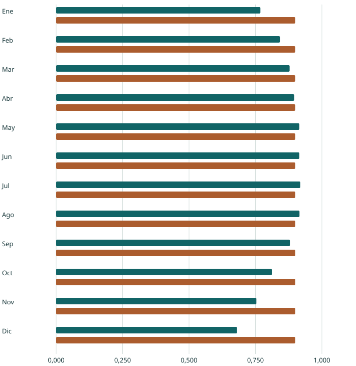
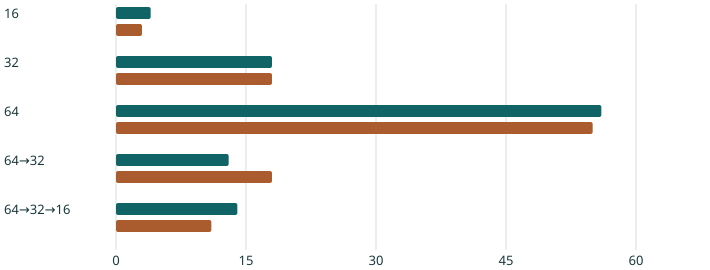
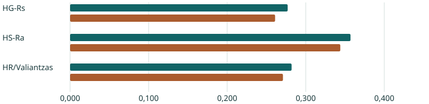
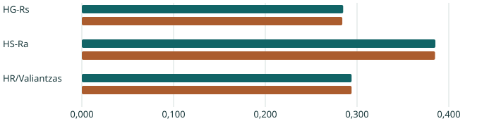
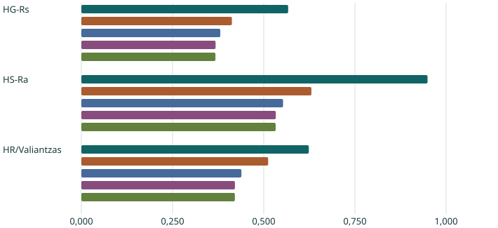
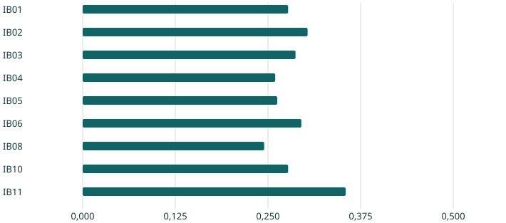
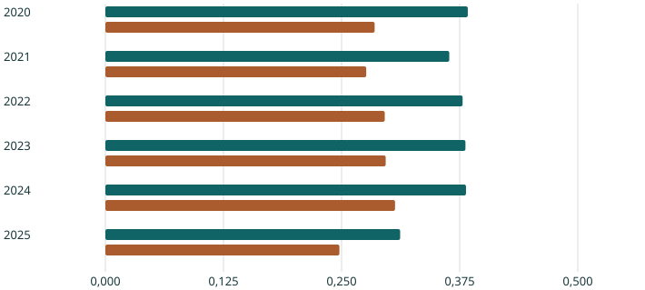
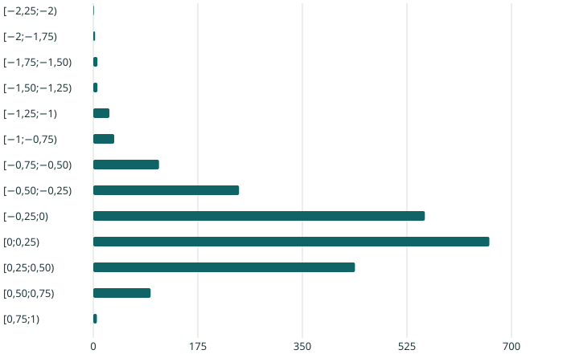
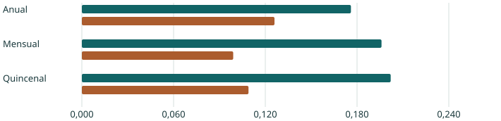

# Auditoría científica de ET₀ V2

Proyecto SIAR–ET₀ · Informe para Dirección 00W

Comparación independiente con el TFG y el TFM · 25 de noviembre de 2026

## Contenido

1. [Resumen ejecutivo](#s1)
2. [Contexto y evidencias](#s2)
3. [TFG](#s3)
4. [TFM](#s4)
5. [ET₀ V2 y correspondencia](#s5)
6. [Estaciones](#s6)
7. [Penman–Monteith](#s7)
8. [Fórmulas](#s8)
9. [AHC](#s9)
10. [Redes neuronales](#s10)
11. [Métricas](#s11)
12. [Comparación TFG–V2](#s12)
13. [Temporalidad y ventana histórica](#s13)
14. [Radiación y ET₀](#s14)
15. [Bibliografía](#s15)
16. [Márgenes](#s16)
17. [Agronomía](#s17)
18. [Evaluación](#s18)
19. [Cierre 00W](#s19)
20. [Próximas comprobaciones](#s20)

## 01. Resumen ejecutivo

**ET₀ V2 reproduce el orden y la escala del MAE del TFG.** En las redes, el menor error corresponde a HG-Rs, seguido de HR/Valiantzas y HS-Ra. Los MAE anuales de ET₀ V2 son 0,284–0,285, 0,294 y 0,385 mm/día, respectivamente, en 19.251 pares comunes de nueve estaciones. Frente al criterio de validación del TFG, las diferencias descriptivas son +0,007 a +0,028 mm/día. Igualar la ponderación por estación y año en V2 apenas cambia este resultado.

La concordancia es **científicamente defendible como orden de magnitud y patrón relativo**. La equivalencia estadística y la validez instrumental quedan abiertas. Cambian los años, la cobertura, la referencia PM efectiva, la selección y los insumos. En el TFG, el criterio «test» usa el propio año evaluado para elegir arquitectura.

> **Hallazgos prioritarios.** El fragmento MATLAB de presión del TFG contiene un error material si se ejecuta literalmente. El TFM contiene discrepancias en el indicador rotulado R² y en la indexación quincenal. En ET₀ V2, el factor 0,408 de Valiantzas se confirma en el código congelado y es coherente con Ra en unidades de energía. La ecuación expandida impresa por Martí et al. difiere por un factor ≈2,45. El supuesto de viento a 2 m sigue abierto por estación y periodo.

## 02. Contexto, alcance y evidencias

Auditoría independiente de dos antecedentes de la UIB y la campaña congelada de ET₀ V2. Se leen los PDF y anexos, la memoria y PR de GitHub, el código al commit de campaña y el catálogo de la LAN. En Cockpit se verifican por lectura ambas huellas de catálogo y el freeze del ZIP, y se derivan indicadores directamente de predicciones preservadas. El análisis mantiene el estado científico **NOT_PUBLISHED**.

| Evidencia | Identidad observada |
| --- | --- |
| Catálogo TEST | fef85f0a6ae981792d867a9de2b10b9f7787bc680461820d2284cd20453df4ab |
| Catálogo DEVELOPMENT | 3207fe042abb004b7cd69122339845adc8d55cd65b5cfd4d676d9e5512e6eea9 |
| Freeze en ZIP | 97acad7ce7cc39c65d82f6efdc36290ed0325caaef2dedb69d9ffbefe1addfbd |
| Campaña de evaluación | Kaggle 370251881 · commit 1e419ad881db1cc9798685ef19f414862461674b |

Procedencia. *TFG original* · *TFM original* · [memoria ET₀ V2](<https://github.com/lependens/Capitulo-1/blob/main/scientific_pipeline/docs/ET0_V2_MEMORIA_CIENTIFICA.md>) · [resultados retrospectivos](<https://github.com/lependens/Capitulo-1/blob/main/scientific_pipeline/docs/et0_v2_retrospective_results_2026.md>) · [certificación](<https://github.com/lependens/Capitulo-1/blob/main/scientific_pipeline/docs/et0_v2_certificacion_evidencia.md>) · [reproducción](<https://github.com/lependens/Capitulo-1/blob/main/scientific_pipeline/docs/et0_v2_metodologia_y_reproduccion.md>) · [metadatos experimentales](<https://github.com/lependens/Capitulo-1/blob/main/scientific_pipeline/docs/et0_v2_experimental_metadata.md>) · [contrato de inferencia](<https://github.com/lependens/Capitulo-1/blob/main/scientific_pipeline/docs/et0_v2_contrato_inferencia.md>) · [PR #76](<https://github.com/lependens/Capitulo-1/pull/76>) · [PR #78](<https://github.com/lependens/Capitulo-1/pull/78>) · [PR #80](<https://github.com/lependens/Capitulo-1/pull/80>) · [PR #81](<https://github.com/lependens/Capitulo-1/pull/81>) · [PR #82](<https://github.com/lependens/Capitulo-1/pull/82>).

## 03. Reconstrucción del TFG · 2017–2018

Doce estaciones SIAR. Ventana de 2004 a 2017, con inicio y fin propios por estación. La tabla 1 suma **47.663 días declarados** en las doce series. Ciutadella entra en el diseño con 240 días, y la tabla 7 utiliza la media de once estaciones tras excluirla. Tablas 2–3 describen medias y dispersión de meteorología. La tabla 4 define Rs + Tmedia; Tmax, Tmin, Tmedia y Ra; y las cuatro anteriores más HR media para ANN HR.

La memoria define un año exterior retenido por estación, validación interna del 15 %, una capa oculta de 1–10 neuronas, activación tansig, Levenberg–Marquardt y diez repeticiones. Los 43.800 entrenamientos salen de 146 combinaciones estación-año × 10 tamaños × 10 repeticiones × 3 familias. `validacio4` confirma el muestreo con `randperm`, `CONJUNT` arma el esquema, `prova1` entrega las tres particiones y llama a `entrenatesta1Talt` para una capa tansig. No se localizaron el estado de RNG, los archivos de entrada, el registro de todas las ejecuciones ni el cuerpo completo de la rutina de entrenamiento invocada. LM, preprocesado por defecto y el universo de repeticiones quedan en distintos niveles de verificación.

En la reconstrucción del código, el subconjunto exterior puntúa redes ya entrenadas. La rama «criterio de test» elige un mínimo sobre ese año, lo que introduce optimismo por selección. La calibración de fórmulas en `hgp2` usa la serie completa filtrada de cada estación, que también alimenta el cálculo de sus errores. *TFG original*, pp. 19–31, 34–39, 44–64.

## 04. Reconstrucción del TFM · 2020–2021

XEMA, Cataluña: 213 estaciones de origen, 683.824 filas diarias, 2005–2015. Andalucía: 121 estaciones de origen según p. 27, 1998–mediados de 2020, con cobertura desigual. El PDF imprime «679.43» como total andaluz y describe por separado 100 estaciones operativas en la red RIA. Ninguna de esas cifras establece cuántas estaciones o días entraron efectivamente en cada fórmula, escala o tabla. Las máscaras tras filtros y los matrices MATLAB permitirían contarlos por separado.

La referencia es Rs diaria de piranómetro. `filtra3` limpia valores faltantes y la memoria explica criba de ±3 desviaciones típicas para Tmax, Tmin, HR media y Rs. `netejamq2` enmascara años de hasta 180 días según una prueba de dimensiones, meses con ≤14 filas y quincenas con ≤7 filas. Así, los umbrales operativos que se desprenden del código son 181, 15 y 8 días en grupos normales. Revisar el límite anual frente a la memoria, y que `max(size(...))` también depende del número de columnas. La segunda mitad del mes se define desde el día 16. Coeficientes y evaluación se construyen sobre los mismos datos filtrados.

En `divmesos` los índices empiezan en el primer mes presente de cada año. Si falta enero, el índice local 1 puede representar un mes posterior. `div15` coloca en posición 1 la mitad disponible cuando la otra está vacía. Esto permite mezclar calendarios si la agregación usa índices en vez del mes o quincena real. Los grupos con huecos y la magnitud del efecto quedan por verificar. *TFM original*, pp. 22–34 y 88–101.

## 05. Diseño ET₀ V2 y correspondencia

| Aspecto | TFG | TFM | ET₀ V2 | Clase |
| --- | --- | --- | --- | --- |
| Objetivo, unidad | ET₀ diaria, mm/día | Rs, MJ/m²/día | ET₀ diaria, mm/día | A en unidad TFG–V2; D TFM–V2 |
| Referencia | Penman–Monteith recalculado | Rs de piranómetro | PM_FAO56_V1 calculada | B TFG–V2; C TFM–V2 |
| Red y ventana | 12 SIAR Baleares; 2004–2017 | XEMA 2005–2015; RIA 1998–2020 | 12 históricas; DEVELOPMENT 2004–2019; TEST 2020–2025 en 9 | B con identidad y fechas |
| Entradas y fórmulas | T, Rs o Ra; HR en variante HR | Tmax, Tmin, Ra, HR o altitud | HG-Rs, HS-Ra, Valiantzas; calendario indicado | C por diseño; B en funciones/pares armonizados |
| Datos faltantes y extremos | Filtrado por entradas y target; exclusión global de Ciutadella | Faltantes, ±3σ, soporte por grupo, cribado global posterior | Calidad y elegibilidad por método; cohorte pareada oficial | B si se reconstruyen máscaras |
| Calibración y calendario | Media de cocientes, anual por estación | Media de medias de cocientes; anual, mensual o quincenal | OLS por origen; anual, estacional o mensual | C |
| Entrenamiento y validación | LM declarado; año exterior y 15 % interno | Calibración y error dentro de muestra | AHC, siete familias ML, ANN A/E; folds anuales y TEST posterior | C |
| Selección y evaluación | Mínimos de validación o de test | Sin test final separado | Selección en DEVELOPMENT y freeze anterior al TEST | C |
| Arquitecturas | Una capa 1–10, diez repeticiones | No aplica | Cinco arquitecturas, una a tres capas, tres semillas, ensemble | C |
| Métricas y agregación | MAE, MSE/RMSE, RRMSE, r², NSE, AARE; medias por estación/año o pares concatenados en funciones distintas | MSE, RRMSE, r o columna a auditar; grupos y cribado por indicador | RMSE, MAE, sesgo, R² predictivo, n, cobertura; ponderación por par | B con definición y pesos; D si faltan datos |
| Límites | Target exacto y trazabilidad MATLAB | Población final, indexación y r/R² | Altura de viento, transferencia espacial, dependencia temporal | C |

A · comparación directa del elemento indicado. B · requiere armonización. C · comparación metodológica o cualitativa. D · evidencia insuficiente o magnitudes distintas. Los modelos definitivos se ajustan por estación, familia y calendario. En ML/ANN, los calendarios añaden 4 o 12 indicadores. En AHC, definen coeficientes por grupo. [Diseño aplicado](<https://github.com/lependens/Capitulo-1/blob/1e419ad881db1cc9798685ef19f414862461674b/scientific_pipeline/src/siar_science/et0_v2_support.py>) · [entrenamiento](<https://github.com/lependens/Capitulo-1/blob/1e419ad881db1cc9798685ef19f414862461674b/scientific_pipeline/src/siar_science/et0_v2_models.py>) · [evaluación retrospectiva](<https://github.com/lependens/Capitulo-1/blob/1e419ad881db1cc9798685ef19f414862461674b/scientific_pipeline/src/siar_science/et0_v2_retrospective.py>).

## 06. Correspondencia de estaciones y series

| TFG | Código y nombre V2 | Periodo y días TFG | Altitud TFG → V2 (m) | Latitud V2 (°N) | Alta V2 y baja conocida | Cohorte HG-Rs anual V2 |
| --- | --- | --- | --- | --- | --- | --- |
| 1 Artà | IB09 Artá | 2005–2017 · 4.022 | 114 → 105 | 39,6972 | 2005-10-24 a 2018-10-10 | Histórica, excepción en DEVELOPMENT |
| 2 Calvià | IB10 Calviá | 2005–2017 · 3.999 | 20 → 30 | 39,5511 | 2005-10-08 | TEST 2.097 |
| 3 Ciutadella | IB101 Ciutadella | 2008–2009 · 240 | 21 → 21 | 39,9653 | 2008-12-02 a 2009-08-10 | Histórica; 246 pares en el ejemplo anual |
| 4 Eivissa S’Estany | IB11 S’Estany des Peix | 2005–2017 · 3.957 | 11 → 7 | 38,7269 | 2005-10-10 | TEST 2.188; identidad física por comprobar |
| 5 Es Mercadal | IB08 Es Mercadal | 2005–2017 · 4.142 | 41 → 40 | 40,0036 | 2005-10-05 | TEST 2.097 |
| 6 Felanitx | IB05 Felanitx | 2004–2017 · 4.786 | 109 → 82 | 39,4753 | 2004-04-05 | TEST 2.154 |
| 7 Inca | IB02 Inca | 2004–2017 · 4.784 | 42 → 78 | 39,6836 | 2004-03-31 | TEST 2.017 |
| 8 Manacor | IB03 Manacor | 2004–2017 · 4.764 | 84 → 79 | 39,5458 | 2004-04-01 | TEST 2.192 |
| 9 Santa Eulàlia | IB01 Santa Eulalia | 2004–2017 · 4.631 | 130 → 120 | 39,0100 | 2004-03-30 | TEST 2.192 |
| 10 Sa Pobla | IB06 Sa Pobla | 2004–2017 · 4.756 | 6 → 4 | 39,8028 | 2004-04-05 | TEST 2.190 |
| 11 Sóller | IB07 Sóller | 2004–2012 · 2.878 | 44 → 44 | 39,7803 | 2004-08-11 a 2012-11-13 | Histórica |
| 12 Son Ferriol | IB04 Son Ferriol | 2004–2017 · 4.704 | 28 → 8 | 39,5622 | 2004-04-01 | TEST 2.124 |

Cruce nominal de la tabla 1 del TFG, la memoria V2 y el selector de la LAN. Las diferencias de cota más llamativas son Inca +36 m, Felanitx −27 m y Son Ferriol −20 m. El PDF antiguo presenta coordenadas proyectadas y se requiere documentar el CRS y los historiales de traslado para cotejar posición y cota. El alias Eivissa S’Estany ↔ IB11 es candidato nominal y exige comprobación física. Estas fechas delimitan las series estudiadas. Un estado operativo actual se determina con observaciones recientes o con el catálogo operativo SIAR. IB09 conserva Quality FAIL aun con 4.390 pares elegibles del intervalo autorizado para DEVELOPMENT. IB07, IB09 e IB101 carecen de TEST. La diferencia 240/246 en Ciutadella exige cotejo de fecha y criterios, sin atribuirla a cambios históricos antes de la comparación. *TFG original* · [memoria V2](<https://github.com/lependens/Capitulo-1/blob/main/scientific_pipeline/docs/ET0_V2_MEMORIA_CIENTIFICA.md>) · [MAPA SiAR](<https://servicio.mapa.gob.es/siarweb/masInformacion>).

## 07. Auditoría de Penman–Monteith

| Componente | ET₀ V2 · código ejecutado | TFG · evidencia y resolución |
| --- | --- | --- |
| Temperatura para Δ y ecuación | Media aritmética de Tmax/Tmin; t en °C y +273 en término aerodinámico | Columna 9 rotulada Tmean para hgp2/ANN. La vía exacta en PMN requiere el código completo |
| Presión y γ | P = 101,3·[(293−0,0065z)/293]^5,26 kPa; γ = 0,000665 P | PMN p. 64 escribe 101,3·(293−0,0065z)/293^5,26. A 120 m da ≈3,13×10⁻⁹ kPa frente a ≈99,89 kPa. γ hereda el error si esa línea alimentó el target |
| es, ea y HR | es = media de e°(Tmin), e°(Tmax); ea combina Tmin con HRmax y Tmax con HRmin; e° en kPa | Método FAO descrito. La ruta de código y los valores intermedios usados quedan por recuperar |
| Viento | m/s de SIAR tratado como u₂; comprobación histórica de la altura pendiente | Datos SIAR y anemoveleta documentados; falta trazabilidad estación-periodo y rutina completa |
| Ra y calendario | Día ordinal real; 365 en la fase FAO aun en bisiesto; latitud grados convertida a radianes | hgp2 usa 365 y recibe latitud ya en radianes; resolver llamada y calendario sobre años bisiestos en PMN |
| Onda corta y larga | Rns = 0,77Rs; Rnl = σ·media(TK⁴)·(0,34−0,14√ea)·(1,35·min(Rs/Rso,1)−0,35); Rso=(0,75+2×10⁻⁵z)Ra | Falta el cálculo completo ejecutado. No se puede comprobar límite de Rs/Rso, onda larga, cielo despejado ni G sobre la salida antigua |
| G, conversión y extremos | G=0 diario, 0,408 en término energético, techo Rs/Rso en 1 sin suelo inferior, conserva posible ET₀ negativa | La equivalencia numérica de targets sigue pendiente |

La división con exponente del fragmento PMN altera la ponderación radiativa y aerodinámica, y podría cambiar sustancialmente el target. La evidencia disponible establece el error en el código impreso. Resolver su incidencia en la tabla 7 requiere el `PMN.m` efectivamente ejecutado y la columna de target por estación y fecha. Para V2, una Rs/Rso por debajo de 0,35/1,35 resulta en un término atmosférico de onda larga negativo en la ecuación implementada. La memoria ilustra IB01 el 30-03-2004 y conserva banderas. Esa decisión merece sensibilidad descriptiva por estación y estación climática. [FAO-56, cap. 2](<https://www.fao.org/4/x0490e/x0490e06.htm>) · [cap. 3](<https://www.fao.org/4/x0490e/x0490e07.htm>) · [PM](<https://github.com/lependens/Capitulo-1/blob/1e419ad881db1cc9798685ef19f414862461674b/scientific_pipeline/src/siar_science/penman_monteith.py>) · [atmósfera](<https://github.com/lependens/Capitulo-1/blob/1e419ad881db1cc9798685ef19f414862461674b/scientific_pipeline/src/siar_science/atmosphere.py>) · [geometría solar](<https://github.com/lependens/Capitulo-1/blob/1e419ad881db1cc9798685ef19f414862461674b/scientific_pipeline/src/siar_science/solar.py>).

## 08. Fórmulas empíricas y unidades

| Familia | Expresión con radiación en MJ/m²/día | Correspondencia |
| --- | --- | --- |
| HG-Rs | ET₀ = 0,0135·0,408·Rs·(T+17,8) | hgp2 y V2 coinciden en factor; T media medida en el flujo antiguo frente a media de extremos V2 |
| HS-Ra | ET₀ = 0,0023·0,408·Ra·√(Tmax−Tmin)·(T+17,8) | Mismo factor y exponente; diferencia de T media y posible geometría/filtrado |
| HS para Rs | Rs = k·Ra·√(Tmax−Tmin); k = 0,16 o 0,19 | TFM. El resultado sigue siendo un flujo energético |
| Annandale para Rs | Rs = k·(1+2,7×10⁻⁵z)·Ra·√ΔT | TFM: código ejecutable usa 10⁻⁵, frente a comentario que dice 10⁻⁰·⁵ y advierte del resultado |
| Valiantzas para Rs | Rs = 0,338·Ra·ΔT^0,3·(1,001−HRmedia/100)^0,2 | Coincide con la fuente primaria 2017 y Rstfm. El 1,001 evita que HR=100 anule el término |
| Valiantzas → ET₀ | ET₀ = 0,0135·0,408·Rs estimada·(T+17,8); coeficiente expandido 0,001861704 | hgp2 y V2 incluyen conversión; TFG ecuaciones 15–16 impresas simplifican humedad y la ecuación 16 omite 0,408 |

El artículo de Martí et al. (2024), ec. 1b, divide Rs por λ≈2,45 antes de aplicar 0,0135. La ec. 3 entrega Rs en energía. Sustituirla literalmente en 1b da 0,004563/2,45≈0,00186245. La ec. 4 imprime 0,004563, igual a 0,338×0,0135. Esta diferencia dimensional queda localizada en la fuente primaria. Si Ra ya fuese equivalente de evaporación, multiplicar de nuevo por 0,408 sería incorrecto. Con el Ra energético de V2 la conversión procede. El código histórico aporta evidencia independiente de que también se aplicó en `hgp2`, no evidencia de cómo se produjeron los resultados publicados del artículo. Si x se reescala por un factor fijo k, AHC por cocientes u OLS cambia a c/k y el producto ajustado se conserva, siempre que se usen los mismos pares sin restricciones adicionales. La fórmula sin ajustar y los coeficientes sí cambian.

[Hargreaves y Samani (1985)](<https://doi.org/10.13031/2013.26773>) · [Annandale et al. (2002)](<https://doi.org/10.1007/S002710100047>) · [Valiantzas (2017)](<https://doi.org/10.1061/(ASCE)IR.1943-4774.0001275>) · [discusión de Vega et al.](<https://doi.org/10.1061/(ASCE)IR.1943-4774.0001356>) · [Martí et al. (2024)](<https://doi.org/10.1016/j.agwat.2024.108903>) · [Valiantzas en V2](<https://github.com/lependens/Capitulo-1/blob/1e419ad881db1cc9798685ef19f414862461674b/scientific_pipeline/src/siar_science/valiantzas.py>).

## 09. Qué optimiza cada AHC

Sea x la estimación original e y la referencia. TFG usa `mean(y./x)` en la estación. Para x distinto de cero equivale a minimizar Σ[(y−cx)/x]². TFM hace lo mismo dentro del año/grupo y después promedia los años disponibles, cada uno con el mismo peso aunque tenga distinto número de días. El ajuste y la evaluación se solapan. V2 calcula c=Σxy/Σx² en el entrenamiento de cada fold o de todo DEVELOPMENT. Es la media de y/x ponderada por x² para x≠0. Minimiza MSE en los pares de ajuste. Con x=0, el día no identifica c, aunque su residual puede entrar en la evaluación. El código exige suma de cuadrados positiva y usa pares elegibles. Ningún criterio optimiza directamente el sesgo o el MAE. El óptimo de MAE es una mediana ponderada de y/x con pesos |x|.

| Ejemplo sintético · x=(0,1; 2), y=(0,3; 2) | c | MAE | RMSE | Sesgo |
| --- | --- | --- | --- | --- |
| Media de cocientes | 2 | 1,050 | 1,416 | +0,950 |
| OLS por origen | 1,00499 | 0,105 | 0,141 | −0,095 |

Con 10 días en un año de cociente medio 2 y 100 días en otro de media 1, la media de medias da 1,5 y la media diaria 1,091. En el TFM, `nonzeros` elimina ceros válidos junto a posibles ceros de relleno, `nanmean` omite NaN pero conserva Inf, y `ahcrs` busca ceros para una sola fórmula y construye la máscara con `find(x)==0`, una comprobación que no selecciona las posiciones de los ceros. Si una fórmula es un múltiplo fijo de otra en una estación, como HS y Annandale con la misma ΔT y Ra, la calibración multiplicativa absorbe esa diferencia de escala. El AHC equivalente tras calibrar es una consecuencia algebraica.

### AHC mensual HG-Rs · Son Ferriol

Series por color · Mensual (verde azulado) · Anual (naranja)

*Explorador científico, IB04/HG-Rs. DEVELOPMENT 2004–2019, 5.587 pares anuales. El coeficiente anual se repite para visualizarlo. Unidad del eje · adimensional.*

El ejemplo de IB04 muestra por qué debe mirarse el n de cada grupo y su Σx². En julio quedan 495 pares y Σx²≈17.470. En diciembre, 493 y Σx²≈650. El número de pares se parece, pero su contribución al ajuste anual por mínimos cuadrados es muy distinta. [Ajuste AHC de campaña](<https://github.com/lependens/Capitulo-1/blob/1e419ad881db1cc9798685ef19f414862461674b/scientific_pipeline/src/siar_science/et0_v2_models.py>).

## 10. Redes neuronales y selección

TFG ensaya una capa de 1–10 neuronas. Con p entradas, h neuronas y una salida, el total es h(p+2)+1 parámetros. Para p=2, 4 y 5, la malla tiene 5–41, 7–61 y 8–71 parámetros por red. La tabla 8 declara medias CV/test de 7,25/5,97, 7,48/5,61 y 8,48/5,17 neuronas. Las diez repeticiones forman parte de la búsqueda.

V2 usa StandardScaler ajustado dentro de cada entrenamiento, ReLU, Adam, α=10⁻⁴, parada temprana interna con 200 épocas máximas, paciencia 15, mejora mínima 0,0001 y tres semillas cuyas predicciones se promedian. A valida sobre el último 15 % del entrenamiento exterior y E sobre el 15 % ordenado por hash. La arquitectura se elige por RMSE medio en años retenidos de DEVELOPMENT. La mediana de las mejores épocas por semilla fija el reajuste. HG-Rs anual con 64 neuronas tiene 257 parámetros por red. Con cuatro entradas y 64→32→16 son 2.945. El esquema exterior por años retenidos permite entrenar con años posteriores al año que se evalúa en algunos folds. El TEST 2020–2025 verifica la evaluación en fechas posteriores para las estaciones conocidas. La diferencia de orden de milésimas entre A y E no acredita una mejora estadística.

### Arquitecturas seleccionadas en DEVELOPMENT

Series por color · ANN A (verde azulado) · ANN E (naranja)

*ann-selected-architectures.csv, 105 celdas por variante, 2004–2019 · celdas*

## 11. Auditoría y armonización de métricas

| Indicador | Definición | Diferencias comprobadas |
| --- | --- | --- |
| MSE / RMSE | mean(e²) / √mean(e²), con e = predicción−referencia | TFG mm guarda MSE por fold; mmG guarda RMSE tras concatenar los pares. Necesaria trazabilidad de la tabla 7 antes de convertir su MSE. V2 usa RMSE absoluto |
| RRMSE | RMSE dividido por media de referencia del grupo | TFG y TFM; TFM lo rotula RMSE. La media de ratios por grupo difiere del ratio sobre todos los pares |
| Pearson r² | corr(y,ŷ)² | TFG lo calcula separado de NSE. TFM anual extrae r sin cuadrar. El código mensual/quincenal copia RRMSE del bloque 2 al bloque 3 donde debería ir correlación. Analizar la fuente exacta de las tablas 16 y 17 |
| R² predictivo / NSE | 1−Σe²/Σ(y−ȳ)² | V2 usa la definición predictiva. TFG guarda NSE aparte. Con target constante el denominador desaparece |
| MAE, sesgo y AARE | mean(\|e\|), mean(e), mean(\|e\|/\|y\|) | TFG AARE divide por referencia sin protección ante ceros. V2 oficial informa MAE y sesgo. Aquí se deriva AARE sobre los mismos pares |
| Cobertura | n y denominador de calendario o referencia | Para comparar V2 se exige target y cinco métodos presentes. Las coberturas propias de cada modelo se informan aparte |

`nonzeros` altera denominadores cuando cero es un valor real. AARE amplifica días cercanos a cero. El RRMSE de Rs del TFM y el RMSE absoluto de ET₀ V2 miden magnitudes distintas. En HS-Ra anual original, Pearson r² derivado es 0,84245 y el R² predictivo oficial 0,6913. Una correlación alta puede coexistir con errores de nivel.

## 12. Comparación cuantitativa TFG–ET₀ V2

| Familia | TFG elección CV | TFG elección test | V2 ANN A | V2 ANN E | V2 A − TFG CV |
| --- | --- | --- | --- | --- | --- |
| HG-Rs | 0,2770 | 0,2610 | 0,2848 | 0,2839 | +0,0078 |
| HS-Ra | 0,3570 | 0,3440 | 0,3854 | 0,3850 | +0,0284 |
| HR/Valiantzas | 0,2820 | 0,2710 | 0,2940 | 0,2940 | +0,0121 |

MAE en mm/día. TFG, tabla 7, once estaciones con años propios de 2004–2017. V2, TEST 2020–2025, nueve estaciones y 19.251 pares por familia y configuración anual. La selección por test reduce el MAE TFG en 0,011–0,016 mm/día. Frente a su rama CV, V2 es +0,008, +0,028 y +0,012 mm/día en el orden de la tabla. Se preserva el orden de las tres familias.

### MAE del TFG

Series por color · Elección CV (verde azulado) · Elección test (naranja)

*Tabla 7, once estaciones, 2004–2017 efectivo por estación · mm/día*

### MAE de ET₀ V2

Series por color · ANN A (verde azulado) · ANN E (naranja)

*TEST 2020–2025. Anual, 19.251 pares por familia · mm/día*

### RMSE absoluto de ET₀ V2

Series por color · Fórmula (verde azulado) · AHC (naranja) · ML (azul) · ANN A (morado) · ANN E (verde)

*TEST anual 2020–2025, 19.251 pares por familia · mm/día*

| Familia | TFG fórmula MAE | TFG calibrada MAE | V2 fórmula MAE | V2 AHC MAE |
| --- | --- | --- | --- | --- |
| HG-Rs | 0,485 | 0,506 | 0,4743 | 0,3146 |
| HS-Ra | 0,672 | 0,468 | 0,7873 | 0,4938 |
| HR/Valiantzas | 0,461 | 0,373 | 0,4701 | 0,3832 |

HG-Rs presenta la principal divergencia de calibración. El TFG empeora +0,021 mm/día con media de cocientes y V2 mejora ≈0,160 con OLS en su propio TEST. Estimador, reparto de días, target y ventanas son explicaciones plausibles. El texto TFG p. 35 cruza cifras de MSE y AARE de la tabla 7. Se priorizan la tabla y los anexos.

### Derivación desde predicciones preservadas

| Familia | Método | RMSE | MAE | RRMSE | Pearson r² | AARE | Sesgo |
| --- | --- | --- | --- | --- | --- | --- | --- |
| HG-Rs | Fórmula | 0,56701 | 0,47430 | 0,19682 | 0,93525 | 0,24074 | 0,29409 |
| HG-Rs | AHC | 0,41267 | 0,31455 | 0,14324 | 0,94213 | 0,18106 | -0,00399 |
| HG-Rs | ML | 0,38086 | 0,29730 | 0,13220 | 0,95194 | 0,17319 | 0,06689 |
| HG-Rs | ANN A | 0,36805 | 0,28485 | 0,12775 | 0,95441 | 0,16562 | 0,04265 |
| HG-Rs | ANN E | 0,36761 | 0,28393 | 0,12760 | 0,95444 | 0,16475 | 0,03888 |
| HS-Ra | Fórmula | 0,94906 | 0,78735 | 0,32943 | 0,84245 | 0,38690 | 0,57798 |
| HS-Ra | AHC | 0,63069 | 0,49378 | 0,21892 | 0,87912 | 0,26004 | 0,19692 |
| HS-Ra | ML | 0,55304 | 0,39964 | 0,19197 | 0,90708 | 0,19995 | 0,17362 |
| HS-Ra | ANN A | 0,53308 | 0,38540 | 0,18504 | 0,91123 | 0,18956 | 0,14522 |
| HS-Ra | ANN E | 0,53266 | 0,38502 | 0,18489 | 0,91129 | 0,18924 | 0,14438 |
| Valiantzas | Fórmula | 0,62365 | 0,47012 | 0,21647 | 0,89522 | 0,22209 | 0,23713 |
| Valiantzas | AHC | 0,51223 | 0,38323 | 0,17780 | 0,91891 | 0,18428 | 0,13475 |
| Valiantzas | ML | 0,43884 | 0,30525 | 0,15233 | 0,93999 | 0,13270 | 0,11295 |
| Valiantzas | ANN A | 0,42098 | 0,29405 | 0,14613 | 0,94296 | 0,12777 | 0,08788 |
| Valiantzas | ANN E | 0,42091 | 0,29405 | 0,14610 | 0,94296 | 0,12780 | 0,08783 |

RMSE, MAE y sesgo en mm/día. RRMSE, Pearson r² y AARE son adimensionales. Se incluyen 19.251 pares por fila y ningún target de estos pares es exactamente cero. Estas derivaciones complementan las métricas oficiales.

### Agregación por estación y año

| Familia | Modelo | Media MSE | Media RMSE | RRMSE | MAE | Pearson r² | AARE |
| --- | --- | --- | --- | --- | --- | --- | --- |
| HG-Rs | ANN A | 0,13496 | 0,36229 | 0,12612 | 0,28444 | 0,95650 | 0,16609 |
| HG-Rs | ANN E | 0,13462 | 0,36170 | 0,12588 | 0,28350 | 0,95650 | 0,16521 |
| HS-Ra | ANN A | 0,28288 | 0,52806 | 0,18483 | 0,38462 | 0,91250 | 0,18986 |
| HS-Ra | ANN E | 0,28244 | 0,52767 | 0,18470 | 0,38425 | 0,91257 | 0,18954 |
| Valiantzas | ANN A | 0,17642 | 0,41574 | 0,14561 | 0,29314 | 0,94654 | 0,12763 |
| Valiantzas | ANN E | 0,17638 | 0,41569 | 0,14559 | 0,29314 | 0,94655 | 0,12765 |

Primero se calculan métricas por estación-año, después se promedian los años dentro de estación y finalmente las nueve estaciones con igual peso. El TFG CV informa, en el orden HG-Rs/HS-Ra/HR, RRMSE 0,120/0,166/0,136, Pearson r² 0,958/0,919/0,946 y AARE 0,151/0,164/0,115. El RMSE TFG comparable sigue indeterminado. La ponderación cambia poco el MAE V2; los periodos y posibles diferencias de target siguen abiertos.

| Estación | V2 n | V2 RMSE | V2 MAE | V2 sesgo | TFG ANN Rs CV | TFG ANN Rs test |
| --- | --- | --- | --- | --- | --- | --- |
| IB01 | 2192 | 0,3683 | 0,2772 | -0,0025 | 0,2460 | 0,2423 |
| IB02 | 2017 | 0,3933 | 0,3035 | 0,0137 | 0,2891 | 0,2842 |
| IB03 | 2192 | 0,3715 | 0,2872 | -0,0274 | 0,3134 | 0,2829 |
| IB04 | 2124 | 0,3231 | 0,2598 | 0,0519 | 0,2802 | 0,2529 |
| IB05 | 2154 | 0,3283 | 0,2625 | 0,0496 | 0,2940 | 0,2508 |
| IB06 | 2190 | 0,3824 | 0,2950 | 0,0653 | 0,2774 | 0,2739 |
| IB08 | 2097 | 0,3092 | 0,2449 | 0,0867 | 0,2705 | 0,2634 |
| IB10 | 2097 | 0,3406 | 0,2772 | 0,1721 | 0,2873 | 0,2509 |
| IB11 | 2188 | 0,4674 | 0,3548 | -0,0200 | 0,3753 | 0,3700 |

HG-Rs anual ANN A, TEST 2020–2025, frente a TFG tabla 9, años 2004–2017 efectivos por estación. IB11 figura solo como correspondencia nominal candidata. Al incluir Ciutadella, el MAE global CV del TFG pasa de 0,2767 a 0,4397. Artà y Sóller presentan 0,2242 y 0,1858 mm/día y carecen de TEST V2.

### MAE HG-Rs por estación · V2

*TEST anual 2020–2025. Tamaños de cohorte en la tabla · mm/día*

| Año | n | RMSE | MAE | Sesgo |
| --- | --- | --- | --- | --- |
| 2020 | 3293 | 0,3836 | 0,2850 | 0,0442 |
| 2021 | 3283 | 0,3640 | 0,2761 | 0,0018 |
| 2022 | 3176 | 0,3781 | 0,2957 | 0,0480 |
| 2023 | 3281 | 0,3811 | 0,2967 | 0,0798 |
| 2024 | 3154 | 0,3817 | 0,3066 | 0,0230 |
| 2025 | 3064 | 0,3120 | 0,2477 | 0,0597 |

### Variación interanual HG-Rs · V2

Series por color · RMSE (verde azulado) · MAE (naranja)

*V2, ANN A anual, agrupación de los pares por año 2020–2025 · mm/día*

El anexo TFG §6.4 ofrece índices de año y ventanas distintas por estación. Son Ferriol, por ejemplo, oscila entre 0,234 y 0,322 mm/día en MAE CV de ANN Rs (tabla 26). V2 regional presenta 0,2477 a 0,3066. Las dos series ilustran variación interanual a escalas distintas.

### Residuos de HG-Rs · IB01

*2.192 residuos diarios ANN A menos PM, TEST de IB01 2020–2025. Intervalos en mm/día · días*

## 13. Temporalidad y periodo compartido

| TFM · Valiantzas ajustado | Anual | Mensual | Quincenal |
| --- | --- | --- | --- |
| Cataluña RRMSE | 0,176 | 0,196 | 0,202 |
| Andalucía RRMSE | 0,126 | 0,099 | 0,109 |
| Cataluña MSE | 10,082 | 10,600 | 12,979 |
| Andalucía MSE | 7,047 | 5,554 | 4,199 |

### Efecto de la temporalidad en el TFM

Series por color · Cataluña (verde azulado) · Andalucía (naranja)

*Tablas 14–15. XEMA 2005–2015 y RIA desde 1998 a 2020. Ajuste dentro de muestra, soporte efectivo por escala indeterminado · RRMSE adimensional*

En Cataluña, anual obtiene menor RRMSE y MSE. En Andalucía, mensual minimiza RRMSE y quincenal MSE. El MSE de la propia fórmula Valiantzas *sin calibrar* cambia de 8,740 a 7,236 a 5,255 en Andalucía. Por tanto la evaluación mueve pesos, soporte o filtros con el calendario. `Errglobaltemp` filtra por columna las estaciones por debajo de media+3σ y excluye ceros. Las tablas 19–20 aplican otros resúmenes, por lo que sus medias no se usan como reemplazo de las tablas 14–15. En el anexo quincenal aparecen expresiones con índice `k−1+w` que pueden solapar quincenas adyacentes. La magnitud de estos efectos requiere las matrices originales.

| V2 · RMSE mm/día | Anual | Estacional | Mensual |
| --- | --- | --- | --- |
| HG-Rs AHC | 0,4127 | 0,3987 | 0,3953 |
| HG-Rs ML | 0,3809 | 0,3529 | 0,3448 |
| HG-Rs ANN A | 0,3680 | 0,3368 | 0,3279 |
| HS-Ra AHC | 0,6307 | 0,6212 | 0,6202 |
| HS-Ra ML | 0,5530 | 0,5571 | 0,5581 |
| HS-Ra ANN A | 0,5331 | 0,5236 | 0,5353 |
| Valiantzas AHC | 0,5122 | 0,5094 | 0,5072 |
| Valiantzas ML | 0,4388 | 0,4410 | 0,4412 |
| Valiantzas ANN A | 0,4210 | 0,4160 | 0,4233 |

En V2, mensual gana para AHC en las tres familias y para ML/ANN con HG-Rs. En Valiantzas y HS-Ra, el mejor ML observado es anual y la mejor ANN A, estacional. V2 conserva 19.251 pares comunes y calcula RMSE con la misma definición. El beneficio con más categorías es una propiedad empírica del caso, con efectos del soporte y posible sobreajuste. V2 no probó quincenas.

### Ventana común 2004–2017

El ZIP original contiene `capsule/development.json.gz`, con filas de entrada y target, y `predictions.csv.gz` con predicciones TEST. La búsqueda por nombres no mostró predicciones diarias OOF de DEVELOPMENT. Existen `ml-fold-metrics.csv`, `ann-fold-seed-metrics.csv` y `ahc-fold-coefficients.csv`. Sus métricas de candidatos se calcularon sobre años retenidos, usados también para seleccionar dentro de DEVELOPMENT. Sirven para examinar soporte y comparación de indicadores compatibles, con cautela por selección. Para fechar, alinear y evaluar las dos series a diario se necesitan Tt/Tt2 del TFG con fecha, target y estación, y salidas OOF preservadas de V2 si existen fuera del ZIP. El histórico completo ajustado mezcla entrenamiento y evaluación.

## 14. De radiación solar a ET₀ operativa

1. **Fecha de emisión** → Tmax, Tmin, HR, Rs, viento
2. **Entradas disponibles** → Rs prevista o estimada con Ra
3. **ET₀ por horizonte** → Fórmula, PM o modelo entrenado

Esquema conceptual. A: T y HR → Valiantzas para Rs → HG-Rs. B: sustituir Rs en PM si el resto de variables está disponible. C: predecir ET₀ directamente con ANN/ML. D: estimar Rs con HS o Annandale si falta HR. E: contrastar Rs medida y estimada en idénticas fechas. F: sustituir Rs de forma aislada y después con las demás entradas para medir propagación e interacciones.

En HG-Rs, ∂ET₀/∂Rs=0,0135·0,408·(T+17,8). A 20 °C, un error aislado de 2 MJ/m²/día equivale a ≈0,416 mm/día de ET₀. En PM, Rs modifica onda corta y larga antes del techo de Rs/Rso y cambia de sensibilidad al alcanzarlo. Errores meteorológicos pueden covariar. Una red entrenada con Rs observada puede perder rendimiento con Rs prevista o estimada por cambio de distribución. Para SIAR y AEMET, usar días y estaciones comunes, conservar emisor, emisión y horizonte D+0…D+6, y comparar con persistencia y AHC, sin usar variables posteriores a la hora de emisión.

## 15. Comparación bibliográfica

| Fuente primaria | Población, referencia y diseño | Escala descriptiva y límite |
| --- | --- | --- |
| Martí et al. 2025 · doi:10.3390/agriculture15242557 | Dos instalaciones mediterráneas, Albacete 2007–2015 (sin 2010) y Badajoz 2007–2016; HS, PMT y ANN frente a FAO-56 y lisímetros; evaluación diaria a anual | RRMSE diario contra PM ≈0,06–0,18; HS 0,179/0,155; ANN con más entradas 0,070/0,057 y MAE ≈0,20/0,19 mm/día. Con lisímetro, RRMSE diario ≈0,14–0,27. Población y sensores distintos |
| Martí et al. 2024 · doi:10.1016/j.agwat.2024.108903 | Albacete 2007–2015 y Badajoz 2007–2016 en cuadros de calibración; HS, PM y GEP con entradas limitadas; PM y lisímetros | Muestra perfiles quincenales de RRMSE y sensibilidad al periodo de calibración y referencia. Comparación metodológica para V2 |
| Comparación ANN en el País Vasco | Norte de España, clima atlántico; estimación diaria frente a PM56; grupos según temperatura/HR, radiación y entradas más completas | RMSE 0,385, 0,238 y 0,285 mm/día, respectivamente. Comparación orientativa por tipo de entradas |
| Reference evapotranspiration estimate… Mediterranean climates | 577 estaciones CLIMWAT de climas mediterráneos diversos; métodos HS y PMT frente a PM | RMSE ≈0,60–0,65 en zonas áridas e hiperáridas, PMT inferior a 0,52 en zonas semiáridas a húmedas. Escala y agregación climática distintas |
| Boosted ML models · doi:10.3390/w13243489 | Tabriz y Shiraz, dos estaciones, PM FAO-56 y partición train/test con empíricos calibrados y boosting | TEST agregado HS original 1,00/0,80 y calibrado 0,75/0,58 mm/día (RMSE/MAE). Valiantzas multivariable calibrado 0,27/0,22, con entradas distintas de V2 |

[Albacete–Badajoz ANN](<https://doi.org/10.3390/agriculture15242557>) · [ventanas de calibración y lisímetros](<https://doi.org/10.1016/j.agwat.2024.108903>) · [CLIMWAT mediterráneo](<https://www.sciencedirect.com/science/article/pii/S0022169412011171>) · [boosting](<https://doi.org/10.3390/w13243489>) · [estudio ANN del País Vasco](<https://www.sciencedirect.com/science/article/pii/S0378377408000024>).

## 16. Órdenes de magnitud defendibles

Un MAE de pocas décimas y RMSE ≈0,33–0,54 mm/día en las redes de V2 son plausibles para imitar PM a diario en estaciones conocidas. HS-Ra ANN anual da RRMSE ≈0,185, próximo a modelos térmicos peninsulares y superior a ANN con más entradas. HS-Ra original da RMSE ≈0,95 mm/día, comparable en escala con valores publicados para otros climas. La escala depende de los días, de los sensores y de la referencia. La equivalencia estadística requeriría clave diaria común, margen determinado por la decisión agronómica e incertidumbre pareada por estación y bloques temporales.

## 17. Interpretación agronómica

1 mm de lámina representa una lámina de 10 m³ por hectárea. El MAE de ANN A HG-Rs anual, 0,28485 mm/día, equivale a 2,85 m³/ha/día de lámina de referencia. El sesgo regional +0,04265 equivale a +0,43 m³/ha/día. Pasar de AHC a ANN A en esa familia reduce MAE ≈0,030 mm/día (≈0,30 m³/ha/día) y cambia el sesgo de −0,0040 a +0,0427. La diferencia A/E menor a 0,001 mm/día en MAE anual no justifica por sí sola mayor complejidad. La dosis de riego necesita Kc, precipitación efectiva, balance de suelo y eficiencia.

| IB01 · HG-Rs anual ANN A | Grupos completos | Sesgo acumulado medio (mm) | MAE acumulado (mm) | RMSE acumulado (mm) | Extremos (mm) |
| --- | --- | --- | --- | --- | --- |
| Semana ISO | 312 | −0,0249 | 1,3606 | 1,7039 | −6,3291 a +3,9886 |
| Mes natural | 72 | −0,0768 | 4,2981 | 5,2379 | −11,1215 a +12,1581 |

Los indicadores se calculan sobre sumas de residuos diarios en cada grupo completo del TEST 2020–2025. El MAE mensual equivale a ≈43 m³/ha de lámina de referencia en este ejemplo. Los residuos pueden compensarse o acumularse según signo y dependencia temporal.

## 18. Tabla de evaluación

| Aspecto | Evidencia | Resultado | Limitaciones | Gravedad | Actuación recomendada |
| --- | --- | --- | --- | --- | --- |
| MAE por familia | Tabla 7 y 19.251 pares diarios por familia | CONCORDANTE CON LIMITACIONES | Años y targets distintos | Media | Comparar misma cohorte y misma referencia |
| Presión PM original | Línea MATLAB p. 64 | POSIBLE ERROR MATERIAL | Error en el anexo; efecto en resultados sin demostrar | Alta | Recuperar PMN.m y columna 27 |
| Valiantzas–Martí | Ec. 1b, 3 y 4; hgp2; código V2 | DISCREPANCIA EXPLICABLE | Unidades V2 coherentes; ecuación impresa 2,45× | Media | Confirmar convención primaria |
| Viento V2 | Entrada SIAR interpretada como u₂ | DISCREPANCIA PENDIENTE | Historia de sensores incompleta | Media | Cotejar altura y hacer sensibilidad |
| Selección TFG por test | prova1 p. 59–60 | DISCREPANCIA EXPLICABLE | Estimador optimista por selección | Alta | Priorizar criterio CV |
| MSE TFG | mm y mmG guardan operaciones distintas | DISCREPANCIA PENDIENTE | Linaje exacto de valores | Media | Recuperar tabla 7 fuente |
| R² y quincenas TFM | errorstfm2/3a/4 y div15 | POSIBLE ERROR MATERIAL | r anual, RRMSE en otras ramas; índices de quincena solapables | Alta | Cotejar tablas y matrices MATLAB ejecutadas |
| Temporalidad TFM | Tablas 12–15; original varía entre escalas | CONCORDANTE CON LIMITACIONES | Cambia agregación, soporte o filtro | Media | Calcular sobre fechas y ponderación idénticas |
| Red SIAR | Códigos, nombres, cotas y fechas | DISCREPANCIA PENDIENTE | CRS, cambios de estación e IB11 | Media | Verificar ficha y serie histórica |
| Rs frente a ET₀ | Piranómetro frente a PM calculada | NO COMPARABLE | Objetivos y unidades distintos | Alta si se equiparan | Cuantificar propagación de error |
| Cifras TEST V2 | Recalculo de 15 filas globales anuales | CONCORDANTE | Cobertura limitada a las predicciones inspeccionadas | Baja | Mantener referencia y población junto a cada cifra |
| Equivalencia física | Sin referencia instrumental común | NO COMPARABLE | Tampoco hay margen agronómico predefinido | Alta para publicación | Acotar afirmaciones a concordancia con PM |

## 19. Cierre para Dirección 00W

El orden y la escala de errores del TFG se sostienen con predicciones V2 preservadas. V2 mejora separación de selección, ajuste y evaluación, trazabilidad y comparación pareada. Los errores potenciales de MATLAB tienen consecuencias para la interpretación de los antecedentes. No se ha demostrado un error material en la implementación congelada del TEST V2. Sigue pendiente una comparación diaria histórica y una evaluación de incertidumbre con referencia común.

| Control | Estado |
| --- | --- |
| TFG-METHODOLOGY-REVIEW | COMPLETE · revisión documental y de código disponible |
| TFM-METHODOLOGY-REVIEW | COMPLETE · revisión documental y de código disponible |
| ET0-V2-HISTORICAL-COMPARISON | COMPLETE · descriptiva; comparación diaria de periodo común pendiente |
| ET0-V2-METRIC-COMPARABILITY | ASSESSED |
| ET0-V2-AHC-COMPARISON | COMPLETE |
| ET0-V2-EXTERNAL-LITERATURE-REVIEW | COMPLETE · revisión focalizada |
| ET0-V2-CONCORDANCE-ASSESSMENT | CONCORDANTE CON LIMITACIONES |
| ET0-V2-MATERIAL-ISSUES | POSIBLES ERRORES HISTÓRICOS; NINGUNO DEMOSTRADO EN TEST V2 |
| ET0-V2-SCIENTIFIC-PUBLICATION | NOT_PUBLISHED |

## 20. Siguientes comprobaciones científicas

1. **TFG.** Recuperar `PMN.m`, `hgp2.m`, base diaria de estación con la columna 27, fechas, CRS, altitudes y alturas de viento. Después, `prova1.m`, `entrenatesta1Talt.m`, `CONJUNT.m`, `validacio4.m`, `p` con Tt/Tsg/Tt2/Tsg2/w/M1, tabla 7 fuente y estado RNG si se conservó.
2. **TFM.** Recuperar `TOTCAT`, `TOTAND`, `GEOCAT`, `GEOAND`, vector/máscaras `e/f` y versiones ejecutadas de `tfmra`, `Rstfm`, `ahcrs`, `divmesos`, `div15`, `netejamq2`, `ahcest2`, `rsxahc`, `errorstfm2/3a/4` y `Errglobaltemp`. Obtener conteos por estación, fecha y grupo, y las matrices que originan tablas 12–20.
3. **V2 histórico.** Buscar en backups de lotes predicciones fuera de fold diarias y contrastarlas en 2004–2017 con los pares históricos originales. Validar CRS y correspondencia de IB11, viento y referencia PM. Si solo hay métricas por fold, comparar las identificables con el mismo cálculo.
4. **Previsiones.** Diseñar contraste prospectivo por emisor, horizonte, estación y disponibilidad de radiación. Predefinir margen práctico según la decisión de riego. Medir sesgo, mediana y extremos de acumulados, con incertidumbre pareada por bloques de estación y tiempo.

Reproducción de derivaciones V2 · Leer `et0-v2-retrospective-20261116/predictions.csv.gz` desde el ZIP original. Filtrar `calendar=annual` y requerir target y las cinco columnas FORMULA, AHC, ML, ANN_A y ANN_E. Definir residuo como predicción−target. Para el histograma, usar floor(residuo/0,25). En la agregación, exigir siete fechas por semana ISO o todos los días del mes natural. Las arquitecturas se cuentan por stage y architecture del JSON `selected_configuration` de `ann-selected-architectures.csv`.
