# ET₀ V2: resultados retrospectivos 2020–2025

> Preservación y catálogo técnico verificados; publicación oficial NOT_PUBLISHED, pendiente de aprobación de Dirección.

En las tres comparaciones anuales, ML y ambas variantes ANN reducen el RMSE frente a AHC en las mismas claves. ANN A y ANN E quedan muy próximas: sus diferencias anuales son inferiores a 0,001 mm/día en las tres familias. Esto describe la concordancia con PM en esta muestra y no demuestra que las redes midan mejor la ET₀ física.

```mermaid
xychart-beta
    title "RMSE retrospectivo anual, mm/día"
    x-axis ["HS-Ra", "HG-Rs", "Valiantzas"]
    y-axis "RMSE" 0 --> 0.7
    bar [0.6307, 0.4127, 0.5122]
    bar [0.5530, 0.3809, 0.4388]
    bar [0.5331, 0.3680, 0.4210]
    bar [0.5327, 0.3676, 0.4209]
```

En cada familia las barras son, por orden, AHC, ML, ANN A y ANN E. Las familias requieren entradas distintas; la figura no equivale a una comparación con sensores idénticos.

En el desglose anual de ANN A, IB11 presenta el mayor RMSE de las estaciones evaluadas en las tres familias: 0,607 para HS-Ra, 0,467 para HG-Rs y 0,506 mm/día para Valiantzas. Los menores corresponden a IB04 (0,469), IB08 (0,309) e IB03 (0,388), respectivamente. Las estaciones no tienen necesariamente la misma cobertura temporal, por lo que estos extremos son descriptivos y no prueban una causa ni una clasificación ajustada por condiciones.

La referencia es PM_FAO56_V1 calculada: el experimento mide concordancia con esa fórmula, no precisión frente a mediciones instrumentales independientes. Los errores de cada familia y calendario usan fechas y estaciones comunes a fórmula, AHC, ML principal, ANN A y ANN E; la cobertura usa días de catálogo. Las diferencias entre familias no implican igualdad de entradas.

| Familia | Resolución | Método | n común | RMSE | MAE | Sesgo | R² | Cobertura propia | Mejora RMSE frente a AHC |
|---|---|---|---:|---:|---:|---:|---:|---:|---:|
| HS_RA_V1 | annual | FORMULA | 19251 | 0.9491 | 0.7873 | +0.5780 | 0.6913 | 97.66% | -50.5% |
| HS_RA_V1 | annual | AHC | 19251 | 0.6307 | 0.4938 | +0.1969 | 0.8637 | 97.66% | +0.0% |
| HS_RA_V1 | annual | ML | 19251 | 0.5530 | 0.3996 | +0.1736 | 0.8952 | 97.66% | +12.3% |
| HS_RA_V1 | annual | ANN_A | 19251 | 0.5331 | 0.3854 | +0.1452 | 0.9026 | 97.66% | +15.5% |
| HS_RA_V1 | annual | ANN_E | 19251 | 0.5327 | 0.3850 | +0.1444 | 0.9028 | 97.66% | +15.5% |
| HS_RA_V1 | seasonal | FORMULA | 19251 | 0.9491 | 0.7873 | +0.5780 | 0.6913 | 97.66% | -52.8% |
| HS_RA_V1 | seasonal | AHC | 19251 | 0.6212 | 0.4712 | +0.1635 | 0.8678 | 97.66% | +0.0% |
| HS_RA_V1 | seasonal | ML | 19251 | 0.5571 | 0.4027 | +0.1845 | 0.8936 | 97.66% | +10.3% |
| HS_RA_V1 | seasonal | ANN_A | 19251 | 0.5236 | 0.3794 | +0.1336 | 0.9061 | 97.66% | +15.7% |
| HS_RA_V1 | seasonal | ANN_E | 19251 | 0.5238 | 0.3796 | +0.1337 | 0.9060 | 97.66% | +15.7% |
| HS_RA_V1 | monthly | FORMULA | 19251 | 0.9491 | 0.7873 | +0.5780 | 0.6913 | 97.66% | -53.0% |
| HS_RA_V1 | monthly | AHC | 19251 | 0.6202 | 0.4684 | +0.1611 | 0.8682 | 97.66% | +0.0% |
| HS_RA_V1 | monthly | ML | 19251 | 0.5581 | 0.4036 | +0.1855 | 0.8933 | 97.66% | +10.0% |
| HS_RA_V1 | monthly | ANN_A | 19251 | 0.5353 | 0.3895 | +0.1440 | 0.9018 | 97.66% | +13.7% |
| HS_RA_V1 | monthly | ANN_E | 19251 | 0.5357 | 0.3902 | +0.1453 | 0.9017 | 97.66% | +13.6% |
| HG_RS_V1 | annual | FORMULA | 19251 | 0.5670 | 0.4743 | +0.2941 | 0.8898 | 97.66% | -37.4% |
| HG_RS_V1 | annual | AHC | 19251 | 0.4127 | 0.3146 | -0.0040 | 0.9416 | 97.66% | +0.0% |
| HG_RS_V1 | annual | ML | 19251 | 0.3809 | 0.2973 | +0.0669 | 0.9503 | 97.66% | +7.7% |
| HG_RS_V1 | annual | ANN_A | 19251 | 0.3680 | 0.2849 | +0.0427 | 0.9536 | 97.66% | +10.8% |
| HG_RS_V1 | annual | ANN_E | 19251 | 0.3676 | 0.2839 | +0.0389 | 0.9537 | 97.66% | +10.9% |
| HG_RS_V1 | seasonal | FORMULA | 19251 | 0.5670 | 0.4743 | +0.2941 | 0.8898 | 97.66% | -42.2% |
| HG_RS_V1 | seasonal | AHC | 19251 | 0.3987 | 0.3009 | -0.0227 | 0.9455 | 97.66% | +0.0% |
| HG_RS_V1 | seasonal | ML | 19251 | 0.3529 | 0.2713 | +0.0790 | 0.9573 | 97.66% | +11.5% |
| HG_RS_V1 | seasonal | ANN_A | 19251 | 0.3368 | 0.2548 | +0.0480 | 0.9611 | 97.66% | +15.5% |
| HG_RS_V1 | seasonal | ANN_E | 19251 | 0.3355 | 0.2534 | +0.0461 | 0.9614 | 97.66% | +15.9% |
| HG_RS_V1 | monthly | FORMULA | 19251 | 0.5670 | 0.4743 | +0.2941 | 0.8898 | 97.66% | -43.4% |
| HG_RS_V1 | monthly | AHC | 19251 | 0.3953 | 0.2966 | -0.0296 | 0.9465 | 97.66% | +0.0% |
| HG_RS_V1 | monthly | ML | 19251 | 0.3448 | 0.2638 | +0.0815 | 0.9593 | 97.66% | +12.8% |
| HG_RS_V1 | monthly | ANN_A | 19251 | 0.3279 | 0.2491 | +0.0638 | 0.9632 | 97.66% | +17.1% |
| HG_RS_V1 | monthly | ANN_E | 19251 | 0.3285 | 0.2505 | +0.0670 | 0.9630 | 97.66% | +16.9% |
| VALIANTZAS_V1 | annual | FORMULA | 19251 | 0.6236 | 0.4701 | +0.2371 | 0.8667 | 97.58% | -21.8% |
| VALIANTZAS_V1 | annual | AHC | 19251 | 0.5122 | 0.3832 | +0.1347 | 0.9101 | 97.58% | +0.0% |
| VALIANTZAS_V1 | annual | ML | 19251 | 0.4388 | 0.3052 | +0.1129 | 0.9340 | 97.58% | +14.3% |
| VALIANTZAS_V1 | annual | ANN_A | 19251 | 0.4210 | 0.2941 | +0.0879 | 0.9393 | 97.58% | +17.8% |
| VALIANTZAS_V1 | annual | ANN_E | 19251 | 0.4209 | 0.2940 | +0.0878 | 0.9393 | 97.58% | +17.8% |
| VALIANTZAS_V1 | seasonal | FORMULA | 19251 | 0.6236 | 0.4701 | +0.2371 | 0.8667 | 97.58% | -22.4% |
| VALIANTZAS_V1 | seasonal | AHC | 19251 | 0.5094 | 0.3780 | +0.1342 | 0.9111 | 97.58% | +0.0% |
| VALIANTZAS_V1 | seasonal | ML | 19251 | 0.4410 | 0.3071 | +0.1207 | 0.9334 | 97.58% | +13.4% |
| VALIANTZAS_V1 | seasonal | ANN_A | 19251 | 0.4160 | 0.2903 | +0.0866 | 0.9407 | 97.58% | +18.3% |
| VALIANTZAS_V1 | seasonal | ANN_E | 19251 | 0.4161 | 0.2906 | +0.0891 | 0.9407 | 97.58% | +18.3% |
| VALIANTZAS_V1 | monthly | FORMULA | 19251 | 0.6236 | 0.4701 | +0.2371 | 0.8667 | 97.58% | -23.0% |
| VALIANTZAS_V1 | monthly | AHC | 19251 | 0.5072 | 0.3764 | +0.1387 | 0.9118 | 97.58% | +0.0% |
| VALIANTZAS_V1 | monthly | ML | 19251 | 0.4412 | 0.3076 | +0.1222 | 0.9333 | 97.58% | +13.0% |
| VALIANTZAS_V1 | monthly | ANN_A | 19251 | 0.4233 | 0.2963 | +0.1047 | 0.9386 | 97.58% | +16.5% |
| VALIANTZAS_V1 | monthly | ANN_E | 19251 | 0.4232 | 0.2964 | +0.1064 | 0.9386 | 97.58% | +16.6% |

RMSE, MAE y sesgo en mm/día. Mejora positiva indica menor RMSE que AHC en esa misma cohorte. Los cálculos incluyen 45 filas globales; las métricas por estación, año, mes y temporada están en `retrospective-metrics.csv`.

IB07, IB09 e IB101 son series históricas sin observaciones retrospectivas. IB09 se admitió únicamente en DEVELOPMENT por excepción documentada; Quality V1 conserva FAIL. La evaluación es retrospectiva y no prueba transferencia a nuevas estaciones. El AHC ajustado con todo el histórico se conserva en `ahc-full-history-in-sample.csv` y no es una comparación fuera de muestra.

Origen: Kaggle `370251881`; manifest SHA256 `f771dc3564270528c203d9af709b2b88649a552ef7dd831bf4503d04a2fd8daa`; freeze SHA256 `97acad7ce7cc39c65d82f6efdc36290ed0325caaef2dedb69d9ffbefe1addfbd`. Las 9.612 filas de métricas han sido contrastadas con las predicciones para conteos, MAE, RMSE y sesgo; R² se contrastó salvo grupos indefinidos o prácticamente constantes.

